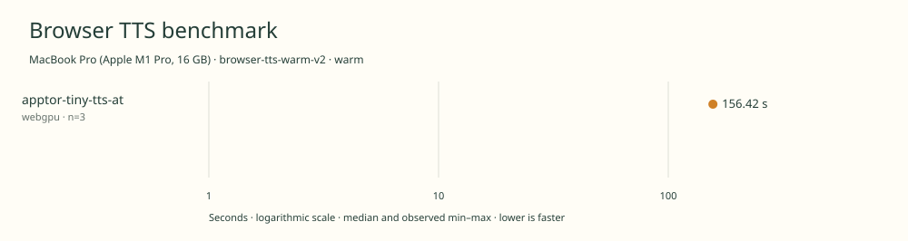

# 2026-11-22t05-54-50-412z-apptor-tiny-tts-at-webgpu-warm-6c488d22

MacBook Pro (Apple M1 Pro, 16 GB) · Apple M1 Pro · Google Chrome 157.0.8103.79

Protocol: **browser-tts-warm-v2**, scenario **warm**. Native harness run.

First source-chunk request through final CPU-readable PCM; excludes initialization, validation, hashing, WAV encoding and save. Optional articleCallPeakRssBytes spans the entire browser call including post-timer validation/export.

| Model | Requested backend | Status | Median | Min–max | Runs |
|---|---|---|---:|---:|---:|
| apptor-tiny-tts-at | webgpu | measured | 156.42 s | 156.37–156.79 s | 3 |

Additional metrics (median of available observations; scopes are distinct):

| Model | Backend | Metric | Median | Unit | n |
|---|---|---|---:|---|---:|
| apptor-tiny-tts-at | webgpu | First completed source chunk | 1487.800 | ms | 3 |
| apptor-tiny-tts-at | webgpu | First PCM block | 490.575 | ms | 3 |
| apptor-tiny-tts-at | webgpu | Generated audio | 1453.140 | s | 3 |
| apptor-tiny-tts-at | webgpu | Generation / audio duration | 0.108 | ratio | 3 |

Model support (catalog capability, not coverage of this run):

| Model | Supported voices | Bundled voices | Languages | Tested voice |
|---|---:|---:|---|---|
| apptor-tiny-tts-at | 2 | 2 | 1 (de-AT) | M2 |

Pinned Austrian Standard German checkpoint, synthetic M2 speaker, Austrian phonetic rules and accent conditioning.. The model card/demo expose two synthetic speakers \(F2, M2\); internal label AT is the Austrian accent style, not a third public speaker. Benchmark settings use M2 at internal index 1, speed 1.0, pitch shift 0, pitch range 1.0, accent 1.0, 24 kHz and INT8 Vocos. Austrian pronunciation readings are enabled at accent &gt;= 0.5. The upstream card describes an early-preview mild/inconsistent Austrian Standard German accent, not a dialect; output rights are not inferred from the model license. Sources: [1](https://huggingface.co/apptor/apptor-tiny-tts-at/tree/e28eb444250b4d06162e6ba8e5090c4284345913), [2](https://huggingface.co/apptor/apptor-tiny-tts-at/blob/e28eb444250b4d06162e6ba8e5090c4284345913/README.md), [3](https://huggingface.co/apptor/apptor-tiny-tts-at/tree/e28eb444250b4d06162e6ba8e5090c4284345913/web), [4](https://github.com/gemelo-ai/vocos/tree/eb39abfc42c1dee4854d9b10d44dd7d4fd3b0e53).

- **apptor-tiny-tts-at / webgpu**: Observed 3081 compute dispatches in the untimed Austrian TTS/Vocos probe; unsupported operators can fall back to WASM.

Capability checks run separately before timing. GPU dispatch does not imply GPU-exclusive execution.

Raw WAV is saved locally; opt-in audio publication is separate from timing and automatic result submission.

Campaign 2026-11-22T05-39-38-326Z-1faadfd5898a; cell 2/4; source e49d51e6aaa9ee77d700285ca17b02003dda5f00; fixture de-at-article-v1 (de-AT, 23898 JavaScript characters, 109 spans); requested n=3; effective n=3; Austrian German M2, accent 1.0, speed 1.0, 24 kHz, INT8 Vocos, one WASM thread. Full warm v2 scores precede separate cached RSS diagnostics. CPU and WebGPU are sequential.

Different protocols, fixtures, settings or machines must not be pooled into a speedup ranking. This report does not rate speech quality.
