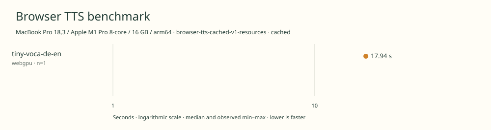

# 2026-11-22t07-24-38-536z-tiny-voca-de-en-webgpu-cached-7e83045b

MacBook Pro 18,3 / Apple M1 Pro 8-core / 16 GB / arm64 · Apple M1 Pro · Google Chrome 157.0.8103.79

Protocol: **browser-tts-cached-v1-resources**, scenario **cached**. Native harness run.

First source-chunk request through final CPU-readable PCM; excludes initialization, validation, hashing, WAV encoding and save. Optional articleCallPeakRssBytes spans the entire browser call including post-timer validation/export. Generation RSS uses timestamped samples inside browser generation start/end boundaries; it includes the owned Chrome process tree and browser baseline.

| Model | Requested backend | Status | Median | Min–max | Runs |
|---|---|---|---:|---:|---:|
| tiny-voca-de-en | webgpu | measured | 17.94 s | 17.94–17.94 s | 1 |

Additional metrics (median of available observations; scopes are distinct):

| Model | Backend | Metric | Median | Unit | n |
|---|---|---|---:|---|---:|
| tiny-voca-de-en | webgpu | First completed source chunk | 333.595 | ms | 1 |
| tiny-voca-de-en | webgpu | First PCM block | 173.165 | ms | 1 |
| tiny-voca-de-en | webgpu | Generated audio | 1134.635 | s | 1 |
| tiny-voca-de-en | webgpu | Generation / audio duration | 0.016 | ratio | 1 |
| tiny-voca-de-en | webgpu | Model initialization | 1155.851 | ms | 1 |
| tiny-voca-de-en | webgpu | Complete controller trial including setup/export | 22714.243 | ms | 1 |
| tiny-voca-de-en | webgpu | Transferred HTTP body data | 42626 | bytes | 1 |
| tiny-voca-de-en | webgpu | Ideal body transfer at 1 Mbps | 0.341 | s | 1 |
| tiny-voca-de-en | webgpu | Whole-call Chrome process-tree peak RSS | 2053095424 | bytes | 1 |
| tiny-voca-de-en | webgpu | Per-trial mean generation Chrome process-tree RSS | 1688258853 | bytes | 1 |
| tiny-voca-de-en | webgpu | In-window Chrome RSS observations | 35.000 | samples | 1 |

Model support (catalog capability, not coverage of this run):

| Model | Supported voices | Bundled voices | Languages | Tested voice |
|---|---:|---:|---|---|
| tiny-voca-de-en | 64 | 64 | 2 (de, en) | fresh-en-f00 |

Pinned Voca64 checkpoint with 32 synthetic German and 32 synthetic English voices; benchmark fixes fresh-de-f00 and fresh-en-f00.. The official pinned browser bundle uses local Phony/nrmlz frontends and ONNX Runtime WebAssembly CPU inference; this benchmark profile also runs the same pinned graphs through ONNX Runtime WebGPU with WASM fallback and verified hardware dispatch. The Space frontend NOTICE says English production phonemization is not enabled, while the pinned worker and English frontend do expose it; English is gated by official full-fixture token/stress parity and headed browser smoke diagnostics. The Apache model license does not establish standalone output rights. Sources: [1](https://huggingface.co/Fraunhofer-IEM/tiny-voca-de-en/tree/57fe34dfc061e6cc58e27d186bf7ba16d82d2def), [2](https://huggingface.co/Fraunhofer-IEM/tiny-voca-de-en/blob/57fe34dfc061e6cc58e27d186bf7ba16d82d2def/README.md), [3](https://huggingface.co/spaces/Fraunhofer-IEM/designed-voices-tts/tree/a8ee94178a6f9b703e89e113a3354549d1bdc38d), [4](https://huggingface.co/spaces/Fraunhofer-IEM/designed-voices-tts/blob/a8ee94178a6f9b703e89e113a3354549d1bdc38d/THIRD_PARTY_NOTICES.md).

- **tiny-voca-de-en / webgpu**: Observed 2493 WebGPU compute dispatches in the untimed real synthesis probe; unsupported operators may fall back to WASM.

Capability checks run separately before timing. GPU dispatch does not imply GPU-exclusive execution.

Raw WAV is saved locally; opt-in audio publication is separate from timing and automatic result submission.

Campaign 2026-11-22T07-18-38-587Z-6c4e2db495aa; cell 4/4; source 144f1e4a2e9913f921b3ad559517c0cc9970067d; fixture english-20k-v1 (en, 20000 JavaScript characters, 93 spans); requested n=1; effective n=1; Headed Google Chrome in disposable profiles, one at a time. AC, browser build, background load and thermal status to be recorded locally at start and finish. Resource sampling is a separate cached diagnostic.

RSS is sampled every 500 ms across the owned Chrome process tree, including the Chrome baseline and inference workers. Whole-call peak spans post-timer validation/export; generation mean uses only in-window samples from browser generation start through final CPU-readable PCM.

Different protocols, fixtures, settings or machines must not be pooled into a speedup ranking. This report does not rate speech quality.
