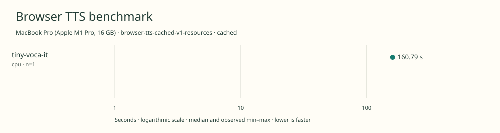

# 2026-11-22t08-51-36-536z-tiny-voca-it-cpu-cached-a3d6a522

MacBook Pro (Apple M1 Pro, 16 GB) · Apple M1 Pro · Google Chrome 157.0.8103.79

Protocol: **browser-tts-cached-v1-resources**, scenario **cached**. Native harness run.

First source-chunk request through final CPU-readable PCM; excludes initialization, validation, hashing, WAV encoding and save. Optional articleCallPeakRssBytes spans the entire browser call including post-timer validation/export. Generation RSS uses timestamped samples inside browser generation start/end boundaries; it includes the owned Chrome process tree and browser baseline.

| Model | Requested backend | Status | Median | Min–max | Runs |
|---|---|---|---:|---:|---:|
| tiny-voca-it | cpu | measured | 160.79 s | 160.79–160.79 s | 1 |

Additional metrics (median of available observations; scopes are distinct):

| Model | Backend | Metric | Median | Unit | n |
|---|---|---|---:|---|---:|
| tiny-voca-it | cpu | First completed source chunk | 1608.480 | ms | 1 |
| tiny-voca-it | cpu | First PCM block | 404.255 | ms | 1 |
| tiny-voca-it | cpu | Generated audio | 1622.065 | s | 1 |
| tiny-voca-it | cpu | Generation / audio duration | 0.099 | ratio | 1 |
| tiny-voca-it | cpu | Model initialization | 598.312 | ms | 1 |
| tiny-voca-it | cpu | Complete controller trial including setup/export | 166183.542 | ms | 1 |
| tiny-voca-it | cpu | Transferred HTTP body data | 50405 | bytes | 1 |
| tiny-voca-it | cpu | Ideal body transfer at 1 Mbps | 0.403 | s | 1 |
| tiny-voca-it | cpu | Whole-call Chrome process-tree peak RSS | 1892532224 | bytes | 1 |
| tiny-voca-it | cpu | Per-trial mean generation Chrome process-tree RSS | 1386863514 | bytes | 1 |
| tiny-voca-it | cpu | In-window Chrome RSS observations | 320.000 | samples | 1 |

Model support (catalog capability, not coverage of this run):

| Model | Supported voices | Bundled voices | Languages | Tested voice |
|---|---:|---:|---|---|
| tiny-voca-it | 2 | 2 | 1 (it) | Lorenzo (EM4) |

Pinned v0.3.0 FP32 checkpoint; the released web profile exposes Lorenzo \(EM4\) and Chiara \(EF4\), and this benchmark fixes Lorenzo/EM4. The model JSON has 14 indexed embedding slots; that is not the released product voice count.. The pinned ONNX graph is the official FP32 release. The official worker uses one-thread WASM; this benchmark adds WebGPU with explicit WASM fallback and untimed hardware dispatch proof. The graph contains native unseeded RandomNormalLike noise, so PCM digests are not a waveform identity guarantee. Apache-2.0 model/code terms do not establish a separate generated-audio license. Sources: [1](https://github.com/carbogninalberto/tiny-voca-it/releases/tag/v0.3.0), [2](https://github.com/carbogninalberto/tiny-voca-it/tree/280f40c307acf04138a5227b6cf9b1544e5886b4), [3](https://github.com/carbogninalberto/tiny-voca-it/blob/0c57fab284e58e0bad620f21790e631d5dec17f8/worker.js), [4](https://github.com/carbogninalberto/tiny-voca-it/blob/280f40c307acf04138a5227b6cf9b1544e5886b4/LICENSE), [5](https://github.com/microsoft/onnxruntime/blob/v1.20.1/ThirdPartyNotices.txt), [6](https://www.npmjs.com/package/espeak-ng), [7](https://github.com/espeak-ng/espeak-ng).

- **tiny-voca-it / cpu**: ONNX Runtime Web 1.20.1 with the official single-thread SIMD WASM route; CPU frontend preprocessing.

Capability checks run separately before timing. GPU dispatch does not imply GPU-exclusive execution.

Raw WAV is saved locally; opt-in audio publication is separate from timing and automatic result submission.

Campaign 2026-11-22T08-31-20-944Z-9fe9e052a990; cell 3/4; source 2f1f236b34a3baf9c5a442e87468809a38b335d0; fixture it-article-v1 (it, 23584 JavaScript characters, 107 spans); requested n=1; effective n=1; Headed Google Chrome in disposable profiles, sequential. Fixed Italian Lorenzo EM4 v0.3.0 FP32 and ORT Web 1.20.1. AC, Chrome version, background load and thermal observations are recorded at launch and completion. Dedicated cached memory cells are separate from warm measurement.

RSS is sampled every 500 ms across the owned Chrome process tree, including the Chrome baseline and inference workers. Whole-call peak spans post-timer validation/export; generation mean uses only in-window samples from browser generation start through final CPU-readable PCM.

Different protocols, fixtures, settings or machines must not be pooled into a speedup ranking. This report does not rate speech quality.
