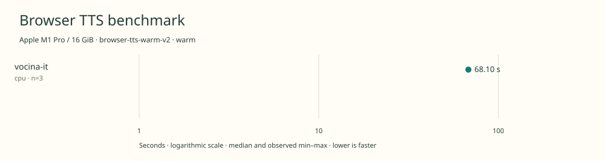

# 2026-11-22t09-55-34-149z-vocina-it-cpu-warm-f8480ae7

Apple M1 Pro / 16 GiB · Apple M1 Pro · Google Chrome 157.0.8103.79

Protocol: **browser-tts-warm-v2**, scenario **warm**. Native harness run.

First source-chunk request through final CPU-readable PCM; excludes initialization, validation, hashing, WAV encoding and save. Optional articleCallPeakRssBytes spans the entire browser call including post-timer validation/export.

| Model | Requested backend | Status | Median | Min–max | Runs |
|---|---|---|---:|---:|---:|
| vocina-it | cpu | measured | 68.10 s | 68.06–68.12 s | 3 |

Additional metrics (median of available observations; scopes are distinct):

| Model | Backend | Metric | Median | Unit | n |
|---|---|---|---:|---|---:|
| vocina-it | cpu | First completed source chunk | 652.730 | ms | 3 |
| vocina-it | cpu | First PCM block | 153.010 | ms | 3 |
| vocina-it | cpu | Generated audio | 1452.559 | s | 3 |
| vocina-it | cpu | Generation / audio duration | 0.047 | ratio | 3 |

Model support (catalog capability, not coverage of this run):

| Model | Supported voices | Bundled voices | Languages | Tested voice |
|---|---:|---:|---|---|
| vocina-it | 2 | 2 | 1 (it) | I1 (Femminile) |

Pinned Vocina v1.0 INT8 checkpoint and its two released Italian preset voices. Benchmarks I1 \(Femminile, index 0\) only. I2 \(Maschile, index 1\) is also released. The publisher estimates approximately 4.5M parameters; the local graph scan reports a 180,555 explicitly named FP32 weight/bias initializer lower bound and 4,533,743 stored initializer values, not an exact trainable count. Voice/output redistribution terms were not separately stated. Sources: [1](https://github.com/OfficinePixel/vocina/tree/8dd17b31b0b6e40ce132105f5d0ea9eb7da98f34), [2](https://github.com/OfficinePixel/vocina/releases/tag/v1.0), [3](https://www.officinepixel.com/vocina/).

- **vocina-it / cpu**: ONNX Runtime Web 1.27.0 bundled CPU/WASM entrypoint, verified local WASM binary and one WASM thread; Italian G2P runs in the dedicated worker.

Capability checks run separately before timing. GPU dispatch does not imply GPU-exclusive execution.

Raw WAV is saved locally; opt-in audio publication is separate from timing and automatic result submission.

Campaign 2026-11-22T09-55-33-549Z-28db6049187f; cell 1/4; source adeea4ac056330319f95e078066ba06501f0c7db; fixture it-article-v1 (it, 23584 JavaScript characters, 107 spans); requested n=3; effective n=3; Headed Google Chrome in disposable profiles, sequential. Vocina v1.0 dynamic-MatMul INT8, default I1 (Femminile) at neutral settings, official G2P with empty variants, and ORT Web 1.27.0. Dedicated cached resource cells do not contribute to the warm time score. Native stochastic inference preserved. Record AC, Chrome version, host load and thermal observations.

Different protocols, fixtures, settings or machines must not be pooled into a speedup ranking. This report does not rate speech quality.
