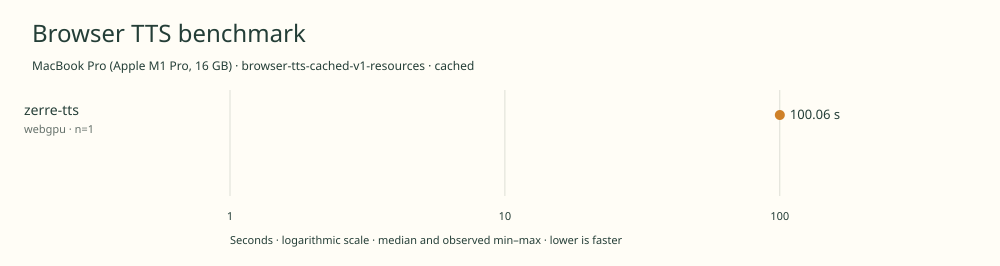

# 2026-11-22t11-15-27-394z-zerre-tts-webgpu-cached-2baa29d6

MacBook Pro (Apple M1 Pro, 16 GB) · Apple M1 Pro · Google Chrome 157.0.8103.79

Protocol: **browser-tts-cached-v1-resources**, scenario **cached**. Native harness run.

First source-chunk request through final CPU-readable PCM; excludes initialization, validation, hashing, WAV encoding and save. Optional articleCallPeakRssBytes spans the entire browser call including post-timer validation/export. Generation RSS uses timestamped samples inside browser generation start/end boundaries; it includes the owned Chrome process tree and browser baseline.

| Model | Requested backend | Status | Median | Min–max | Runs |
|---|---|---|---:|---:|---:|
| zerre-tts | webgpu | measured | 100.06 s | 100.06–100.06 s | 1 |

Additional metrics (median of available observations; scopes are distinct):

| Model | Backend | Metric | Median | Unit | n |
|---|---|---|---:|---|---:|
| zerre-tts | webgpu | First completed source chunk | 1188.045 | ms | 1 |
| zerre-tts | webgpu | First PCM block | 374.525 | ms | 1 |
| zerre-tts | webgpu | Generated audio | 1493.739 | s | 1 |
| zerre-tts | webgpu | Generation / audio duration | 0.067 | ratio | 1 |
| zerre-tts | webgpu | Model initialization | 738.378 | ms | 1 |
| zerre-tts | webgpu | Complete controller trial including setup/export | 105485.741 | ms | 1 |
| zerre-tts | webgpu | Transferred HTTP body data | 48123 | bytes | 1 |
| zerre-tts | webgpu | Ideal body transfer at 1 Mbps | 0.385 | s | 1 |
| zerre-tts | webgpu | Whole-call Chrome process-tree peak RSS | 1924268032 | bytes | 1 |
| zerre-tts | webgpu | Per-trial mean generation Chrome process-tree RSS | 1221596227 | bytes | 1 |
| zerre-tts | webgpu | In-window Chrome RSS observations | 199.000 | samples | 1 |

Model support (catalog capability, not coverage of this run):

| Model | Supported voices | Bundled voices | Languages | Tested voice |
|---|---:|---:|---|---|
| zerre-tts | 2 | 2 | 1 (tr) | SES-A |

Pinned Turkish-only checkpoint and browser demo at the listed revisions. The released neutral labels are SES-A/MK \(index 0, default\) and SES-B/NK \(index 1\); this benchmark fixes SES-A. Labels do not establish speaker identity.. Official browser uses Turkish locale casing and a 25,344-entry lexicon with rule fallback. It drops digit runs and splits apostrophe suffixes into separate word tokens; 39 digit-bearing sentence pieces across 35 canonical spans are affected. The browser is CPU/WASM; benchmark WebGPU is a separately qualified explicit WebGPU+WASM path. No English or Kurdish synthesis is supported. Native RandomNormalLike noise is unseeded; provider output lengths may differ by one frame. Model license does not independently verify training recording rights or grant blanket output rights. Sources: [1](https://github.com/erkinemreta1/zerre-tts/tree/cf3cdfaaa54a9e8ec541081bb5c2e97c3d563db4), [2](https://huggingface.co/erkint/zerre-tts/tree/55753a04ae624998cba86f7c17625616e318124e), [3](https://github.com/n4ze3m/tiny-voca#community), [4](https://github.com/erkinemreta1/zerre-tts/blob/cf3cdfaaa54a9e8ec541081bb5c2e97c3d563db4/docs/data_sources.md), [5](https://github.com/erkinemreta1/zerre-tts/blob/cf3cdfaaa54a9e8ec541081bb5c2e97c3d563db4/LICENSE), [6](https://github.com/microsoft/onnxruntime/blob/v1.20.1/ThirdPartyNotices.txt).

- **zerre-tts / webgpu**: Observed 2847 WebGPU compute dispatches during an untimed synthesis probe; unsupported operations may use explicit WASM fallback.

Capability checks run separately before timing. GPU dispatch does not imply GPU-exclusive execution.

Raw WAV is saved locally; opt-in audio publication is separate from timing and automatic result submission.

Campaign 2026-11-22T11-01-57-730Z-c06a9abd8cf1; cell 4/4; source fe8f66909ca808473dac4ceb56dc36e23ec44943; fixture tr-article-v1 (tr, 20679 JavaScript characters, 94 spans); requested n=1; effective n=1; Headed Google Chrome in disposable profiles, sequential. Zerre tr-v1 dynamic-MatMul INT8, default SES-A (index 0) at neutral settings, official Turkish browser lexicon and phonemizer, and ORT Web 1.20.1. The official tokenizer omits digit runs. Dedicated cached resource cells do not contribute to the warm time score. Native stochastic inference preserved. Record AC, Chrome version, host load and thermal observations.

RSS is sampled every 500 ms across the owned Chrome process tree, including the Chrome baseline and inference workers. Whole-call peak spans post-timer validation/export; generation mean uses only in-window samples from browser generation start through final CPU-readable PCM.

Different protocols, fixtures, settings or machines must not be pooled into a speedup ranking. This report does not rate speech quality.
