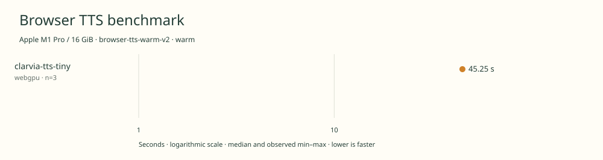

# 2026-11-22t12-03-52-132z-clarvia-tts-tiny-webgpu-warm-cf22e07f

Apple M1 Pro / 16 GiB · Apple M1 Pro · Google Chrome 157.0.8103.79

Protocol: **browser-tts-warm-v2**, scenario **warm**. Native harness run.

First source-chunk request through final CPU-readable PCM; excludes initialization, validation, hashing, WAV encoding and save. Optional articleCallPeakRssBytes spans the entire browser call including post-timer validation/export.

| Model | Requested backend | Status | Median | Min–max | Runs |
|---|---|---|---:|---:|---:|
| clarvia-tts-tiny | webgpu | measured | 45.25 s | 45.25–45.36 s | 3 |

Additional metrics (median of available observations; scopes are distinct):

| Model | Backend | Metric | Median | Unit | n |
|---|---|---|---:|---|---:|
| clarvia-tts-tiny | webgpu | First completed source chunk | 496.785 | ms | 3 |
| clarvia-tts-tiny | webgpu | First PCM block | 147.460 | ms | 3 |
| clarvia-tts-tiny | webgpu | Generated audio | 1301.536 | s | 3 |
| clarvia-tts-tiny | webgpu | Generation / audio duration | 0.035 | ratio | 3 |

Model support (catalog capability, not coverage of this run):

| Model | Supported voices | Bundled voices | Languages | Tested voice |
|---|---:|---:|---|---|
| clarvia-tts-tiny | 10 | 10 | 1 (tr) | female_1 (synthetic) |

Pinned Turkish FP32 checkpoint with ten bundled synthetic voices; the browser profile fixes female\_1.. Only female\_1 is benchmarked. The model card describes a synthetic training set; dataset summaries are publisher claims and have not been independently audited. The publisher requests AI-audio disclosure and prohibits impersonation. Model/code licensing is not a separate blanket grant to redistribute generated recordings. Sources: [1](https://huggingface.co/wite-tech/clarvia-tts-tiny/blob/51023684a0a39742455c838e9d1d8714d3ae7289/README.md), [2](https://huggingface.co/wite-tech/clarvia-tts-tiny/blob/51023684a0a39742455c838e9d1d8714d3ae7289/config.json), [3](https://huggingface.co/wite-tech/clarvia-phonemizer/tree/bf1b1aab40e24ca3f6700980427c386f4f171f6f), [4](https://www.npmjs.com/package/pyodide/v/314.0.8), [5](https://github.com/microsoft/onnxruntime/blob/v1.20.1/ThirdPartyNotices.txt).

- **clarvia-tts-tiny / webgpu**: Observed 2487 WebGPU compute dispatches during an untimed probe; unsupported operators may use explicit WASM fallback.

Capability checks run separately before timing. GPU dispatch does not imply GPU-exclusive execution.

Raw WAV is saved locally; opt-in audio publication is separate from timing and automatic result submission.

Campaign 2026-11-22T11-59-32-168Z-5e0a0a65feae; cell 2/4; source 2c2716b5482c5bcbe094fa7a11a0c30ce0fca318; fixture tr-article-v1 (tr, 20679 JavaScript characters, 94 spans); requested n=3; effective n=3; Headed Google Chrome in disposable profiles, sequential. Clarvia TTS Tiny FP32, default female_1 (index 2) at neutral settings, official Clarvia phonemizer and upstream sentence planner in Pyodide 314.0.8 with CPython 3.14.2, and ORT Web 1.20.1. Dedicated cached resource cells do not contribute to the warm time score. Native stochastic inference preserved. Record AC, Chrome version, host load and thermal observations.

Different protocols, fixtures, settings or machines must not be pooled into a speedup ranking. This report does not rate speech quality.
