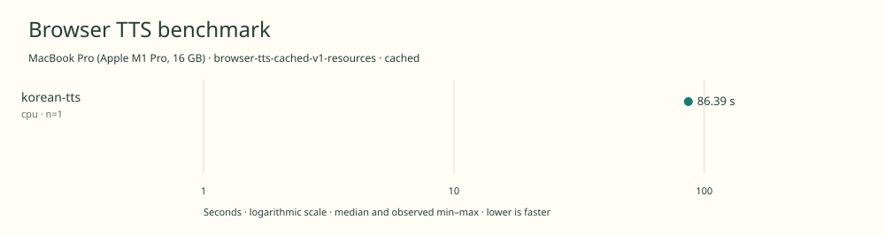

# 2026-11-22t13-29-25-009z-korean-tts-cpu-cached-220ed6ed

MacBook Pro (Apple M1 Pro, 16 GB) · Apple M1 Pro · Google Chrome 157.0.8103.79

Protocol: **browser-tts-cached-v1-resources**, scenario **cached**. Native harness run.

First source-chunk request through final CPU-readable PCM; excludes initialization, validation, hashing, WAV encoding and save. Optional articleCallPeakRssBytes spans the entire browser call including post-timer validation/export. Generation RSS uses timestamped samples inside browser generation start/end boundaries; it includes the owned Chrome process tree and browser baseline.

| Model | Requested backend | Status | Median | Min–max | Runs |
|---|---|---|---:|---:|---:|
| korean-tts | cpu | measured | 86.39 s | 86.39–86.39 s | 1 |

Additional metrics (median of available observations; scopes are distinct):

| Model | Backend | Metric | Median | Unit | n |
|---|---|---|---:|---|---:|
| korean-tts | cpu | First completed source chunk | 1821.315 | ms | 1 |
| korean-tts | cpu | First PCM block | 257.525 | ms | 1 |
| korean-tts | cpu | Generated audio | 1599.221 | s | 1 |
| korean-tts | cpu | Generation / audio duration | 0.054 | ratio | 1 |
| korean-tts | cpu | Model initialization | 3696.147 | ms | 1 |
| korean-tts | cpu | Complete controller trial including setup/export | 94709.794 | ms | 1 |
| korean-tts | cpu | Transferred HTTP body data | 42190 | bytes | 1 |
| korean-tts | cpu | Ideal body transfer at 1 Mbps | 0.338 | s | 1 |
| korean-tts | cpu | Whole-call Chrome process-tree peak RSS | 1926201344 | bytes | 1 |
| korean-tts | cpu | Per-trial mean generation Chrome process-tree RSS | 1404273021 | bytes | 1 |
| korean-tts | cpu | In-window Chrome RSS observations | 172.000 | samples | 1 |

Model support (catalog capability, not coverage of this run):

| Model | Supported voices | Bundled voices | Languages | Tested voice |
|---|---:|---:|---|---|
| korean-tts | 3 | 3 | 2 (ko, en) | KSS |

One pinned bilingual FP32 graph. KSS index 0 is evaluated for the Korean ko-loan frontend; Dizione F2 index 1 is evaluated for English own mode. M2 remains an upstream alternate voice.. Only KSS/ko-article-v1 and F2/english-20k-v1 are benchmark profiles. Mixed Korean with embedded English uses the Korean loanword route. The KSS weight terms apply to both voices; noncommercial acceptance is required. Sources: [1](https://github.com/ooodev/korean-tts/blob/c63fc0de00de22203f4ccfd3dd8a2cd5a20f560c/FINAL_REPORT_v2.md), [2](https://huggingface.co/datasets/Bingsu/KSS_Dataset), [3](https://creativecommons.org/licenses/by-nc-sa/4.0/legalcode), [4](https://huggingface.co/n4ze3m/tiny-voca/tree/a46fbe0c8514cb32f5e80be987e6c96ef0540f8d), [5](https://github.com/ooodev/korean-tts/tree/c63fc0de00de22203f4ccfd3dd8a2cd5a20f560c/tiny-voca).

- **korean-tts / cpu**: Pinned ONNX Runtime Web 1.20.1 model inference on explicit single-thread WASM; Pyodide frontend runs locally on CPU.

Capability checks run separately before timing. GPU dispatch does not imply GPU-exclusive execution.

Raw WAV is saved locally; opt-in audio publication is separate from timing and automatic result submission.

Campaign 2026-11-22T13-18-39-899Z-4f4bdc0d928b; cell 3/4; source fff67d3bc4d836adcb1e87671d8a91c18c7f886c; fixture ko-article-v1 (ko, 10196 JavaScript characters, 47 spans); requested n=1; effective n=1; Headed Google Chrome in sequential disposable profiles. The released korean-tts v2 step-160000 FP32 browser graph, KSS, voice index 0, ko-loan mode. The official Pyodide 0.26.4 frontend and ORT Web 1.20.1, retaining upstream stochastic inference. Dedicated cached resource samples are independent of warm timing.

RSS is sampled every 500 ms across the owned Chrome process tree, including the Chrome baseline and inference workers. Whole-call peak spans post-timer validation/export; generation mean uses only in-window samples from browser generation start through final CPU-readable PCM.

Different protocols, fixtures, settings or machines must not be pooled into a speedup ranking. This report does not rate speech quality.
