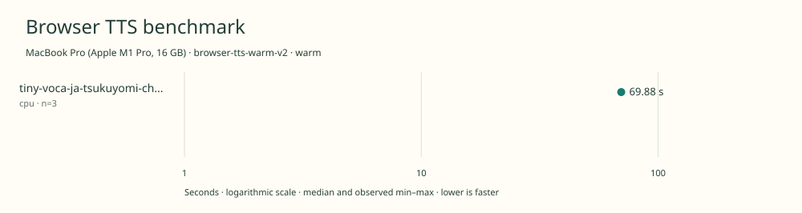

# 2026-11-22t15-03-37-242z-tiny-voca-ja-tsukuyomi-chan-cpu-warm-054d2623

MacBook Pro (Apple M1 Pro, 16 GB) · Apple M1 Pro · Google Chrome 157.0.8103.79

Protocol: **browser-tts-warm-v2**, scenario **warm**. Native harness run.

First source-chunk request through final CPU-readable PCM; excludes initialization, validation, hashing, WAV encoding and save. Optional articleCallPeakRssBytes spans the entire browser call including post-timer validation/export.

| Model | Requested backend | Status | Median | Min–max | Runs |
|---|---|---|---:|---:|---:|
| tiny-voca-ja-tsukuyomi-chan | cpu | measured | 69.88 s | 69.84–69.90 s | 3 |

Additional metrics (median of available observations; scopes are distinct):

| Model | Backend | Metric | Median | Unit | n |
|---|---|---|---:|---|---:|
| tiny-voca-ja-tsukuyomi-chan | cpu | First completed source chunk | 1952.425 | ms | 3 |
| tiny-voca-ja-tsukuyomi-chan | cpu | First PCM block | 1952.345 | ms | 3 |
| tiny-voca-ja-tsukuyomi-chan | cpu | Generated audio | 1323.477 | s | 3 |
| tiny-voca-ja-tsukuyomi-chan | cpu | Generation / audio duration | 0.053 | ratio | 3 |

Model support (catalog capability, not coverage of this run):

| Model | Supported voices | Bundled voices | Languages | Tested voice |
|---|---:|---:|---|---|
| tiny-voca-ja-tsukuyomi-chan | 1 | 1 | 1 (ja) | Tsukuyomi-chan (つくよみちゃん) |

Pinned P1 release only. One bundled synthetic Japanese voice, tsukuyomi \(index 0\), at 24 kHz. The original waveform graph stores 4,589,131 FP32 initializer scalar values; the float64 phase remains in the graph. The separate duration graph shares model.weights.bin and is not counted twice. The browser frontend is pinned to pyopenjtalk-plus 0.4.1.post10, SudachiPy 0.7.0 and SudachiDict-core 20261015.. CPU/WASM only. The original graph pair fails WebGPU provider assignment at /Cast\_9 under ONNX Runtime Web 1.31.1 and preserves a float64 CPU phase; no alternate graph is used. Display the upstream voice credit and generated-audio restrictions wherever output is presented. The model conditions forbid specified harmful uses and secondary use that enables others to reuse the voice as an audio asset or synthesis model; they are not replaced by the source-code license. Warm and cached three-span CPU smokes passed, with 153,916,767 bytes transferred during cached initialization. Offline initialization is unsupported in the current runner/cache path: the pinned SudachiDict-core wheel was unavailable after the browser profile reopened offline. Sources: [1](https://huggingface.co/ayousanz/tiny-voca-ja-tsukuyomi-chan/tree/7ed75cc5f521cc6be4cb57689b2c038928259ae9), [2](https://huggingface.co/ayousanz/tiny-voca-ja-tsukuyomi-chan/blob/7ed75cc5f521cc6be4cb57689b2c038928259ae9/README.md), [3](https://github.com/ayutaz/tiny-voca/tree/66ee00d2c8cd61b34be1cde5880bac0e45b89fcf), [4](https://tyc.rei-yumesaki.net/material/corpus/), [5](https://pypi.org/project/pyopenjtalk-plus/0.4.1.post10/), [6](https://pypi.org/project/SudachiPy/0.7.0/), [7](https://pypi.org/project/sudachidict-core/20261015/), [8](https://pyodide.org/en/stable/), [9](https://onnxruntime.ai/).

- **tiny-voca-ja-tsukuyomi-chan / cpu**: Original FP32 P1 graphs and shared external weights on single-thread ONNX Runtime Web 1.31.1 WASM. The graph retains a float64 phase; WebGPU is unavailable for this original release.

Capability checks run separately before timing. GPU dispatch does not imply GPU-exclusive execution.

Raw WAV is saved locally; opt-in audio publication is separate from timing and automatic result submission.

Campaign 2026-11-22T15-03-36-594Z-692f088c7cb4; cell 1/2; source a4f4eb675cb3e1b64983438e80e3f565b1c7e3e1; fixture ja-article-v1 (ja, 8399 JavaScript characters, 38 spans); requested n=3; effective n=3; Headed Google Chrome in sequential disposable profiles on Apple M1 Pro. Original Tsukuyomi-chan P1 step-1000 graphs with their shared external parameters. Pyodide 314.0.8 executes the pinned Japanese frontend with verified wasm32 adaptations. Single-thread CPU/WASM ORT Web 1.31.1 retains the original FP64 phase. WebGPU qualification failed with the published graph. The separate cached cell measures CPU process-tree RSS during generation after local initialization. Cached smoke still transferred pinned runtime assets on loopback and offline initialization was unsupported.

Different protocols, fixtures, settings or machines must not be pooled into a speedup ranking. This report does not rate speech quality.
