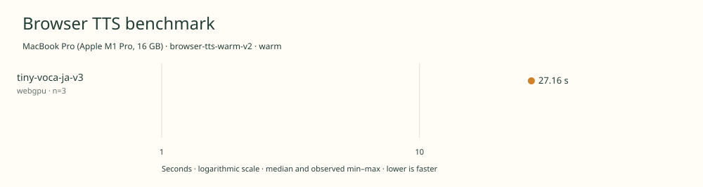

# 2026-11-22t16-40-36-069z-tiny-voca-ja-v3-webgpu-warm-cd78835b

MacBook Pro (Apple M1 Pro, 16 GB) · Apple M1 Pro · Google Chrome 157.0.8103.79

Protocol: **browser-tts-warm-v2**, scenario **warm**. Native harness run.

First source-chunk request through final CPU-readable PCM; excludes initialization, validation, hashing, WAV encoding and save. Optional articleCallPeakRssBytes spans the entire browser call including post-timer validation/export.

| Model | Requested backend | Status | Median | Min–max | Runs |
|---|---|---|---:|---:|---:|
| tiny-voca-ja-v3 | webgpu | measured | 27.16 s | 26.93–27.25 s | 3 |

Additional metrics (median of available observations; scopes are distinct):

| Model | Backend | Metric | Median | Unit | n |
|---|---|---|---:|---|---:|
| tiny-voca-ja-v3 | webgpu | First completed source chunk | 300.380 | ms | 3 |
| tiny-voca-ja-v3 | webgpu | First PCM block | 300.310 | ms | 3 |
| tiny-voca-ja-v3 | webgpu | Generated audio | 1445.856 | s | 3 |
| tiny-voca-ja-v3 | webgpu | Generation / audio duration | 0.019 | ratio | 3 |

Model support (catalog capability, not coverage of this run):

| Model | Supported voices | Bundled voices | Languages | Tested voice |
|---|---:|---:|---|---|
| tiny-voca-ja-v3 | 2 | 2 | 2 (ja, en) | F2 (Japanese and American English) |

Pinned v3 FP32 ONNX graph, step 134000, 24 kHz, selected F2 voice index 0; the original waveform graph stores exactly 4,538,827 FP32 initializer scalar values. Japanese uses pyopenjtalk-plus 0.4.1.post10 g2p\_prosody with the package default Nani prediction fallback and unaltered bundled OpenJTalk dictionary; English uses the pinned upstream tokenizer/parser and eSpeak NG 1.52.0 en-us callback. The public oj-en-1 fingerprint is disclosed; the profile implements public frontend sources and does not reproduce unavailable training annotation scripts.. The graph bundles F2 and M2; this profile selects F2. The Japanese fixture oracle preserves its single unk at source span 5. CPU/WASM and WebGPU/WASM are supported only with pinned ORT 1.31.1 assets and observed GPU dispatch during untimed synthesis. English and Japanese benchmark fixtures are independent input datasets. Sources: [1](https://huggingface.co/gachimoto/tiny-voca-ja/tree/9b2305c81b9ca92ef8347eba473ea096c86f55c4), [2](https://huggingface.co/gachimoto/tiny-voca-ja/blob/9b2305c81b9ca92ef8347eba473ea096c86f55c4/README.md), [3](https://github.com/gachimoto-code/tiny-voca-ja/tree/49632c552d54a13664c1beb96904bef0154fbfc3), [4](https://pypi.org/project/pyopenjtalk-plus/0.4.1.post10/), [5](https://pypi.org/project/SudachiPy/0.7.0/), [6](https://pypi.org/project/sudachidict-core/20261015/), [7](https://github.com/espeak-ng/espeak-ng/tree/4870adfa25b1a32b4361592f1be8a40337c58d6c), [8](https://pyodide.org/en/stable/), [9](https://onnxruntime.ai/).

- **tiny-voca-ja-v3 / webgpu**: Observed 2310 WebGPU compute dispatches during untimed original graph synthesis; unsupported operators may run through WASM.

Capability checks run separately before timing. GPU dispatch does not imply GPU-exclusive execution.

Raw WAV is saved locally; opt-in audio publication is separate from timing and automatic result submission.

Campaign 2026-11-22T16-35-30-773Z-12ac7b790491; cell 2/4; source 9bda87dfd44d718d753075bcf7ba223915936b5c; fixture english-20k-v1 (en, 20000 JavaScript characters, 93 spans); requested n=3; effective n=3; Headed Google Chrome with serial disposable profiles on Apple M1 Pro. Exact Gachimoto tiny-voca-ja v3 FP32 ONNX, F2 index 0 with neutral speed and pitch. Pinned eSpeak NG 1.52.0 en-us quiet CLI IPA trace with released Python token/stress projection. ORT Web 1.31.1 single-thread CPU/WASM or independently verified hardware WebGPU+WASM. Dedicated cached resource samples are independent of warm timing.

Different protocols, fixtures, settings or machines must not be pooled into a speedup ranking. This report does not rate speech quality.
