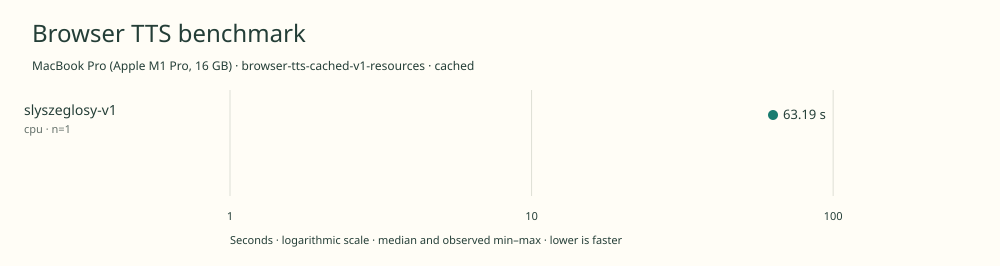

# 2026-11-22t17-39-35-755z-slyszeglosy-v1-cpu-cached-b5986119

MacBook Pro (Apple M1 Pro, 16 GB) · Apple M1 Pro · Google Chrome 157.0.8103.79

Protocol: **browser-tts-cached-v1-resources**, scenario **cached**. Native harness run.

First source-chunk request through final CPU-readable PCM; excludes initialization, validation, hashing, WAV encoding and save. Optional articleCallPeakRssBytes spans the entire browser call including post-timer validation/export. Generation RSS uses timestamped samples inside browser generation start/end boundaries; it includes the owned Chrome process tree and browser baseline.

| Model | Requested backend | Status | Median | Min–max | Runs |
|---|---|---|---:|---:|---:|
| slyszeglosy-v1 | cpu | measured | 63.19 s | 63.19–63.19 s | 1 |

Additional metrics (median of available observations; scopes are distinct):

| Model | Backend | Metric | Median | Unit | n |
|---|---|---|---:|---|---:|
| slyszeglosy-v1 | cpu | First completed source chunk | 642.580 | ms | 1 |
| slyszeglosy-v1 | cpu | First PCM block | 222.250 | ms | 1 |
| slyszeglosy-v1 | cpu | Generated audio | 1340.171 | s | 1 |
| slyszeglosy-v1 | cpu | Generation / audio duration | 0.047 | ratio | 1 |
| slyszeglosy-v1 | cpu | Model initialization | 1629.853 | ms | 1 |
| slyszeglosy-v1 | cpu | Complete controller trial including setup/export | 68913.182 | ms | 1 |
| slyszeglosy-v1 | cpu | Transferred HTTP body data | 52237 | bytes | 1 |
| slyszeglosy-v1 | cpu | Ideal body transfer at 1 Mbps | 0.418 | s | 1 |
| slyszeglosy-v1 | cpu | Whole-call Chrome process-tree peak RSS | 2010578944 | bytes | 1 |
| slyszeglosy-v1 | cpu | Per-trial mean generation Chrome process-tree RSS | 1775702508 | bytes | 1 |
| slyszeglosy-v1 | cpu | In-window Chrome RSS observations | 125.000 | samples | 1 |

Model support (catalog capability, not coverage of this run):

| Model | Supported voices | Bundled voices | Languages | Tested voice |
|---|---:|---:|---|---|
| slyszeglosy-v1 | 2 | 2 | 1 (pl) | F |

One pinned V1 graph bundles synthetic F and M Polish voices. The adapter evaluates F index 0 only; the separate V2 model is outside this profile.. Only F index 0, Polish, pl-article-v1 is registered. M remains bundled but unevaluated. V2 is explicitly outside this V1 entry. Model and synthetic voice data require noncommercial license acknowledgment. Sources: [1](https://huggingface.co/Damaon/slyszeglosy/tree/23b63ff12db5f19260985031e64c2f45b89cc609), [2](https://github.com/Damaon/slyszeglosy/tree/605a13f5d9994ad8c897dff3463ce1f339acfb5f), [3](https://creativecommons.org/licenses/by-nc/4.0/legalcode).

- **slyszeglosy-v1 / cpu**: Pinned ONNX Runtime Web 1.20.1 with explicit single-thread WASM; Pyodide frontend runs locally.

Capability checks run separately before timing. GPU dispatch does not imply GPU-exclusive execution.

Raw WAV is saved locally; opt-in audio publication is separate from timing and automatic result submission.

Campaign 2026-11-22T17-31-56-972Z-3592c6dbba16; cell 3/4; source 5e0212f8277c154901925f9d13d5306ecc976039; fixture pl-article-v1 (pl, 21375 JavaScript characters, 98 spans); requested n=1; effective n=1; Headed Google Chrome on Apple M1 Pro, disposable sequential profiles. Słyszegłosy V1 stock FP32 ONNX, original synthetic F voice at index zero, neutral speed and pitch. Pinned wymowa Polish frontend in same-origin Pyodide 0.26.4. ORT Web 1.20.1 single-thread CPU/WASM or Apple hardware WebGPU+WASM. Separate cached process-tree RSS measurements.

RSS is sampled every 500 ms across the owned Chrome process tree, including the Chrome baseline and inference workers. Whole-call peak spans post-timer validation/export; generation mean uses only in-window samples from browser generation start through final CPU-readable PCM.

Different protocols, fixtures, settings or machines must not be pooled into a speedup ranking. This report does not rate speech quality.
