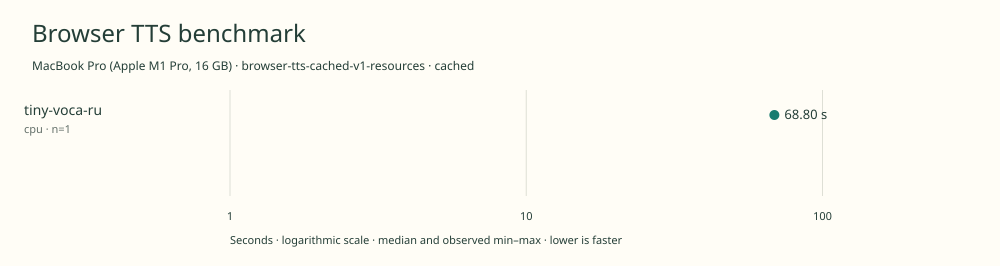

# 2026-11-22t18-41-07-258z-tiny-voca-ru-cpu-cached-fa5685ae

MacBook Pro (Apple M1 Pro, 16 GB) · Apple M1 Pro · Google Chrome 157.0.8103.79

Protocol: **browser-tts-cached-v1-resources**, scenario **cached**. Native harness run.

First source-chunk request through final CPU-readable PCM; excludes initialization, validation, hashing, WAV encoding and save. Optional articleCallPeakRssBytes spans the entire browser call including post-timer validation/export. Generation RSS uses timestamped samples inside browser generation start/end boundaries; it includes the owned Chrome process tree and browser baseline.

| Model | Requested backend | Status | Median | Min–max | Runs |
|---|---|---|---:|---:|---:|
| tiny-voca-ru | cpu | measured | 68.80 s | 68.80–68.80 s | 1 |

Additional metrics (median of available observations; scopes are distinct):

| Model | Backend | Metric | Median | Unit | n |
|---|---|---|---:|---|---:|
| tiny-voca-ru | cpu | First completed source chunk | 1258.615 | ms | 1 |
| tiny-voca-ru | cpu | First PCM block | 696.870 | ms | 1 |
| tiny-voca-ru | cpu | Generated audio | 1355.179 | s | 1 |
| tiny-voca-ru | cpu | Generation / audio duration | 0.051 | ratio | 1 |
| tiny-voca-ru | cpu | Model initialization | 1689.334 | ms | 1 |
| tiny-voca-ru | cpu | Complete controller trial including setup/export | 74643.672 | ms | 1 |
| tiny-voca-ru | cpu | Transferred HTTP body data | 67558 | bytes | 1 |
| tiny-voca-ru | cpu | Ideal body transfer at 1 Mbps | 0.540 | s | 1 |
| tiny-voca-ru | cpu | Whole-call Chrome process-tree peak RSS | 2645311488 | bytes | 1 |
| tiny-voca-ru | cpu | Per-trial mean generation Chrome process-tree RSS | 1892801958 | bytes | 1 |
| tiny-voca-ru | cpu | In-window Chrome RSS observations | 136.000 | samples | 1 |

Model support (catalog capability, not coverage of this run):

| Model | Supported voices | Bundled voices | Languages | Tested voice |
|---|---:|---:|---|---|
| tiny-voca-ru | 2 | 2 | 1 (ru) | M |

One pinned 24 kHz FP32 Russian waveform graph bundles synthetic F and M voices. The benchmark profile selects publisher-default M \(index 1\), Russian only, at unity speed and neutral pitch controls. The contextual OOV and homograph frontend uses separate single-thread WASM graphs.. Both synthetic voices are bundled; only M index 1 is evaluated in ru-article-v1. WebGPU is used only by the waveform graph with explicit WASM fallback; OOV accent and contextual homograph resolution are single-thread WASM. Sources: [1](https://huggingface.co/egnch/tiny-voca-ru/tree/2723b0e71fea216001bd4f6caf0866eb06879339), [2](https://github.com/yilbegan/tiny-voca-ru/tree/aa7086b3b6522f5a5d8cadb11cc5c8b3fde98784), [3](https://huggingface.co/spaces/egnch/tiny-voca-ru-demo/tree/bf78c265c4cd02a7853d1bcf1d8bcc1fa72aa69e), [4](https://huggingface.co/datasets/egnch/tiny-voca-ru-dataset/blob/641a71953589e7faceab6022b55f599e03578043/LICENSE.md), [5](https://github.com/Den4ikAI/ruaccent).

- **tiny-voca-ru / cpu**: Waveform, OOV accent and contextual homograph graphs use explicit single-thread WASM; local Pyodide handles Russian normalization and G2P.

Capability checks run separately before timing. GPU dispatch does not imply GPU-exclusive execution.

Raw WAV is saved locally; opt-in audio publication is separate from timing and automatic result submission.

Campaign 2026-11-22T18-32-31-735Z-e82ce2829935; cell 3/4; source b61a139d470464f8bbbd0e9088242122f0a21d80; fixture ru-article-v1 (ru, 20732 JavaScript characters, 95 spans); requested n=1; effective n=1; Headed Google Chrome on Apple M1 Pro, disposable sequential profiles. Tiny Voca Russian stock FP32 waveform ONNX, official browser default M voice index one, neutral speed and pitch. Pinned full Russian contextual stress path in Pyodide 0.26.4 with original OOV and contextual stress graphs on single-thread WASM. ORT Web 1.20.1 single-thread CPU/WASM or Apple hardware WebGPU+WASM. Separate cached process-tree RSS measurements.

RSS is sampled every 500 ms across the owned Chrome process tree, including the Chrome baseline and inference workers. Whole-call peak spans post-timer validation/export; generation mean uses only in-window samples from browser generation start through final CPU-readable PCM.

Different protocols, fixtures, settings or machines must not be pooled into a speedup ranking. This report does not rate speech quality.
