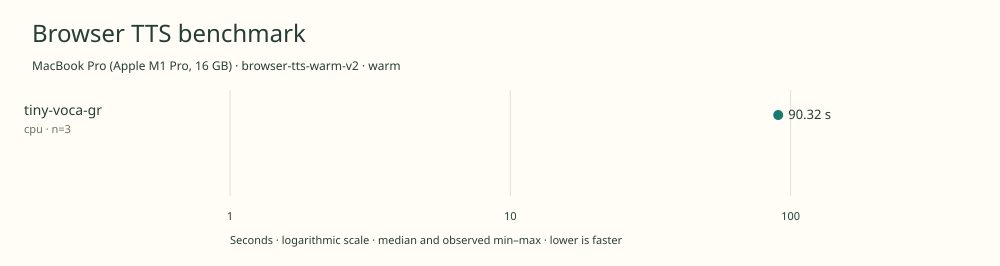

# 2026-11-22t19-55-14-092z-tiny-voca-gr-cpu-warm-ed6d78b7

MacBook Pro (Apple M1 Pro, 16 GB) · Apple M1 Pro · Google Chrome 157.0.8103.79

Protocol: **browser-tts-warm-v2**, scenario **warm**. Native harness run.

First source-chunk request through final CPU-readable PCM; excludes initialization, validation, hashing, WAV encoding and save. Optional articleCallPeakRssBytes spans the entire browser call including post-timer validation/export.

| Model | Requested backend | Status | Median | Min–max | Runs |
|---|---|---|---:|---:|---:|
| tiny-voca-gr | cpu | measured | 90.32 s | 90.30–90.50 s | 3 |

Additional metrics (median of available observations; scopes are distinct):

| Model | Backend | Metric | Median | Unit | n |
|---|---|---|---:|---|---:|
| tiny-voca-gr | cpu | First completed source chunk | 830.830 | ms | 3 |
| tiny-voca-gr | cpu | First PCM block | 233.640 | ms | 3 |
| tiny-voca-gr | cpu | Generated audio | 1790.208 | s | 3 |
| tiny-voca-gr | cpu | Generation / audio duration | 0.050 | ratio | 3 |

Model support (catalog capability, not coverage of this run):

| Model | Supported voices | Bundled voices | Languages | Tested voice |
|---|---:|---:|---|---|
| tiny-voca-gr | 2 | 2 | 1 (el) | M |

Pinned tiny-voca-gr release only. Two fixed synthesis profiles \(M and F\) at 24 kHz; M index 0 is the benchmark default. The FP32 ONNX graph is a local export of the released PyTorch checkpoint.. Modern Greek only. Native frontend verification covers 109 spans and 335 utterances, with a maximum of 179 tokens and 28 &lt;unk&gt; instances. The Greek inventory can lose sounds from mixed-script names and initials. M is the benchmark voice and F is available for smoke diagnostics. Sources: [1](https://huggingface.co/ComputationalLinguisticsPlatform/tiny-voca-gr/tree/927ea15cf4edcb8695b75328c9c90c5c53928554), [2](https://github.com/n4ze3m/tiny-voca/tree/62e2adef158bc997042cc6234f541f1e0e4cd55d), [3](https://github.com/espeak-ng/espeak-ng/tree/2e9a5fccbb0095e87b2769e9249ea1f821918ecd), [4](https://huggingface.co/datasets/aangelakis/STOMA/tree/fcb947d49abd2736701d8ce3786136812bac85fa).

- **tiny-voca-gr / cpu**: The pinned FP32 graph uses explicit single-thread WASM. Greek normalization and eSpeak G2P run locally in the worker.

Capability checks run separately before timing. GPU dispatch does not imply GPU-exclusive execution.

Raw WAV is saved locally; opt-in audio publication is separate from timing and automatic result submission.

Campaign 2026-11-22T19-55-13-455Z-b55f7a1b46ba; cell 1/4; source 979a76f1d0346fe72a04389a0a70fc64be992963; fixture el-article-v1 (el, 23928 JavaScript characters, 109 spans); requested n=3; effective n=3; Headed Google Chrome on Apple M1 Pro, disposable sequential profiles. Modern Greek Tiny Voca official FP32 ONNX export from the exact release checkpoint, M voice index zero, neutral speed and pitch. Pinned Greek eSpeak NG 1.51 and released Greek phones/stress inventory. ORT Web 1.31.1 single-thread CPU/WASM or Apple hardware WebGPU+WASM. Separate cached process-tree RSS observations.

Different protocols, fixtures, settings or machines must not be pooled into a speedup ranking. This report does not rate speech quality.
