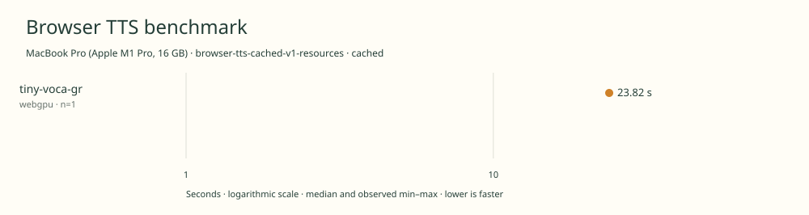

# 2026-11-22t20-04-52-385z-tiny-voca-gr-webgpu-cached-5124dd63

MacBook Pro (Apple M1 Pro, 16 GB) · Apple M1 Pro · Google Chrome 157.0.8103.79

Protocol: **browser-tts-cached-v1-resources**, scenario **cached**. Native harness run.

First source-chunk request through final CPU-readable PCM; excludes initialization, validation, hashing, WAV encoding and save. Optional articleCallPeakRssBytes spans the entire browser call including post-timer validation/export. Generation RSS uses timestamped samples inside browser generation start/end boundaries; it includes the owned Chrome process tree and browser baseline.

| Model | Requested backend | Status | Median | Min–max | Runs |
|---|---|---|---:|---:|---:|
| tiny-voca-gr | webgpu | measured | 23.82 s | 23.82–23.82 s | 1 |

Additional metrics (median of available observations; scopes are distinct):

| Model | Backend | Metric | Median | Unit | n |
|---|---|---|---:|---|---:|
| tiny-voca-gr | webgpu | First completed source chunk | 298.520 | ms | 1 |
| tiny-voca-gr | webgpu | First PCM block | 129.595 | ms | 1 |
| tiny-voca-gr | webgpu | Generated audio | 1790.208 | s | 1 |
| tiny-voca-gr | webgpu | Generation / audio duration | 0.013 | ratio | 1 |
| tiny-voca-gr | webgpu | Model initialization | 1064.073 | ms | 1 |
| tiny-voca-gr | webgpu | Complete controller trial including setup/export | 30033.036 | ms | 1 |
| tiny-voca-gr | webgpu | Transferred HTTP body data | 76982 | bytes | 1 |
| tiny-voca-gr | webgpu | Ideal body transfer at 1 Mbps | 0.616 | s | 1 |
| tiny-voca-gr | webgpu | Whole-call Chrome process-tree peak RSS | 2276294656 | bytes | 1 |
| tiny-voca-gr | webgpu | Per-trial mean generation Chrome process-tree RSS | 2172009450 | bytes | 1 |
| tiny-voca-gr | webgpu | In-window Chrome RSS observations | 47.000 | samples | 1 |

Model support (catalog capability, not coverage of this run):

| Model | Supported voices | Bundled voices | Languages | Tested voice |
|---|---:|---:|---|---|
| tiny-voca-gr | 2 | 2 | 1 (el) | M |

Pinned tiny-voca-gr release only. Two fixed synthesis profiles \(M and F\) at 24 kHz; M index 0 is the benchmark default. The FP32 ONNX graph is a local export of the released PyTorch checkpoint.. Modern Greek only. Native frontend verification covers 109 spans and 335 utterances, with a maximum of 179 tokens and 28 &lt;unk&gt; instances. The Greek inventory can lose sounds from mixed-script names and initials. M is the benchmark voice and F is available for smoke diagnostics. Sources: [1](https://huggingface.co/ComputationalLinguisticsPlatform/tiny-voca-gr/tree/927ea15cf4edcb8695b75328c9c90c5c53928554), [2](https://github.com/n4ze3m/tiny-voca/tree/62e2adef158bc997042cc6234f541f1e0e4cd55d), [3](https://github.com/espeak-ng/espeak-ng/tree/2e9a5fccbb0095e87b2769e9249ea1f821918ecd), [4](https://huggingface.co/datasets/aangelakis/STOMA/tree/fcb947d49abd2736701d8ce3786136812bac85fa).

- **tiny-voca-gr / webgpu**: Observed 2277 WebGPU compute dispatches from the pinned FP32 graph. WASM remains available for unsupported operators.

Capability checks run separately before timing. GPU dispatch does not imply GPU-exclusive execution.

Raw WAV is saved locally; opt-in audio publication is separate from timing and automatic result submission.

Campaign 2026-11-22T19-55-13-455Z-b55f7a1b46ba; cell 4/4; source 979a76f1d0346fe72a04389a0a70fc64be992963; fixture el-article-v1 (el, 23928 JavaScript characters, 109 spans); requested n=1; effective n=1; Headed Google Chrome on Apple M1 Pro, disposable sequential profiles. Modern Greek Tiny Voca official FP32 ONNX export from the exact release checkpoint, M voice index zero, neutral speed and pitch. Pinned Greek eSpeak NG 1.51 and released Greek phones/stress inventory. ORT Web 1.31.1 single-thread CPU/WASM or Apple hardware WebGPU+WASM. Separate cached process-tree RSS observations.

RSS is sampled every 500 ms across the owned Chrome process tree, including the Chrome baseline and inference workers. Whole-call peak spans post-timer validation/export; generation mean uses only in-window samples from browser generation start through final CPU-readable PCM.

Different protocols, fixtures, settings or machines must not be pooled into a speedup ranking. This report does not rate speech quality.
