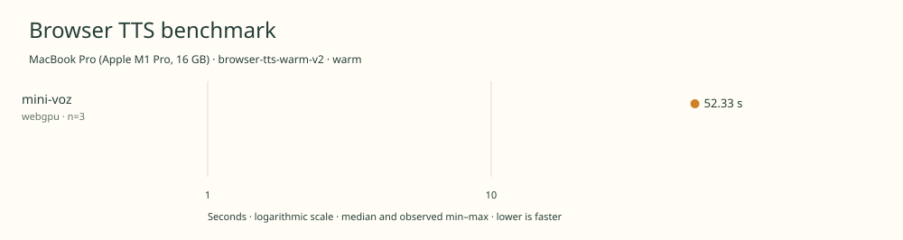

# 2026-11-22t21-04-39-744z-mini-voz-webgpu-warm-6b3c9f74

MacBook Pro (Apple M1 Pro, 16 GB) · Apple M1 Pro · Google Chrome 157.0.8103.79

Protocol: **browser-tts-warm-v2**, scenario **warm**. Native harness run.

First source-chunk request through final CPU-readable PCM; excludes initialization, validation, hashing, WAV encoding and save. Optional articleCallPeakRssBytes spans the entire browser call including post-timer validation/export.

| Model | Requested backend | Status | Median | Min–max | Runs |
|---|---|---|---:|---:|---:|
| mini-voz | webgpu | measured | 52.33 s | 52.33–52.44 s | 3 |

Additional metrics (median of available observations; scopes are distinct):

| Model | Backend | Metric | Median | Unit | n |
|---|---|---|---:|---|---:|
| mini-voz | webgpu | First completed source chunk | 475.335 | ms | 3 |
| mini-voz | webgpu | First PCM block | 160.345 | ms | 3 |
| mini-voz | webgpu | Generated audio | 1466.709 | s | 3 |
| mini-voz | webgpu | Generation / audio duration | 0.036 | ratio | 3 |

Model support (catalog capability, not coverage of this run):

| Model | Supported voices | Bundled voices | Languages | Tested voice |
|---|---:|---:|---|---|
| mini-voz | 4 | 4 | 1 (es-ES) | F1 |

Pinned Mini Voz FP32 ONNX checkpoint and stock browser frontend at ad40085efb3fb13c905e4b4640855edf62471dd1. Four fixed synthetic profiles F1/F2/M1/M2 at 24 kHz; F1/index 0 is the default. The browser profile fixes Castilian es-ES with eSpeak set\_voice\("es", "es"\).. The stock ESM frontend is retained byte-for-byte. The fixed fixture oracle covers all 105 spans/334 utterances, max 180 tokens and zero unknown phones. Only es-ES is in this browser profile; es-419 is not exposed and there is no genuine English voice. Single-thread WASM is fixed for both CPU and WebGPU \(which may use WASM for unsupported operators\). The original graph generates unseeded waveform noise; PCM hashes are not a repeatability guarantee. Model/code terms do not establish blanket generated-audio redistribution rights. Sources: [1](https://github.com/ElMariones/mini-voz/tree/ad40085efb3fb13c905e4b4640855edf62471dd1), [2](https://github.com/ElMariones/mini-voz/blob/ad40085efb3fb13c905e4b4640855edf62471dd1/CITATION.cff), [3](https://github.com/n4ze3m/tiny-voca), [4](https://registry.npmjs.org/onnxruntime-web/-/onnxruntime-web-1.20.1.tgz), [5](https://github.com/espeak-ng/espeak-ng).

- **mini-voz / webgpu**: Observed 2487 WebGPU compute dispatches; WASM fallback remains available.

Capability checks run separately before timing. GPU dispatch does not imply GPU-exclusive execution.

Raw WAV is saved locally; opt-in audio publication is separate from timing and automatic result submission.

Campaign 2026-11-22T20-59-43-857Z-2dd13c6dbcca; cell 2/4; source 34c829ee99d1ddd7ec45a1f4ea1793c610c6a36a; fixture es-es-article-v1 (es-ES, 22965 JavaScript characters, 105 spans); requested n=3; effective n=3; Headed Google Chrome on Apple M1 Pro, disposable sequential profiles. Mini Voz released stock FP32 graph, default Castilian Spanish F1 voice index zero, neutral speed and pitch and per-utterance peak cap 0.99. Exact released Castilian normalization, eSpeak NG frontend and data. ORT Web 1.20.1 single-thread CPU/WASM or Apple hardware WebGPU+WASM. Separate cached process-tree RSS observations.

Different protocols, fixtures, settings or machines must not be pooled into a speedup ranking. This report does not rate speech quality.
