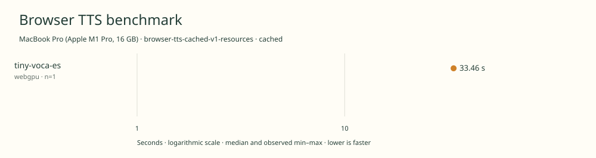

# 2026-11-22t22-04-14-320z-tiny-voca-es-webgpu-cached-e25ba3ea

MacBook Pro (Apple M1 Pro, 16 GB) · Apple M1 Pro · Google Chrome 157.0.8103.79

Protocol: **browser-tts-cached-v1-resources**, scenario **cached**. Native harness run.

First source-chunk request through final CPU-readable PCM; excludes initialization, validation, hashing, WAV encoding and save. Optional articleCallPeakRssBytes spans the entire browser call including post-timer validation/export. Generation RSS uses timestamped samples inside browser generation start/end boundaries; it includes the owned Chrome process tree and browser baseline.

| Model | Requested backend | Status | Median | Min–max | Runs |
|---|---|---|---:|---:|---:|
| tiny-voca-es | webgpu | measured | 33.46 s | 33.46–33.46 s | 1 |

Additional metrics (median of available observations; scopes are distinct):

| Model | Backend | Metric | Median | Unit | n |
|---|---|---|---:|---|---:|
| tiny-voca-es | webgpu | First completed source chunk | 438.480 | ms | 1 |
| tiny-voca-es | webgpu | First PCM block | 170.960 | ms | 1 |
| tiny-voca-es | webgpu | Generated audio | 1630.219 | s | 1 |
| tiny-voca-es | webgpu | Generation / audio duration | 0.021 | ratio | 1 |
| tiny-voca-es | webgpu | Model initialization | 588.630 | ms | 1 |
| tiny-voca-es | webgpu | Complete controller trial including setup/export | 38860.804 | ms | 1 |
| tiny-voca-es | webgpu | Transferred HTTP body data | 57783 | bytes | 1 |
| tiny-voca-es | webgpu | Ideal body transfer at 1 Mbps | 0.462 | s | 1 |
| tiny-voca-es | webgpu | Whole-call Chrome process-tree peak RSS | 2173796352 | bytes | 1 |
| tiny-voca-es | webgpu | Per-trial mean generation Chrome process-tree RSS | 1682823975 | bytes | 1 |
| tiny-voca-es | webgpu | In-window Chrome RSS observations | 66.000 | samples | 1 |

Model support (catalog capability, not coverage of this run):

| Model | Supported voices | Bundled voices | Languages | Tested voice |
|---|---:|---:|---|---|
| tiny-voca-es | 2 | 2 | 1 (es-ES) | F2 |

Pinned marcosmaceo/tiny-voca-es Spanish checkpoint only. Two fixed synthetic Castilian voices, F2 and M2, at 24 kHz mono; benchmark default is F2/index 0. This browser profile exposes es-ES only. The upstream native English development route requires a separate English checkpoint and is not a voice in these Spanish weights.. The checkpoint contains 4,534,411 publisher-reported parameters. The full es-es-article-v1 native/browser frontend audit matches exactly: 105 spans, 334 utterances, maximum 180 tokens, zero unknown phones; audit is smoke-only. es-AR/es-CU are unvalidated rule-based transforms and are not exposed. The graph has no seed input and generates waveform noise internally. English requires a separate upstream English checkpoint. Model/code terms do not grant blanket rights to generated recordings. Sources: [1](https://huggingface.co/marcosmaceo/tiny-voca-es/tree/9898eaef9b245d7a5240156eed919ee1bd2a9b84), [2](https://github.com/stdevMac/tiny-voca/tree/a4bf2bd979fc40b1bd7e34e13c0164db627d14ec), [3](https://github.com/espeak-ng/espeak-ng/tree/4870adfa25b1a32b4361592f1be8a40337c58d6c), [4](https://registry.npmjs.org/onnxruntime-web/-/onnxruntime-web-1.22.0.tgz), [5](https://huggingface.co/datasets/marcosmaceo/tiny-voca-es).

- **tiny-voca-es / webgpu**: Observed 2646 WebGPU compute dispatches from the pinned graph; WASM fallback remains available.

Capability checks run separately before timing. GPU dispatch does not imply GPU-exclusive execution.

Raw WAV is saved locally; opt-in audio publication is separate from timing and automatic result submission.

Campaign 2026-11-22T21-54-12-125Z-f0ea96f38f62; cell 4/4; source fafe7d9cbe032012ed7702f683d721a6c6b7c46c; fixture es-es-article-v1 (es-ES, 22965 JavaScript characters, 105 spans); requested n=1; effective n=1; Headed Google Chrome on Apple M1 Pro, disposable sequential profiles. tiny-voca-es released FP32 graph, default Castilian Spanish F2 voice index zero, neutral speed and pitch and completed-span peak cap 0.99. Exact released Castilian normalization, sentence segmentation and eSpeak NG 1.52.0. ORT Web 1.22.0 single-thread CPU/WASM or Apple hardware WebGPU+WASM. Separate cached process-tree RSS observations.

RSS is sampled every 500 ms across the owned Chrome process tree, including the Chrome baseline and inference workers. Whole-call peak spans post-timer validation/export; generation mean uses only in-window samples from browser generation start through final CPU-readable PCM.

Different protocols, fixtures, settings or machines must not be pooled into a speedup ranking. This report does not rate speech quality.
