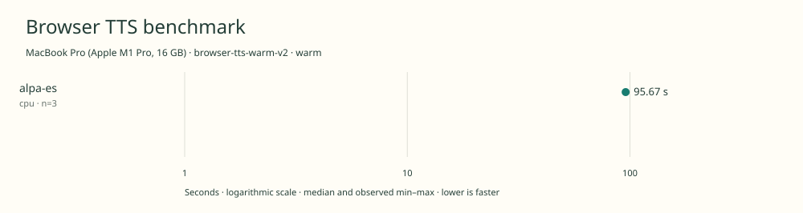

# 2026-11-22t23-02-41-155z-alpa-es-cpu-warm-574587f7

MacBook Pro (Apple M1 Pro, 16 GB) · Apple M1 Pro · Google Chrome 157.0.8103.79

Protocol: **browser-tts-warm-v2**, scenario **warm**. Native harness run.

First source-chunk request through final CPU-readable PCM; excludes initialization, validation, hashing, WAV encoding and save. Optional articleCallPeakRssBytes spans the entire browser call including post-timer validation/export.

| Model | Requested backend | Status | Median | Min–max | Runs |
|---|---|---|---:|---:|---:|
| alpa-es | cpu | measured | 95.67 s | 95.62–95.72 s | 3 |

Additional metrics (median of available observations; scopes are distinct):

| Model | Backend | Metric | Median | Unit | n |
|---|---|---|---:|---|---:|
| alpa-es | cpu | First completed source chunk | 960.260 | ms | 3 |
| alpa-es | cpu | First PCM block | 960.190 | ms | 3 |
| alpa-es | cpu | Generated audio | 1416.683 | s | 3 |
| alpa-es | cpu | Generation / audio duration | 0.068 | ratio | 3 |

Model support (catalog capability, not coverage of this run):

| Model | Supported voices | Bundled voices | Languages | Tested voice |
|---|---:|---:|---|---|
| alpa-es | 2 | 2 | 1 (es-AR) | female |

Pinned FranciscoCarlosErra/alpa-es checkpoint only. Two fixed voices \(female and male\) trained from recorded OpenSLR 61 speech; the browser profile selects female/index 0. This profile exposes Rioplatense Spanish \(es-AR\) only. The released frontend retains native unknown digit groups; it does not spell them out.. The pinned checkpoint contains exactly 4,529,035 parameters as counted from its loaded state. All 104 registered es-ar-article-v1 source spans pass the native letter/stress frontend audit; max 218 tokens, 63 unknown digit groups across 34 spans. Smoke-only audit; no pronunciation or listening review is claimed. The graph has no seed input and generates unseeded noise/breath internally; audio is retained as raw Float32 PCM. Sources: [1](https://huggingface.co/FranciscoCarlosErra/alpa-es/tree/de2bf894bdd9eb768ae03fc6b385176a0ff505d1), [2](https://github.com/n4ze3m/tiny-voca/tree/28e0722), [3](https://www.openslr.org/61/), [4](https://github.com/microsoft/onnxruntime/tree/v1.31.1).

- **alpa-es / cpu**: The pinned FP32 graph uses explicit single-thread WASM. Rioplatense Spanish normalization and phonemization run in the local worker.

Capability checks run separately before timing. GPU dispatch does not imply GPU-exclusive execution.

Raw WAV is saved locally; opt-in audio publication is separate from timing and automatic result submission.

Campaign 2026-11-22T23-02-40-563Z-443485f185ac; cell 1/4; source bef91023f0a625c03eecc7d0dcf1391f012d535a; fixture es-ar-article-v1 (es-AR, 22749 JavaScript characters, 104 spans); requested n=3; effective n=3; Headed Google Chrome on Apple M1 Pro, disposable sequential profiles. Exact approved Alpa-es Polish FP32 ONNX export, female index zero at neutral speed and pitch. Released Rioplatense letter and vowel weight frontend, one model utterance per fixed span. ORT Web 1.31.1 CPU/WASM single thread or verified Apple hardware WebGPU+WASM. Separate cached process-tree RSS.

Different protocols, fixtures, settings or machines must not be pooled into a speedup ranking. This report does not rate speech quality.
