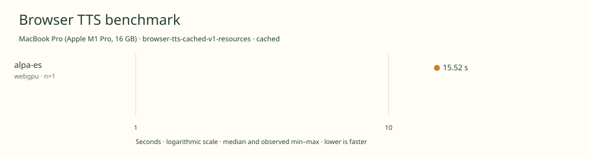

# 2026-11-22t23-12-09-189z-alpa-es-webgpu-cached-dee19f60

MacBook Pro (Apple M1 Pro, 16 GB) · Apple M1 Pro · Google Chrome 157.0.8103.79

Protocol: **browser-tts-cached-v1-resources**, scenario **cached**. Native harness run.

First source-chunk request through final CPU-readable PCM; excludes initialization, validation, hashing, WAV encoding and save. Optional articleCallPeakRssBytes spans the entire browser call including post-timer validation/export. Generation RSS uses timestamped samples inside browser generation start/end boundaries; it includes the owned Chrome process tree and browser baseline.

| Model | Requested backend | Status | Median | Min–max | Runs |
|---|---|---|---:|---:|---:|
| alpa-es | webgpu | measured | 15.52 s | 15.52–15.52 s | 1 |

Additional metrics (median of available observations; scopes are distinct):

| Model | Backend | Metric | Median | Unit | n |
|---|---|---|---:|---|---:|
| alpa-es | webgpu | First completed source chunk | 266.375 | ms | 1 |
| alpa-es | webgpu | First PCM block | 266.320 | ms | 1 |
| alpa-es | webgpu | Generated audio | 1416.683 | s | 1 |
| alpa-es | webgpu | Generation / audio duration | 0.011 | ratio | 1 |
| alpa-es | webgpu | Model initialization | 1182.710 | ms | 1 |
| alpa-es | webgpu | Complete controller trial including setup/export | 21028.770 | ms | 1 |
| alpa-es | webgpu | Transferred HTTP body data | 58549 | bytes | 1 |
| alpa-es | webgpu | Ideal body transfer at 1 Mbps | 0.468 | s | 1 |
| alpa-es | webgpu | Whole-call Chrome process-tree peak RSS | 2580381696 | bytes | 1 |
| alpa-es | webgpu | Per-trial mean generation Chrome process-tree RSS | 1902701227 | bytes | 1 |
| alpa-es | webgpu | In-window Chrome RSS observations | 30.000 | samples | 1 |

Model support (catalog capability, not coverage of this run):

| Model | Supported voices | Bundled voices | Languages | Tested voice |
|---|---:|---:|---|---|
| alpa-es | 2 | 2 | 1 (es-AR) | female |

Pinned FranciscoCarlosErra/alpa-es checkpoint only. Two fixed voices \(female and male\) trained from recorded OpenSLR 61 speech; the browser profile selects female/index 0. This profile exposes Rioplatense Spanish \(es-AR\) only. The released frontend retains native unknown digit groups; it does not spell them out.. The pinned checkpoint contains exactly 4,529,035 parameters as counted from its loaded state. All 104 registered es-ar-article-v1 source spans pass the native letter/stress frontend audit; max 218 tokens, 63 unknown digit groups across 34 spans. Smoke-only audit; no pronunciation or listening review is claimed. The graph has no seed input and generates unseeded noise/breath internally; audio is retained as raw Float32 PCM. Sources: [1](https://huggingface.co/FranciscoCarlosErra/alpa-es/tree/de2bf894bdd9eb768ae03fc6b385176a0ff505d1), [2](https://github.com/n4ze3m/tiny-voca/tree/28e0722), [3](https://www.openslr.org/61/), [4](https://github.com/microsoft/onnxruntime/tree/v1.31.1).

- **alpa-es / webgpu**: Observed 843 WebGPU compute dispatches from the pinned Alpa FP32 graph. WASM remains available for unsupported operators.

Capability checks run separately before timing. GPU dispatch does not imply GPU-exclusive execution.

Raw WAV is saved locally; opt-in audio publication is separate from timing and automatic result submission.

Campaign 2026-11-22T23-02-40-563Z-443485f185ac; cell 4/4; source bef91023f0a625c03eecc7d0dcf1391f012d535a; fixture es-ar-article-v1 (es-AR, 22749 JavaScript characters, 104 spans); requested n=1; effective n=1; Headed Google Chrome on Apple M1 Pro, disposable sequential profiles. Exact approved Alpa-es Polish FP32 ONNX export, female index zero at neutral speed and pitch. Released Rioplatense letter and vowel weight frontend, one model utterance per fixed span. ORT Web 1.31.1 CPU/WASM single thread or verified Apple hardware WebGPU+WASM. Separate cached process-tree RSS.

RSS is sampled every 500 ms across the owned Chrome process tree, including the Chrome baseline and inference workers. Whole-call peak spans post-timer validation/export; generation mean uses only in-window samples from browser generation start through final CPU-readable PCM.

Different protocols, fixtures, settings or machines must not be pooled into a speedup ranking. This report does not rate speech quality.
