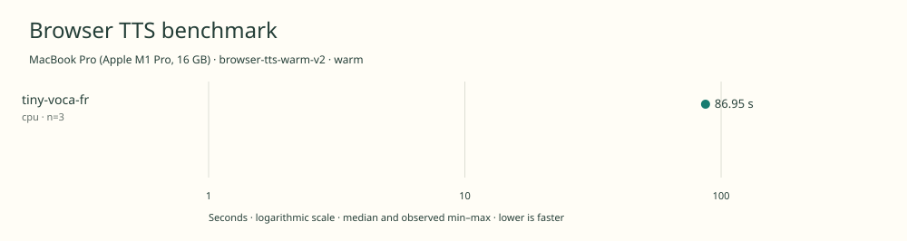

# 2026-11-23t00-08-29-212z-tiny-voca-fr-cpu-warm-f9f7e9b0

MacBook Pro (Apple M1 Pro, 16 GB) · Apple M1 Pro · Google Chrome 157.0.8103.79

Protocol: **browser-tts-warm-v2**, scenario **warm**. Native harness run.

First source-chunk request through final CPU-readable PCM; excludes initialization, validation, hashing, WAV encoding and save. Optional articleCallPeakRssBytes spans the entire browser call including post-timer validation/export.

| Model | Requested backend | Status | Median | Min–max | Runs |
|---|---|---|---:|---:|---:|
| tiny-voca-fr | cpu | measured | 86.95 s | 86.92–86.95 s | 3 |

Additional metrics (median of available observations; scopes are distinct):

| Model | Backend | Metric | Median | Unit | n |
|---|---|---|---:|---|---:|
| tiny-voca-fr | cpu | First completed source chunk | 815.910 | ms | 3 |
| tiny-voca-fr | cpu | First PCM block | 244.240 | ms | 3 |
| tiny-voca-fr | cpu | Generated audio | 1411.147 | s | 3 |
| tiny-voca-fr | cpu | Generation / audio duration | 0.062 | ratio | 3 |

Model support (catalog capability, not coverage of this run):

| Model | Supported voices | Bundled voices | Languages | Tested voice |
|---|---:|---:|---|---|
| tiny-voca-fr | 2 | 2 | 1 (fr) | FR_F1 |

Pinned French checkpoint and browser frontend only. FR\_F1/index 0 is the benchmark default; FR\_M1/index 1 is available as an alternate diagnostic voice.. Diagnostic frontend audit matches all 108 fr-article-v1 spans: 318 utterances, maximum 183 tokens, zero unknown phones; audit is smoke-only. No parameter count is asserted because the model-card and inherited base-card values differ. The upstream demo is CPU-only; ORT 1.20.1 fails WebGPU on /Concat\_6 due to a non-concat dimension mismatch, so the separately pinned existing ORT 1.31.1 WebGPU+WASM assets are used. No number rewriting: in 17 h 40, h is read as the letter name between 17 and 40. The upstream liaison limit in comment‿allez \(missing \[t\]\) is retained. The graph has no seed input and generates unseeded waveform noise. Model terms do not grant blanket rights to generated recordings. Sources: [1](https://huggingface.co/DanielSuncost/tiny-voca-fr/tree/73f7700f514e70eef3b459aedcc49829d41945d4), [2](https://github.com/DanielSuncost/tiny-voca-fr/tree/4cc26ab23d934e3d33796eb06bf11f23f4c9ab34), [3](https://www.npmjs.com/package/espeak-ng/v/1.0.2), [4](https://github.com/microsoft/onnxruntime/tree/v1.31.1).

- **tiny-voca-fr / cpu**: ONNX Runtime Web 1.20.1 uses explicit single-thread WASM, matching the upstream CPU-only browser demo. French normalization and eSpeak NG G2P run locally.

Capability checks run separately before timing. GPU dispatch does not imply GPU-exclusive execution.

Raw WAV is saved locally; opt-in audio publication is separate from timing and automatic result submission.

Campaign 2026-11-23T00-08-28-561Z-b1ec1724f47e; cell 1/4; source 8c5c2147261d43b373c711334409f62857065e4d; fixture fr-article-v1 (fr, 23757 JavaScript characters, 108 spans); requested n=3; effective n=3; Headed Google Chrome on Apple M1 Pro, disposable sequential profiles. Released Tiny Voca French FP32 ONNX, FR_F1 index zero at neutral speed and pitch. Exact released eSpeak NG 1.0.2 browser frontend with fr-fr phonemes, sentence splitting, and peak limiting. Single-thread CPU/WASM on released ORT Web 1.20.1, or independently verified Apple hardware WebGPU+WASM on ORT Web 1.31.1. Separate cached process-tree RSS.

Different protocols, fixtures, settings or machines must not be pooled into a speedup ranking. This report does not rate speech quality.
