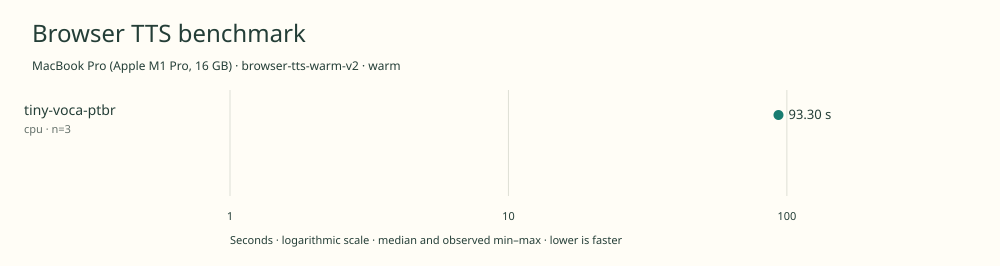

# 2026-11-23t02-09-13-281z-tiny-voca-ptbr-cpu-warm-9ed2786e

MacBook Pro (Apple M1 Pro, 16 GB) · Apple M1 Pro · Google Chrome 157.0.8103.79

Protocol: **browser-tts-warm-v2**, scenario **warm**. Native harness run.

First source-chunk request through final CPU-readable PCM; excludes initialization, validation, hashing, WAV encoding and save. Optional articleCallPeakRssBytes spans the entire browser call including post-timer validation/export.

| Model | Requested backend | Status | Median | Min–max | Runs |
|---|---|---|---:|---:|---:|
| tiny-voca-ptbr | cpu | measured | 93.30 s | 93.20–93.64 s | 3 |

Additional metrics (median of available observations; scopes are distinct):

| Model | Backend | Metric | Median | Unit | n |
|---|---|---|---:|---|---:|
| tiny-voca-ptbr | cpu | First completed source chunk | 849.460 | ms | 3 |
| tiny-voca-ptbr | cpu | First PCM block | 209.980 | ms | 3 |
| tiny-voca-ptbr | cpu | Generated audio | 1768.555 | s | 3 |
| tiny-voca-ptbr | cpu | Generation / audio duration | 0.053 | ratio | 3 |

Model support (catalog capability, not coverage of this run):

| Model | Supported voices | Bundled voices | Languages | Tested voice |
|---|---:|---:|---|---|
| tiny-voca-ptbr | 2 | 2 | 1 (pt-BR) | F_s4 |

Pinned semfence/tiny-voca-ptbr checkpoint only. Two fixed synthetic voices, F\_s4 and M\_sm4, at 24 kHz mono; benchmark default is F\_s4/index 0. This browser profile exposes Brazilian Portuguese \(pt-BR\) only.. The pinned checkpoint card reports 4,533,259 parameters including the waveform generator. Exact pt-br-article-v1 frontend audit: 101 spans, 310 utterances, maximum 225 tokens, zero &lt;unk&gt; phones; this is a diagnostic, not a score. Both original synthetic voices are included. The graph has no seed input and generates waveform noise internally. Generated recordings have no blanket redistribution grant from the code license. Sources: [1](https://huggingface.co/semfence/tiny-voca-ptbr/tree/f231cbe318c9f972e27fd8dad5d8ebcfb40a672f), [2](https://huggingface.co/spaces/semfence/tiny-voca-ptbr-demo/tree/a456470df5589478e3fb3f1973457771f4c056bd), [3](https://github.com/n4ze3m/tiny-voca), [4](https://github.com/SemFence/dizione-ptbr/tree/8fbb77e579fe684f3afd9cb2a801d0adce8c89cf), [5](https://github.com/MontrealCorpusTools/mfa-models/tree/dictionary-portuguese_brazil_mfa-v2.0.0a), [6](https://registry.npmjs.org/onnxruntime-web/-/onnxruntime-web-1.22.0.tgz).

- **tiny-voca-ptbr / cpu**: Explicit ONNX Runtime Web 1.22.0 single-thread WASM provider; this is the CPU backend.

Capability checks run separately before timing. GPU dispatch does not imply GPU-exclusive execution.

Raw WAV is saved locally; opt-in audio publication is separate from timing and automatic result submission.

Campaign 2026-11-23T02-09-12-660Z-a9aceb978466; cell 1/4; source a1f52276803d69fde8e4d77456066d2ebd04da07; fixture pt-br-article-v1 (pt-BR, 22164 JavaScript characters, 101 spans); requested n=3; effective n=3; Headed Google Chrome on Apple M1 Pro, disposable sequential profiles. tiny-voca-ptbr released FP32 graph, default Brazilian Portuguese F_s4 voice index zero, neutral speed and pitch and completed-span peak cap 0.99. Exact released Brazilian Portuguese Dizione JS normalization, tokenization, and sentence segmentation. ORT Web 1.22.0 single-thread CPU/WASM or Apple hardware WebGPU+WASM. Separate cached process-tree RSS observations.

Different protocols, fixtures, settings or machines must not be pooled into a speedup ranking. This report does not rate speech quality.
