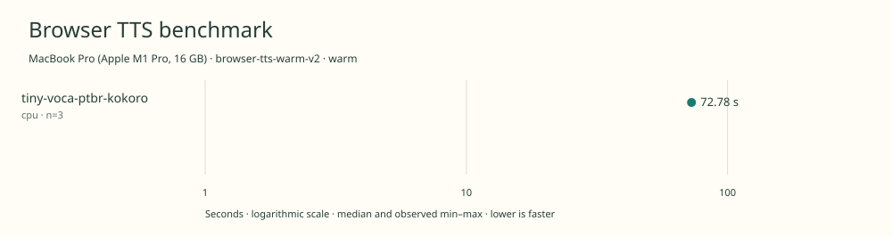

# 2026-11-23t03-19-07-622z-tiny-voca-ptbr-kokoro-cpu-warm-f23b292d

MacBook Pro (Apple M1 Pro, 16 GB) · Apple M1 Pro · Google Chrome 157.0.8103.79

Protocol: **browser-tts-warm-v2**, scenario **warm**. Native harness run.

First source-chunk request through final CPU-readable PCM; excludes initialization, validation, hashing, WAV encoding and save. Optional articleCallPeakRssBytes spans the entire browser call including post-timer validation/export.

| Model | Requested backend | Status | Median | Min–max | Runs |
|---|---|---|---:|---:|---:|
| tiny-voca-ptbr-kokoro | cpu | measured | 72.78 s | 72.73–72.79 s | 3 |

Additional metrics (median of available observations; scopes are distinct):

| Model | Backend | Metric | Median | Unit | n |
|---|---|---|---:|---|---:|
| tiny-voca-ptbr-kokoro | cpu | First completed source chunk | 673.510 | ms | 3 |
| tiny-voca-ptbr-kokoro | cpu | First PCM block | 183.140 | ms | 3 |
| tiny-voca-ptbr-kokoro | cpu | Generated audio | 1453.024 | s | 3 |
| tiny-voca-ptbr-kokoro | cpu | Generation / audio duration | 0.050 | ratio | 3 |

Model support (catalog capability, not coverage of this run):

| Model | Supported voices | Bundled voices | Languages | Tested voice |
|---|---:|---:|---|---|
| tiny-voca-ptbr-kokoro | 2 | 2 | 1 (pt-BR) | F |

Pinned Haple/tiny-voca-ptbr-kokoro checkpoint only. Two fixed synthetic voices, F and M, at 24 kHz mono; benchmark default is F/index 0. This browser profile supports Brazilian Portuguese \(pt-BR\) only.. Author-reported exact count is 4,535,755 parameters including the waveform generator. The immutable pt-br-article-v1 text/frontend audit matches 101 spans and 310 utterances, maximum 228 tokens, zero unknown tokens, and the native token/stress digest; this is diagnostic evidence, not a score. eSpeak NG 1.51 is part of the trained frontend ABI. English trace output is not a supported language. Generated recordings have no blanket redistribution grant. Sources: [1](https://huggingface.co/Haple/tiny-voca-ptbr-kokoro/tree/596401fc87f1635f73326872001e370d3aedab9b), [2](https://github.com/Haple/tiny-voca-ptbr-kokoro/tree/1e7ed993260ecdd91552762f7403c00632bf5dab), [3](https://github.com/espeak-ng/espeak-ng/tree/2e9a5fccbb0095e87b2769e9249ea1f821918ecd), [4](https://registry.npmjs.org/onnxruntime-web/-/onnxruntime-web-1.31.1.tgz).

- **tiny-voca-ptbr-kokoro / cpu**: Explicit ONNX Runtime Web 1.31.1 single-thread WASM provider.

Capability checks run separately before timing. GPU dispatch does not imply GPU-exclusive execution.

Raw WAV is saved locally; opt-in audio publication is separate from timing and automatic result submission.

Campaign 2026-11-23T03-19-06-976Z-6b948d514829; cell 1/4; source 5576650cfde71cb70cea0f3bc8766c7094e767de; fixture pt-br-article-v1 (pt-BR, 22164 JavaScript characters, 101 spans); requested n=3; effective n=3; Headed Google Chrome on Apple M1 Pro, disposable sequential profiles. Haple tiny-voca-ptbr-kokoro released FP32 graph, F voice index zero, neutral controls, and completed-span peak cap 0.99. Pinned eSpeak NG 1.51 and original Brazilian Portuguese normalization and frontend. ORT Web 1.31.1 single-thread CPU/WASM or Apple hardware WebGPU+WASM. Separate cached process-tree RSS observations.

Different protocols, fixtures, settings or machines must not be pooled into a speedup ranking. This report does not rate speech quality.
