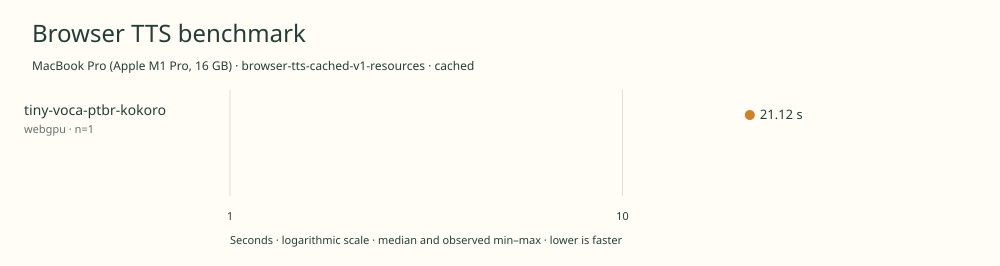

# 2026-11-23t03-27-04-807z-tiny-voca-ptbr-kokoro-webgpu-cached-469b132c

MacBook Pro (Apple M1 Pro, 16 GB) · Apple M1 Pro · Google Chrome 157.0.8103.79

Protocol: **browser-tts-cached-v1-resources**, scenario **cached**. Native harness run.

First source-chunk request through final CPU-readable PCM; excludes initialization, validation, hashing, WAV encoding and save. Optional articleCallPeakRssBytes spans the entire browser call including post-timer validation/export. Generation RSS uses timestamped samples inside browser generation start/end boundaries; it includes the owned Chrome process tree and browser baseline.

| Model | Requested backend | Status | Median | Min–max | Runs |
|---|---|---|---:|---:|---:|
| tiny-voca-ptbr-kokoro | webgpu | measured | 21.12 s | 21.12–21.12 s | 1 |

Additional metrics (median of available observations; scopes are distinct):

| Model | Backend | Metric | Median | Unit | n |
|---|---|---|---:|---|---:|
| tiny-voca-ptbr-kokoro | webgpu | First completed source chunk | 276.060 | ms | 1 |
| tiny-voca-ptbr-kokoro | webgpu | First PCM block | 125.475 | ms | 1 |
| tiny-voca-ptbr-kokoro | webgpu | Generated audio | 1453.024 | s | 1 |
| tiny-voca-ptbr-kokoro | webgpu | Generation / audio duration | 0.015 | ratio | 1 |
| tiny-voca-ptbr-kokoro | webgpu | Model initialization | 1054.954 | ms | 1 |
| tiny-voca-ptbr-kokoro | webgpu | Complete controller trial including setup/export | 26691.503 | ms | 1 |
| tiny-voca-ptbr-kokoro | webgpu | Transferred HTTP body data | 59974 | bytes | 1 |
| tiny-voca-ptbr-kokoro | webgpu | Ideal body transfer at 1 Mbps | 0.480 | s | 1 |
| tiny-voca-ptbr-kokoro | webgpu | Whole-call Chrome process-tree peak RSS | 2421784576 | bytes | 1 |
| tiny-voca-ptbr-kokoro | webgpu | Per-trial mean generation Chrome process-tree RSS | 1846590318 | bytes | 1 |
| tiny-voca-ptbr-kokoro | webgpu | In-window Chrome RSS observations | 42.000 | samples | 1 |

Model support (catalog capability, not coverage of this run):

| Model | Supported voices | Bundled voices | Languages | Tested voice |
|---|---:|---:|---|---|
| tiny-voca-ptbr-kokoro | 2 | 2 | 1 (pt-BR) | F |

Pinned Haple/tiny-voca-ptbr-kokoro checkpoint only. Two fixed synthetic voices, F and M, at 24 kHz mono; benchmark default is F/index 0. This browser profile supports Brazilian Portuguese \(pt-BR\) only.. Author-reported exact count is 4,535,755 parameters including the waveform generator. The immutable pt-br-article-v1 text/frontend audit matches 101 spans and 310 utterances, maximum 228 tokens, zero unknown tokens, and the native token/stress digest; this is diagnostic evidence, not a score. eSpeak NG 1.51 is part of the trained frontend ABI. English trace output is not a supported language. Generated recordings have no blanket redistribution grant. Sources: [1](https://huggingface.co/Haple/tiny-voca-ptbr-kokoro/tree/596401fc87f1635f73326872001e370d3aedab9b), [2](https://github.com/Haple/tiny-voca-ptbr-kokoro/tree/1e7ed993260ecdd91552762f7403c00632bf5dab), [3](https://github.com/espeak-ng/espeak-ng/tree/2e9a5fccbb0095e87b2769e9249ea1f821918ecd), [4](https://registry.npmjs.org/onnxruntime-web/-/onnxruntime-web-1.31.1.tgz).

- **tiny-voca-ptbr-kokoro / webgpu**: Observed 2277 WebGPU compute dispatches in an untimed probe; ONNX Runtime Web may use internal WASM kernels for unsupported operators.

Capability checks run separately before timing. GPU dispatch does not imply GPU-exclusive execution.

Raw WAV is saved locally; opt-in audio publication is separate from timing and automatic result submission.

Campaign 2026-11-23T03-19-06-976Z-6b948d514829; cell 4/4; source 5576650cfde71cb70cea0f3bc8766c7094e767de; fixture pt-br-article-v1 (pt-BR, 22164 JavaScript characters, 101 spans); requested n=1; effective n=1; Headed Google Chrome on Apple M1 Pro, disposable sequential profiles. Haple tiny-voca-ptbr-kokoro released FP32 graph, F voice index zero, neutral controls, and completed-span peak cap 0.99. Pinned eSpeak NG 1.51 and original Brazilian Portuguese normalization and frontend. ORT Web 1.31.1 single-thread CPU/WASM or Apple hardware WebGPU+WASM. Separate cached process-tree RSS observations.

RSS is sampled every 500 ms across the owned Chrome process tree, including the Chrome baseline and inference workers. Whole-call peak spans post-timer validation/export; generation mean uses only in-window samples from browser generation start through final CPU-readable PCM.

Different protocols, fixtures, settings or machines must not be pooled into a speedup ranking. This report does not rate speech quality.
