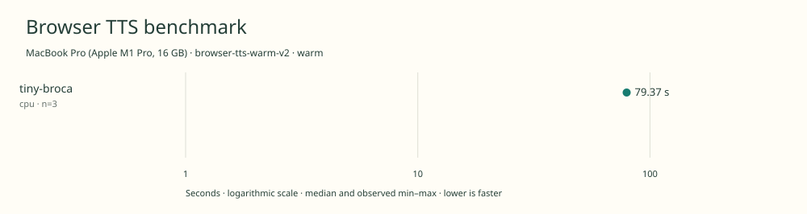

# 2026-11-23t04-09-39-454z-tiny-broca-cpu-warm-738f8a1a

MacBook Pro (Apple M1 Pro, 16 GB) · Apple M1 Pro · Google Chrome 157.0.8103.79

Protocol: **browser-tts-warm-v2**, scenario **warm**. Native harness run.

First source-chunk request through final CPU-readable PCM; excludes initialization, validation, hashing, WAV encoding and save. Optional articleCallPeakRssBytes spans the entire browser call including post-timer validation/export.

| Model | Requested backend | Status | Median | Min–max | Runs |
|---|---|---|---:|---:|---:|
| tiny-broca | cpu | measured | 79.37 s | 79.35–79.38 s | 3 |

Additional metrics (median of available observations; scopes are distinct):

| Model | Backend | Metric | Median | Unit | n |
|---|---|---|---:|---|---:|
| tiny-broca | cpu | First completed source chunk | 742.125 | ms | 3 |
| tiny-broca | cpu | First PCM block | 175.990 | ms | 3 |
| tiny-broca | cpu | Generated audio | 1529.739 | s | 3 |
| tiny-broca | cpu | Generation / audio duration | 0.052 | ratio | 3 |

Model support (catalog capability, not coverage of this run):

| Model | Supported voices | Bundled voices | Languages | Tested voice |
|---|---:|---:|---|---|
| tiny-broca | 2 | 2 | 1 (pt-BR) | F1 |

Pinned brenorb/tiny-broca checkpoint only. Two fixed synthetic voices F1 and M1 at 24 kHz mono; benchmark default F1/index 0. This browser profile supports Brazilian Portuguese \(pt-BR\) only.. Exact pt-br-article-v1 frontend audit: 101 spans, 294 utterances, maximum 262 tokens, seven &lt;unk&gt; tokens. The pinned upstream frontend leaves digits in 18h, 21h, 16h and 1º unnormalized; these four spans are disclosed and preserved. English is unsupported. Model card reports 9,384 sentences / 16,434 clips / 17.3 hours of accepted synthetic training audio; no training recordings or upstream sample WAVs are bundled. Sources: [1](https://huggingface.co/brenorb/tiny-broca/tree/0ea879d8f532ad0c6e7308017b45105a74f81a95), [2](https://github.com/brenorb/tiny-broca/tree/56d68b9fd3375c52030b3de053a26bfcc6e823c2), [3](https://huggingface.co/spaces/brenorb/tiny-broca-demo/tree/56d68b9fd3375c52030b3de053a26bfcc6e823c2), [4](https://cdn.jsdelivr.net/pyodide/v0.26.4/full/), [5](https://registry.npmjs.org/onnxruntime-web/-/onnxruntime-web-1.20.1.tgz).

- **tiny-broca / cpu**: Explicit single-thread WASM provider. Pyodide uses the local pinned runtime.

Capability checks run separately before timing. GPU dispatch does not imply GPU-exclusive execution.

Raw WAV is saved locally; opt-in audio publication is separate from timing and automatic result submission.

Campaign 2026-11-23T04-09-38-812Z-ad6dbeba5b52; cell 1/4; source 5bbac603e361df0789e4a1a72f30d5fc9f1c7143; fixture pt-br-article-v1 (pt-BR, 22164 JavaScript characters, 101 spans); requested n=3; effective n=3; Headed Google Chrome on Apple M1 Pro, disposable sequential profiles. brenorb tiny-broca released FP32 graph, F1 voice index zero, neutral controls, and unchanged stock graph PCM. Pinned Brazilian Portuguese letter-and-stress frontend through stock Pyodide 0.26.4. ORT Web 1.20.1 single-thread CPU/WASM or Apple hardware WebGPU+WASM. Separate cached process-tree RSS observations.

Different protocols, fixtures, settings or machines must not be pooled into a speedup ranking. This report does not rate speech quality.
