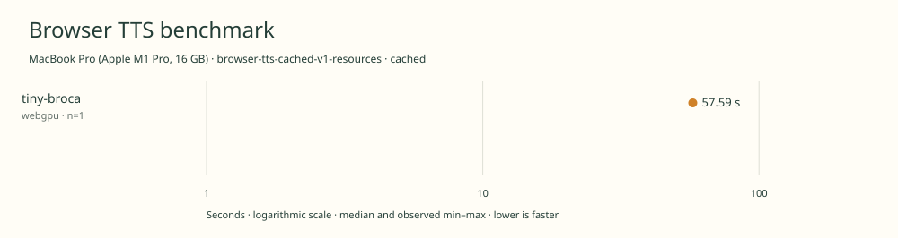

# 2026-11-23t04-20-40-410z-tiny-broca-webgpu-cached-44cca439

MacBook Pro (Apple M1 Pro, 16 GB) · Apple M1 Pro · Google Chrome 157.0.8103.79

Protocol: **browser-tts-cached-v1-resources**, scenario **cached**. Native harness run.

First source-chunk request through final CPU-readable PCM; excludes initialization, validation, hashing, WAV encoding and save. Optional articleCallPeakRssBytes spans the entire browser call including post-timer validation/export. Generation RSS uses timestamped samples inside browser generation start/end boundaries; it includes the owned Chrome process tree and browser baseline.

| Model | Requested backend | Status | Median | Min–max | Runs |
|---|---|---|---:|---:|---:|
| tiny-broca | webgpu | measured | 57.59 s | 57.59–57.59 s | 1 |

Additional metrics (median of available observations; scopes are distinct):

| Model | Backend | Metric | Median | Unit | n |
|---|---|---|---:|---|---:|
| tiny-broca | webgpu | First completed source chunk | 655.570 | ms | 1 |
| tiny-broca | webgpu | First PCM block | 243.800 | ms | 1 |
| tiny-broca | webgpu | Generated audio | 1529.739 | s | 1 |
| tiny-broca | webgpu | Generation / audio duration | 0.038 | ratio | 1 |
| tiny-broca | webgpu | Model initialization | 1618.558 | ms | 1 |
| tiny-broca | webgpu | Complete controller trial including setup/export | 63974.251 | ms | 1 |
| tiny-broca | webgpu | Transferred HTTP body data | 60091 | bytes | 1 |
| tiny-broca | webgpu | Ideal body transfer at 1 Mbps | 0.481 | s | 1 |
| tiny-broca | webgpu | Whole-call Chrome process-tree peak RSS | 2228944896 | bytes | 1 |
| tiny-broca | webgpu | Per-trial mean generation Chrome process-tree RSS | 1661231966 | bytes | 1 |
| tiny-broca | webgpu | In-window Chrome RSS observations | 114.000 | samples | 1 |

Model support (catalog capability, not coverage of this run):

| Model | Supported voices | Bundled voices | Languages | Tested voice |
|---|---:|---:|---|---|
| tiny-broca | 2 | 2 | 1 (pt-BR) | F1 |

Pinned brenorb/tiny-broca checkpoint only. Two fixed synthetic voices F1 and M1 at 24 kHz mono; benchmark default F1/index 0. This browser profile supports Brazilian Portuguese \(pt-BR\) only.. Exact pt-br-article-v1 frontend audit: 101 spans, 294 utterances, maximum 262 tokens, seven &lt;unk&gt; tokens. The pinned upstream frontend leaves digits in 18h, 21h, 16h and 1º unnormalized; these four spans are disclosed and preserved. English is unsupported. Model card reports 9,384 sentences / 16,434 clips / 17.3 hours of accepted synthetic training audio; no training recordings or upstream sample WAVs are bundled. Sources: [1](https://huggingface.co/brenorb/tiny-broca/tree/0ea879d8f532ad0c6e7308017b45105a74f81a95), [2](https://github.com/brenorb/tiny-broca/tree/56d68b9fd3375c52030b3de053a26bfcc6e823c2), [3](https://huggingface.co/spaces/brenorb/tiny-broca-demo/tree/56d68b9fd3375c52030b3de053a26bfcc6e823c2), [4](https://cdn.jsdelivr.net/pyodide/v0.26.4/full/), [5](https://registry.npmjs.org/onnxruntime-web/-/onnxruntime-web-1.20.1.tgz).

- **tiny-broca / webgpu**: Observed 2520 hardware WebGPU dispatches in an untimed probe. WASM handles unsupported operators.

Capability checks run separately before timing. GPU dispatch does not imply GPU-exclusive execution.

Raw WAV is saved locally; opt-in audio publication is separate from timing and automatic result submission.

Campaign 2026-11-23T04-09-38-812Z-ad6dbeba5b52; cell 4/4; source 5bbac603e361df0789e4a1a72f30d5fc9f1c7143; fixture pt-br-article-v1 (pt-BR, 22164 JavaScript characters, 101 spans); requested n=1; effective n=1; Headed Google Chrome on Apple M1 Pro, disposable sequential profiles. brenorb tiny-broca released FP32 graph, F1 voice index zero, neutral controls, and unchanged stock graph PCM. Pinned Brazilian Portuguese letter-and-stress frontend through stock Pyodide 0.26.4. ORT Web 1.20.1 single-thread CPU/WASM or Apple hardware WebGPU+WASM. Separate cached process-tree RSS observations.

RSS is sampled every 500 ms across the owned Chrome process tree, including the Chrome baseline and inference workers. Whole-call peak spans post-timer validation/export; generation mean uses only in-window samples from browser generation start through final CPU-readable PCM.

Different protocols, fixtures, settings or machines must not be pooled into a speedup ranking. This report does not rate speech quality.
