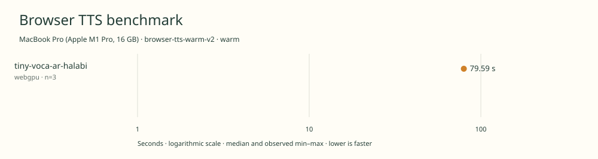

# 2026-11-23t05-29-00-720z-tiny-voca-ar-halabi-webgpu-warm-82fdd147

MacBook Pro (Apple M1 Pro, 16 GB) · Apple M1 Pro · Google Chrome 157.0.8103.79

Protocol: **browser-tts-warm-v2**, scenario **warm**. Native harness run.

First source-chunk request through final CPU-readable PCM; excludes initialization, validation, hashing, WAV encoding and save. Optional articleCallPeakRssBytes spans the entire browser call including post-timer validation/export.

| Model | Requested backend | Status | Median | Min–max | Runs |
|---|---|---|---:|---:|---:|
| tiny-voca-ar-halabi | webgpu | measured | 79.59 s | 79.53–80.29 s | 3 |

Additional metrics (median of available observations; scopes are distinct):

| Model | Backend | Metric | Median | Unit | n |
|---|---|---|---:|---|---:|
| tiny-voca-ar-halabi | webgpu | First completed source chunk | 589.580 | ms | 3 |
| tiny-voca-ar-halabi | webgpu | First PCM block | 228.395 | ms | 3 |
| tiny-voca-ar-halabi | webgpu | Generated audio | 2034.336 | s | 3 |
| tiny-voca-ar-halabi | webgpu | Generation / audio duration | 0.039 | ratio | 3 |

Model support (catalog capability, not coverage of this run):

| Model | Supported voices | Bundled voices | Languages | Tested voice |
|---|---:|---:|---|---|
| tiny-voca-ar-halabi | 1 | 1 | 1 (ar) | F2 |

Pinned Tiny Voca Arabic Halabi F2 release only. One fixed synthetic voice F2/index 0, 24 kHz. This browser profile supports fully vocalized Arabic \(ar\) on ar-article-v1 only; it does not claim English support. Accent is Damascene.. Exact ar-article-v1 frontend audit: 129 spans, 557 utterances, maximum 147 tokens, zero unknown IDs or graphemes. Token/stress SHA-256 8e6f250074d7930ba07fd5e552e57c5a54e8298e6f16c498d3524b5f41a7055e. Full vocalization is required; there is no automatic browser diacritizer. Upstream reports 1,214 accepted utterances / 2.85 hours, a single studio voice, and flatter prosody than the reference. Upstream says no separate written consent accompanies the corpus and relies on the rights holder’s CC BY 4.0 publication; this is recorded as the publisher’s statement, not an independent rights determination. Sources: [1](https://github.com/BenkadourKhaled/tiny-voca/tree/4601b2bdb44bc52ebf73e87d5082b49fa138c6fb), [2](https://github.com/BenkadourKhaled/tiny-voca/releases/tag/v0.1-ar-demo-kit), [3](https://github.com/BenkadourKhaled/tiny-voca/blob/4601b2bdb44bc52ebf73e87d5082b49fa138c6fb/README.md), [4](https://github.com/BenkadourKhaled/tiny-voca/blob/4601b2bdb44bc52ebf73e87d5082b49fa138c6fb/docs/arabic-data.md), [5](https://github.com/BenkadourKhaled/tiny-voca/blob/4601b2bdb44bc52ebf73e87d5082b49fa138c6fb/docs/arabic-demo.md), [6](https://cdn.jsdelivr.net/pyodide/v0.26.4/full/), [7](https://registry.npmjs.org/onnxruntime-web/-/onnxruntime-web-1.20.1.tgz).

- **tiny-voca-ar-halabi / webgpu**: Observed 2520 hardware WebGPU dispatches in an untimed probe. WASM handles unsupported operators; frontend work and output readback are CPU-side.

Capability checks run separately before timing. GPU dispatch does not imply GPU-exclusive execution.

Raw WAV is saved locally; opt-in audio publication is separate from timing and automatic result submission.

Campaign 2026-11-23T05-22-26-152Z-5a92cf0a401d; cell 2/4; source e8b4600bfb29c562fbab4d4fb9f3c4dc9bb994d4; fixture ar-article-v1 (ar, 28275 JavaScript characters, 129 spans); requested n=3; effective n=3; Headed Google Chrome on Apple M1 Pro, disposable sequential profiles. Released Halabi Arabic FP32 graph at step 3000, F2 voice index zero, neutral controls, stock sentence/fit and completed-span peak normalization. Pinned fully vowel-marked Modern Standard Arabic rules frontend through stock Pyodide 0.26.4. ORT Web 1.20.1 single-thread CPU/WASM or Apple hardware WebGPU+WASM. Separate cached process-tree RSS observations.

Different protocols, fixtures, settings or machines must not be pooled into a speedup ranking. This report does not rate speech quality.
