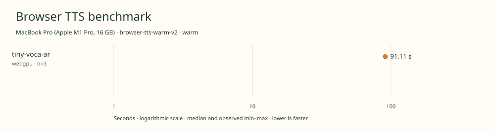

# 2026-11-23t06-26-27-304z-tiny-voca-ar-webgpu-warm-978a9a1e

MacBook Pro (Apple M1 Pro, 16 GB) · Apple M1 Pro · Google Chrome 157.0.8103.79

Protocol: **browser-tts-warm-v2**, scenario **warm**. Native harness run.

First source-chunk request through final CPU-readable PCM; excludes initialization, validation, hashing, WAV encoding and save. Optional articleCallPeakRssBytes spans the entire browser call including post-timer validation/export.

| Model | Requested backend | Status | Median | Min–max | Runs |
|---|---|---|---:|---:|---:|
| tiny-voca-ar | webgpu | measured | 91.11 s | 91.07–91.22 s | 3 |

Additional metrics (median of available observations; scopes are distinct):

| Model | Backend | Metric | Median | Unit | n |
|---|---|---|---:|---|---:|
| tiny-voca-ar | webgpu | First completed source chunk | 819.325 | ms | 3 |
| tiny-voca-ar | webgpu | First PCM block | 816.045 | ms | 3 |
| tiny-voca-ar | webgpu | Generated audio | 2428.608 | s | 3 |
| tiny-voca-ar | webgpu | Generation / audio duration | 0.038 | ratio | 3 |

Model support (catalog capability, not coverage of this run):

| Model | Supported voices | Bundled voices | Languages | Tested voice |
|---|---:|---:|---|---|
| tiny-voca-ar | 1 | 1 | 1 (ar) | M2 |

Experimental Modern Standard Arabic profile with the trained M2/index 1 voice only, 24 kHz, fully vocalized text, and ar-article-v1 fixture. F2 is untrained. No browser diacritizer; not cleared for client use.. Exact ar-article-v1 frontend audit: 129 spans, 340 utterances, maximum 189 tokens, zero unknown token IDs/words, token/stress SHA-256 aff88555e8f3b33e73656fbdc38cbc8fca3b345d3128a1a0d1316be5e03ffc0d. Publisher says only M2 was trained; F2 is untrained/noise. Publisher says not cleared for client use while the modeled reference voice rights question remains open. Sources: [1](https://huggingface.co/abdullah/tiny-voca-ar/tree/dcdf56c10c536d4df74576f036b512c0d212e17f), [2](https://huggingface.co/abdullah/tiny-voca-ar/blob/dcdf56c10c536d4df74576f036b512c0d212e17f/README.md), [3](https://huggingface.co/abdullah/tiny-voca-ar/blob/dcdf56c10c536d4df74576f036b512c0d212e17f/NOTICE.md), [4](https://huggingface.co/datasets/abdullah/tiny-voca-ar/tree/704dae1f4c6b1746e17e287cc9324499679769cd), [5](https://tiny-voca-ar-site.pages.dev/).

- **tiny-voca-ar / webgpu**: Observed 840 hardware WebGPU dispatches in an untimed probe. WASM handles unsupported operators; frontend work and output readback are CPU-side.

Capability checks run separately before timing. GPU dispatch does not imply GPU-exclusive execution.

Raw WAV is saved locally; opt-in audio publication is separate from timing and automatic result submission.

Campaign 2026-11-23T06-16-47-684Z-2471d878d928; cell 2/4; source cf9b05a408ecce9e0ed7ecc1ea8a8504a545bbc9; fixture ar-article-v1 (ar, 28275 JavaScript characters, 129 spans); requested n=3; effective n=3; Headed Google Chrome on Apple M1 Pro, disposable sequential profiles. Abdullah’s released Arabic FP32 graph at step 79955, trained M2 voice index one, neutral controls, stock sentence/fit and completed-span peak normalization. Pinned fully vowel-marked Modern Standard Arabic rules frontend through stock Pyodide 0.26.4. ORT Web 1.20.1 single-thread CPU/WASM or Apple hardware WebGPU+WASM. Separate cached process-tree RSS observations.

Different protocols, fixtures, settings or machines must not be pooled into a speedup ranking. This report does not rate speech quality.
