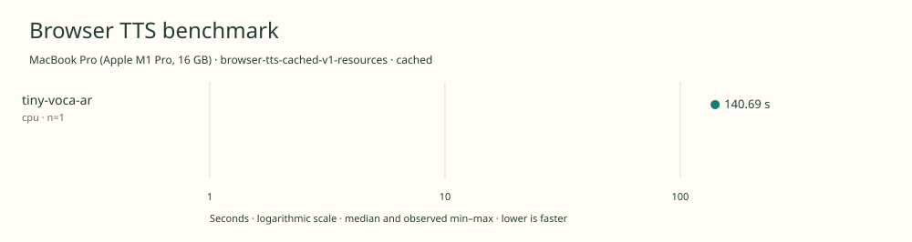

# 2026-11-23t06-32-47-973z-tiny-voca-ar-cpu-cached-988588bc

MacBook Pro (Apple M1 Pro, 16 GB) · Apple M1 Pro · Google Chrome 157.0.8103.79

Protocol: **browser-tts-cached-v1-resources**, scenario **cached**. Native harness run.

First source-chunk request through final CPU-readable PCM; excludes initialization, validation, hashing, WAV encoding and save. Optional articleCallPeakRssBytes spans the entire browser call including post-timer validation/export. Generation RSS uses timestamped samples inside browser generation start/end boundaries; it includes the owned Chrome process tree and browser baseline.

| Model | Requested backend | Status | Median | Min–max | Runs |
|---|---|---|---:|---:|---:|
| tiny-voca-ar | cpu | measured | 140.69 s | 140.69–140.69 s | 1 |

Additional metrics (median of available observations; scopes are distinct):

| Model | Backend | Metric | Median | Unit | n |
|---|---|---|---:|---|---:|
| tiny-voca-ar | cpu | First completed source chunk | 1475.475 | ms | 1 |
| tiny-voca-ar | cpu | First PCM block | 1468.355 | ms | 1 |
| tiny-voca-ar | cpu | Generated audio | 2428.608 | s | 1 |
| tiny-voca-ar | cpu | Generation / audio duration | 0.058 | ratio | 1 |
| tiny-voca-ar | cpu | Model initialization | 1645.063 | ms | 1 |
| tiny-voca-ar | cpu | Complete controller trial including setup/export | 149400.604 | ms | 1 |
| tiny-voca-ar | cpu | Transferred HTTP body data | 96976 | bytes | 1 |
| tiny-voca-ar | cpu | Ideal body transfer at 1 Mbps | 0.776 | s | 1 |
| tiny-voca-ar | cpu | Whole-call Chrome process-tree peak RSS | 2185674752 | bytes | 1 |
| tiny-voca-ar | cpu | Per-trial mean generation Chrome process-tree RSS | 2034880395 | bytes | 1 |
| tiny-voca-ar | cpu | In-window Chrome RSS observations | 280.000 | samples | 1 |

Model support (catalog capability, not coverage of this run):

| Model | Supported voices | Bundled voices | Languages | Tested voice |
|---|---:|---:|---|---|
| tiny-voca-ar | 1 | 1 | 1 (ar) | M2 |

Experimental Modern Standard Arabic profile with the trained M2/index 1 voice only, 24 kHz, fully vocalized text, and ar-article-v1 fixture. F2 is untrained. No browser diacritizer; not cleared for client use.. Exact ar-article-v1 frontend audit: 129 spans, 340 utterances, maximum 189 tokens, zero unknown token IDs/words, token/stress SHA-256 aff88555e8f3b33e73656fbdc38cbc8fca3b345d3128a1a0d1316be5e03ffc0d. Publisher says only M2 was trained; F2 is untrained/noise. Publisher says not cleared for client use while the modeled reference voice rights question remains open. Sources: [1](https://huggingface.co/abdullah/tiny-voca-ar/tree/dcdf56c10c536d4df74576f036b512c0d212e17f), [2](https://huggingface.co/abdullah/tiny-voca-ar/blob/dcdf56c10c536d4df74576f036b512c0d212e17f/README.md), [3](https://huggingface.co/abdullah/tiny-voca-ar/blob/dcdf56c10c536d4df74576f036b512c0d212e17f/NOTICE.md), [4](https://huggingface.co/datasets/abdullah/tiny-voca-ar/tree/704dae1f4c6b1746e17e287cc9324499679769cd), [5](https://tiny-voca-ar-site.pages.dev/).

- **tiny-voca-ar / cpu**: Explicit single-thread WASM provider; Arabic G2P uses local pinned Pyodide.

Capability checks run separately before timing. GPU dispatch does not imply GPU-exclusive execution.

Raw WAV is saved locally; opt-in audio publication is separate from timing and automatic result submission.

Campaign 2026-11-23T06-16-47-684Z-2471d878d928; cell 3/4; source cf9b05a408ecce9e0ed7ecc1ea8a8504a545bbc9; fixture ar-article-v1 (ar, 28275 JavaScript characters, 129 spans); requested n=1; effective n=1; Headed Google Chrome on Apple M1 Pro, disposable sequential profiles. Abdullah’s released Arabic FP32 graph at step 79955, trained M2 voice index one, neutral controls, stock sentence/fit and completed-span peak normalization. Pinned fully vowel-marked Modern Standard Arabic rules frontend through stock Pyodide 0.26.4. ORT Web 1.20.1 single-thread CPU/WASM or Apple hardware WebGPU+WASM. Separate cached process-tree RSS observations.

RSS is sampled every 500 ms across the owned Chrome process tree, including the Chrome baseline and inference workers. Whole-call peak spans post-timer validation/export; generation mean uses only in-window samples from browser generation start through final CPU-readable PCM.

Different protocols, fixtures, settings or machines must not be pooled into a speedup ranking. This report does not rate speech quality.
