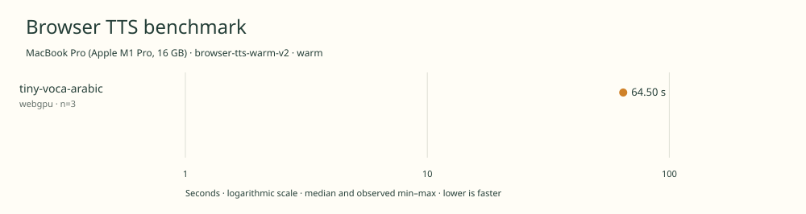

# 2026-11-23t08-06-09-230z-tiny-voca-arabic-webgpu-warm-4abbd0ea

MacBook Pro (Apple M1 Pro, 16 GB) · Apple M1 Pro · Google Chrome 157.0.8103.79

Protocol: **browser-tts-warm-v2**, scenario **warm**. Native harness run.

First source-chunk request through final CPU-readable PCM; excludes initialization, validation, hashing, WAV encoding and save. Optional articleCallPeakRssBytes spans the entire browser call including post-timer validation/export.

| Model | Requested backend | Status | Median | Min–max | Runs |
|---|---|---|---:|---:|---:|
| tiny-voca-arabic | webgpu | measured | 64.50 s | 64.33–64.56 s | 3 |

Additional metrics (median of available observations; scopes are distinct):

| Model | Backend | Metric | Median | Unit | n |
|---|---|---|---:|---|---:|
| tiny-voca-arabic | webgpu | First completed source chunk | 472.985 | ms | 3 |
| tiny-voca-arabic | webgpu | First PCM block | 470.760 | ms | 3 |
| tiny-voca-arabic | webgpu | Generated audio | 1728.475 | s | 3 |
| tiny-voca-arabic | webgpu | Generation / audio duration | 0.037 | ratio | 3 |

Model support (catalog capability, not coverage of this run):

| Model | Supported voices | Bundled voices | Languages | Tested voice |
|---|---:|---:|---|---|
| tiny-voca-arabic | 1 | 1 | 1 (ar) | a000 |

Experimental MSA profile with one synthetic a000 voice, 24 kHz mono, CATT v2 browser diacritization, and ar-article-v1. Latin-script text is stripped; no standalone English support.. Frontend audit: 129 spans, 339 utterances, max 194 tokens, zero unknown tokens/words; token/stress SHA-256 1f5bce0f95699c495b17ec67838ba5f3269bbd2fb631499ab40b26eebe8b3194. CATT runs CPU/WASM on both adapters; WebGPU capability applies only to the acoustic ONNX graph. Sources: [1](https://huggingface.co/oddadmix/tiny-voca-arabic/tree/e529f716965142f51835adc9e5661f224c3fa103), [2](https://huggingface.co/oddadmix/tiny-voca-arabic/blob/e529f716965142f51835adc9e5661f224c3fa103/README.md), [3](https://huggingface.co/spaces/oddadmix/tiny-voca-arabic/tree/64e3e2ae08f7553c38f280a58f05b955a0c296f4), [4](https://huggingface.co/datasets/oddadmix/msa-duplex-assistant-tts/tree/ace6ef2243b47f5152fa95c5c5a6b1db56a05ca2), [5](https://github.com/abjadai/catt/releases/tag/v2), [6](https://github.com/abjadai/catt/commit/8d5330499feb85f6625e6af632141ed2ed6065fd).

- **tiny-voca-arabic / webgpu**: Observed 840 hardware WebGPU acoustic graph dispatches; CATT remains CPU/WASM and frontend/readback work is CPU-side.

Capability checks run separately before timing. GPU dispatch does not imply GPU-exclusive execution.

Raw WAV is saved locally; opt-in audio publication is separate from timing and automatic result submission.

Campaign 2026-11-23T07-52-37-125Z-d70f7068be34; cell 2/4; source 16bdd280e2fa8296f6e9ecfcfd062bf0ec66a765; fixture ar-article-v1 (ar, 28275 JavaScript characters, 129 spans); requested n=3; effective n=3; Headed Google Chrome on Apple M1 Pro, disposable sequential profiles. Oddadmix’s released Arabic FP32 graph at step 104000, a000 voice index zero, neutral controls, stock sentence/fit, 120 ms inter-utterance gaps and per-span peak normalization. The original CATT v2 ED executes through single-thread CPU/WASM in both acoustic modes, with exact Python tokenizer and Arabic rules in Pyodide 0.26.4. ORT Web 1.20.1 supports acoustic CPU/WASM or Apple hardware WebGPU+WASM. The excluded warm-up populates the worker phrase cache. Cached resource observations begin with a fresh phrase cache.

Different protocols, fixtures, settings or machines must not be pooled into a speedup ranking. This report does not rate speech quality.
