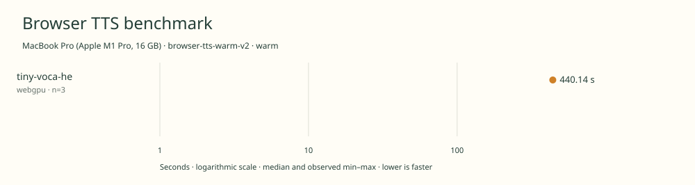

# 2026-11-23t10-21-45-420z-tiny-voca-he-webgpu-warm-a6ab48f0

MacBook Pro (Apple M1 Pro, 16 GB) · Apple M1 Pro · Google Chrome 157.0.8103.79

Protocol: **browser-tts-warm-v2**, scenario **warm**. Native harness run.

First source-chunk request through final CPU-readable PCM; excludes initialization, validation, hashing, WAV encoding and save. Optional articleCallPeakRssBytes spans the entire browser call including post-timer validation/export.

| Model | Requested backend | Status | Median | Min–max | Runs |
|---|---|---|---:|---:|---:|
| tiny-voca-he | webgpu | measured | 440.14 s | 440.06–440.24 s | 3 |

Additional metrics (median of available observations; scopes are distinct):

| Model | Backend | Metric | Median | Unit | n |
|---|---|---|---:|---|---:|
| tiny-voca-he | webgpu | First completed source chunk | 5256.055 | ms | 3 |
| tiny-voca-he | webgpu | First PCM block | 1204.130 | ms | 3 |
| tiny-voca-he | webgpu | Generated audio | 1120.715 | s | 3 |
| tiny-voca-he | webgpu | Generation / audio duration | 0.393 | ratio | 3 |

Model support (catalog capability, not coverage of this run):

| Model | Supported voices | Bundled voices | Languages | Tested voice |
|---|---:|---:|---|---|
| tiny-voca-he | 1 | 1 | 1 (he) | AH |

The Modern Hebrew profile uses he-article-v1 and the released AH voice at 24 kHz mono. RenikudPlus runs on CPU/WASM in both configurations. WebGPU applies to acoustic inference.. FP32 acoustic graph: 21,361,734 bytes. INT8 RenikudPlus G2P graph: 311,605,741 bytes. Combined model weights: 332,967,475 bytes. Independent browser frontend audit: 71 spans, 320 utterances, max 140, zero unknowns; full token/stress SHA-256 4bd0027e1c7429bca336b5dc7c79ea789fe996f7bf79ac37e0dfd6972a8db3d7. Sources: [1](https://github.com/buzagloidan/tiny-voca-he/tree/fdc9b3080984c94768239989391fbaddcf9b5519), [2](https://raw.githubusercontent.com/buzagloidan/tiny-voca-he/fdc9b3080984c94768239989391fbaddcf9b5519/models/he-v3/LICENSE), [3](https://huggingface.co/notmax123/RenikudPlus/tree/679c56ca449d41873fb8ff7711ddf7563d28198f), [4](https://pypi.org/project/renikud-plus/0.6.0/), [5](https://pypi.org/project/hebrew-num2words/0.1.0/), [6](https://github.com/maxmelichov/RenikudPlus/blob/93a82fad122207f9dc38105ceb5068e98d00f092/pyproject.toml).

- **tiny-voca-he / webgpu**: Observed 3360 hardware dispatches in the acoustic ONNX graph. RenikudPlus runs CPU/WASM.

Capability checks run separately before timing. GPU dispatch does not imply GPU-exclusive execution.

Raw WAV is saved locally; opt-in audio publication is separate from timing and automatic result submission.

Campaign 2026-11-23T09-51-56-767Z-ea71b6c236bd; cell 2/4; source a1aee0484c7096728d9512c1203a9d26123f7247; fixture he-article-v1 (he, 15513 JavaScript characters, 71 spans); requested n=3; effective n=3; Headed Google Chrome on Apple M1 Pro with AC power and disposable sequential profiles. Released tiny-voca-he he-v3 FP32 acoustic graph at step 104000 with AH/index zero, speed 1, neutral pitch, original sentence/140-token fit, and a completed-span peak cap. RenikudPlus INT8 ONNX G2P uses CPU/WASM on both paths with the stock 0.6.0 exact MAP decoder, niqqud strip, speaker and target zero and HebrewNum2Words 0.1.0 in Pyodide. Every source span includes live phonemization. The acoustic graph uses ONNX Runtime Web 1.20.1 CPU/WASM or hardware Apple WebGPU+WASM.

Different protocols, fixtures, settings or machines must not be pooled into a speedup ranking. This report does not rate speech quality.
