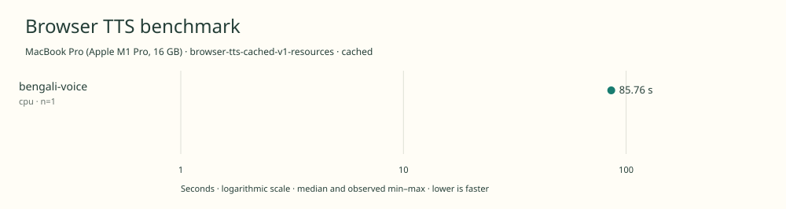

# 2026-11-23t12-28-36-269z-bengali-voice-cpu-cached-bfe96b97

MacBook Pro (Apple M1 Pro, 16 GB) · Apple M1 Pro · Google Chrome 157.0.8103.79

Protocol: **browser-tts-cached-v1-resources**, scenario **cached**. Native harness run.

First source-chunk request through final CPU-readable PCM; excludes initialization, validation, hashing, WAV encoding and save. Optional articleCallPeakRssBytes spans the entire browser call including post-timer validation/export. Generation RSS uses timestamped samples inside browser generation start/end boundaries; it includes the owned Chrome process tree and browser baseline.

| Model | Requested backend | Status | Median | Min–max | Runs |
|---|---|---|---:|---:|---:|
| bengali-voice | cpu | measured | 85.76 s | 85.76–85.76 s | 1 |

Additional metrics (median of available observations; scopes are distinct):

| Model | Backend | Metric | Median | Unit | n |
|---|---|---|---:|---|---:|
| bengali-voice | cpu | First completed source chunk | 1116.125 | ms | 1 |
| bengali-voice | cpu | First PCM block | 1116.065 | ms | 1 |
| bengali-voice | cpu | Generated audio | 1381.237 | s | 1 |
| bengali-voice | cpu | Generation / audio duration | 0.062 | ratio | 1 |
| bengali-voice | cpu | Model initialization | 794.997 | ms | 1 |
| bengali-voice | cpu | Complete controller trial including setup/export | 90756.214 | ms | 1 |
| bengali-voice | cpu | Transferred HTTP body data | 91436 | bytes | 1 |
| bengali-voice | cpu | Ideal body transfer at 1 Mbps | 0.731 | s | 1 |
| bengali-voice | cpu | Whole-call Chrome process-tree peak RSS | 1816985600 | bytes | 1 |
| bengali-voice | cpu | Per-trial mean generation Chrome process-tree RSS | 1323757038 | bytes | 1 |
| bengali-voice | cpu | In-window Chrome RSS observations | 170.000 | samples | 1 |

Model support (catalog capability, not coverage of this run):

| Model | Supported voices | Bundled voices | Languages | Tested voice |
|---|---:|---:|---|---|
| bengali-voice | 1 | 1 | 1 (bn) | Jahnavi (voice index zero) |

Pinned Hansda/bengali-voice-compact INT8 checkpoint at voice index zero \(Jahnavi\). The same Bengali synthesis frontend accepts native Bengali and Roman Bengali input. The broader multilingual-browser-tts family and other checkpoints are outside this registration.. Tested Bengali-script fixture bn-article-v1 and ASCII Roman-input fixture bn-latn-article-v1 are separate editions. Report only one supported spoken language \(bn\); bn-Latn describes an input script, not a separate synthesized language. The benchmark fixes the deployed demo voice index zero and does not claim a generated-audio redistribution license. Sources: [1](https://huggingface.co/Hansda/bengali-voice-compact/tree/18c8afbee3a4cf230e175a5f618350ed2c9560ac), [2](https://github.com/DarvinX/multilingual-browser-tts/tree/f2977727b8baccb989f80b492ea8da00124ecba3), [3](https://huggingface.co/datasets/Hansda/bengali-maya2-jahnavi-20h), [4](https://github.com/google/language-resources/tree/a90601024f07ab7e96c911243324e0adeb16da96/bn), [5](https://onnxruntime.ai/docs/get-started/with-javascript/web.html), [6](https://tts.hansda.in/?lang=bn).

- **bengali-voice / cpu**: ONNX Runtime Web 1.24.3 single-thread SIMD WASM CPU route; executionProviders=[wasm].

Capability checks run separately before timing. GPU dispatch does not imply GPU-exclusive execution.

Raw WAV is saved locally; opt-in audio publication is separate from timing and automatic result submission.

Campaign 2026-11-23T12-22-43-872Z-a23d04fcaab4; cell 2/2; source 0919d332331f48b438dbb2c03bb46a7dbd0aaa27; fixture bn-article-v1 (bn, 19455 JavaScript characters, 89 spans); requested n=1; effective n=1; Headed Google Chrome on Apple M1 Pro with AC power and disposable sequential profiles. Bengali Voice compact-int8 with the Jahnavi voice at 24 kHz, default speed and pitch. Grouped INT8 storage is expanded to FP32 acoustic weights. ONNX Runtime Web 1.24.3 CPU/WASM, one thread, for both the acoustic graph and optional trained Bengali G2P. Uses the publisher frontend, phoneme limit, within-worker OOV cache and span-level waveform checks. Article input is in Bengali script. The unmodified graph was not qualified for hardware WebGPU.

RSS is sampled every 500 ms across the owned Chrome process tree, including the Chrome baseline and inference workers. Whole-call peak spans post-timer validation/export; generation mean uses only in-window samples from browser generation start through final CPU-readable PCM.

Different protocols, fixtures, settings or machines must not be pooled into a speedup ranking. This report does not rate speech quality.
