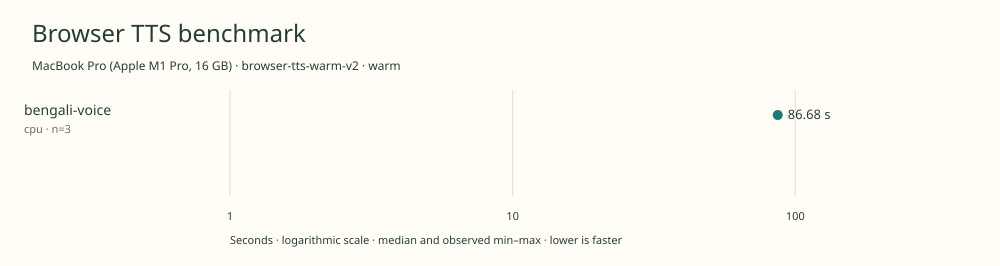

# 2026-11-23t12-30-20-932z-bengali-voice-cpu-warm-22000b7b

MacBook Pro (Apple M1 Pro, 16 GB) · Apple M1 Pro · Google Chrome 157.0.8103.79

Protocol: **browser-tts-warm-v2**, scenario **warm**. Native harness run.

First source-chunk request through final CPU-readable PCM; excludes initialization, validation, hashing, WAV encoding and save. Optional articleCallPeakRssBytes spans the entire browser call including post-timer validation/export.

| Model | Requested backend | Status | Median | Min–max | Runs |
|---|---|---|---:|---:|---:|
| bengali-voice | cpu | measured | 86.68 s | 86.67–86.76 s | 3 |

Additional metrics (median of available observations; scopes are distinct):

| Model | Backend | Metric | Median | Unit | n |
|---|---|---|---:|---|---:|
| bengali-voice | cpu | First completed source chunk | 920.695 | ms | 3 |
| bengali-voice | cpu | First PCM block | 920.615 | ms | 3 |
| bengali-voice | cpu | Generated audio | 1403.957 | s | 3 |
| bengali-voice | cpu | Generation / audio duration | 0.062 | ratio | 3 |

Model support (catalog capability, not coverage of this run):

| Model | Supported voices | Bundled voices | Languages | Tested voice |
|---|---:|---:|---|---|
| bengali-voice | 1 | 1 | 1 (bn) | Jahnavi (voice index zero) |

Pinned Hansda/bengali-voice-compact INT8 checkpoint at voice index zero \(Jahnavi\). The same Bengali synthesis frontend accepts native Bengali and Roman Bengali input. The broader multilingual-browser-tts family and other checkpoints are outside this registration.. Tested Bengali-script fixture bn-article-v1 and ASCII Roman-input fixture bn-latn-article-v1 are separate editions. Report only one supported spoken language \(bn\); bn-Latn describes an input script, not a separate synthesized language. The benchmark fixes the deployed demo voice index zero and does not claim a generated-audio redistribution license. Sources: [1](https://huggingface.co/Hansda/bengali-voice-compact/tree/18c8afbee3a4cf230e175a5f618350ed2c9560ac), [2](https://github.com/DarvinX/multilingual-browser-tts/tree/f2977727b8baccb989f80b492ea8da00124ecba3), [3](https://huggingface.co/datasets/Hansda/bengali-maya2-jahnavi-20h), [4](https://github.com/google/language-resources/tree/a90601024f07ab7e96c911243324e0adeb16da96/bn), [5](https://onnxruntime.ai/docs/get-started/with-javascript/web.html), [6](https://tts.hansda.in/?lang=bn).

- **bengali-voice / cpu**: ONNX Runtime Web 1.24.3 single-thread SIMD WASM CPU route; executionProviders=[wasm].

Capability checks run separately before timing. GPU dispatch does not imply GPU-exclusive execution.

Raw WAV is saved locally; opt-in audio publication is separate from timing and automatic result submission.

Campaign 2026-11-23T12-30-20-363Z-c34f70aba03b; cell 1/2; source 0919d332331f48b438dbb2c03bb46a7dbd0aaa27; fixture bn-latn-article-v1 (bn-Latn, 22055 JavaScript characters, 101 spans); requested n=3; effective n=3; Headed Google Chrome on Apple M1 Pro with AC power and disposable sequential profiles. Bengali Voice compact-int8 with the Jahnavi voice at 24 kHz, default speed and pitch. Grouped INT8 storage is expanded to FP32 acoustic weights. ONNX Runtime Web 1.24.3 CPU/WASM, one thread, for both the acoustic graph and optional trained Bengali G2P. Uses the publisher frontend, phoneme limit, within-worker OOV cache and span-level waveform checks. Article input is in ASCII Romanized Bengali. The unmodified graph was not qualified for hardware WebGPU.

Different protocols, fixtures, settings or machines must not be pooled into a speedup ranking. This report does not rate speech quality.
