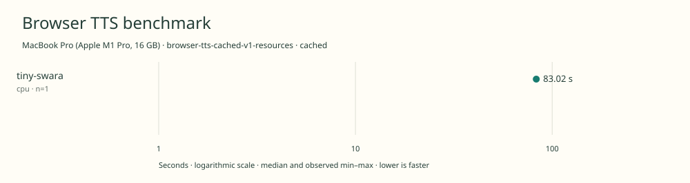

# 2026-11-23t13-38-07-074z-tiny-swara-cpu-cached-ba279a6a

MacBook Pro (Apple M1 Pro, 16 GB) · Apple M1 Pro · Google Chrome 157.0.8103.79

Protocol: **browser-tts-cached-v1-resources**, scenario **cached**. Native harness run.

First source-chunk request through final CPU-readable PCM; excludes initialization, validation, hashing, WAV encoding and save. Optional articleCallPeakRssBytes spans the entire browser call including post-timer validation/export. Generation RSS uses timestamped samples inside browser generation start/end boundaries; it includes the owned Chrome process tree and browser baseline.

| Model | Requested backend | Status | Median | Min–max | Runs |
|---|---|---|---:|---:|---:|
| tiny-swara | cpu | measured | 83.02 s | 83.02–83.02 s | 1 |

Additional metrics (median of available observations; scopes are distinct):

| Model | Backend | Metric | Median | Unit | n |
|---|---|---|---:|---|---:|
| tiny-swara | cpu | First completed source chunk | 1046.680 | ms | 1 |
| tiny-swara | cpu | First PCM block | 324.195 | ms | 1 |
| tiny-swara | cpu | Generated audio | 1575.851 | s | 1 |
| tiny-swara | cpu | Generation / audio duration | 0.053 | ratio | 1 |
| tiny-swara | cpu | Model initialization | 748.664 | ms | 1 |
| tiny-swara | cpu | Complete controller trial including setup/export | 88376.875 | ms | 1 |
| tiny-swara | cpu | Transferred HTTP body data | 91544 | bytes | 1 |
| tiny-swara | cpu | Ideal body transfer at 1 Mbps | 0.732 | s | 1 |
| tiny-swara | cpu | Whole-call Chrome process-tree peak RSS | 1990721536 | bytes | 1 |
| tiny-swara | cpu | Per-trial mean generation Chrome process-tree RSS | 1313783510 | bytes | 1 |
| tiny-swara | cpu | In-window Chrome RSS observations | 165.000 | samples | 1 |

Model support (catalog capability, not coverage of this run):

| Model | Supported voices | Bundled voices | Languages | Tested voice |
|---|---:|---:|---|---|
| tiny-swara | 2 | 2 | 1 (bn) | BF |

Pinned Bengali checkpoint only. BF/index 0 is the benchmark default; BM/index 1 is the alternate bundled voice. Latin code-mix routes are frontend behavior, not additional supported model languages.. The pinned Bengali fixture frontend oracle covers 89 spans and 305 sentence plans, maximum 220 tokens, 2,908 primary-stress marks and zero unknown phones. This is a text frontend audit, not a pronunciation review. Config frontend fingerprint 54cece4f… differs from the complete release inventory fingerprint 9b2e2c14… because the latter adds code-mix fallback entries; native fixture token/stress outputs match. The graph includes RandomNormalLike, so repeated PCM is stochastic. Model card requests Rasa attribution/terms for redistributed derived audio. Sources: [1](https://huggingface.co/Xeven7/tiny-swara/tree/9432a340c46249c8acae4ff4b062d46b9cbd1991), [2](https://github.com/espeak-ng/espeak-ng/tree/4870adfa25b1a32b4361592f1be8a40337c58d6c), [3](https://github.com/microsoft/onnxruntime/tree/v1.31.1), [4](https://huggingface.co/datasets/ai4bharat/Rasa).

- **tiny-swara / cpu**: ONNX Runtime Web 1.31.1 uses explicit single-thread WASM; Bengali normalization and eSpeak NG phonemization run locally.

Capability checks run separately before timing. GPU dispatch does not imply GPU-exclusive execution.

Raw WAV is saved locally; opt-in audio publication is separate from timing and automatic result submission.

Campaign 2026-11-23T13-27-15-873Z-f18c2c264537; cell 3/4; source 680bbce8b9fe50c383ba4c86ea2997c9b749d77c; fixture bn-article-v1 (bn, 19455 JavaScript characters, 89 spans); requested n=1; effective n=1; Headed Google Chrome on Apple M1 Pro under AC power; sequential disposable profiles. Xeven7 Tiny Swara release default INT8 graph, BF/index zero, 24 kHz, speed 1, pitch shift 0, pitch range 1. Exact released Bengali frontend and pinned eSpeak NG 1.52.0 WASM executing live within each article, with original sentence splitting, 0.9 per-sentence peak normalization, and no inserted gap. Same ONNX Runtime Web 1.31.1 version on both routes: one CPU/WASM thread or hardware Apple WebGPU+WASM with explicit synchronized readback.

RSS is sampled every 500 ms across the owned Chrome process tree, including the Chrome baseline and inference workers. Whole-call peak spans post-timer validation/export; generation mean uses only in-window samples from browser generation start through final CPU-readable PCM.

Different protocols, fixtures, settings or machines must not be pooled into a speedup ranking. This report does not rate speech quality.
