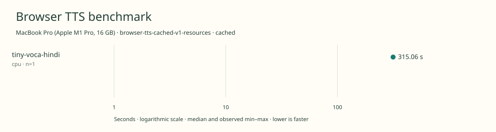

# 2026-11-23t14-42-40-520z-tiny-voca-hindi-cpu-cached-9e823ef0

MacBook Pro (Apple M1 Pro, 16 GB) · Apple M1 Pro · Google Chrome 157.0.8103.79

Protocol: **browser-tts-cached-v1-resources**, scenario **cached**. Native harness run.

First source-chunk request through final CPU-readable PCM; excludes initialization, validation, hashing, WAV encoding and save. Optional articleCallPeakRssBytes spans the entire browser call including post-timer validation/export. Generation RSS uses timestamped samples inside browser generation start/end boundaries; it includes the owned Chrome process tree and browser baseline.

| Model | Requested backend | Status | Median | Min–max | Runs |
|---|---|---|---:|---:|---:|
| tiny-voca-hindi | cpu | measured | 315.06 s | 315.06–315.06 s | 1 |

Additional metrics (median of available observations; scopes are distinct):

| Model | Backend | Metric | Median | Unit | n |
|---|---|---|---:|---|---:|
| tiny-voca-hindi | cpu | First completed source chunk | 4045.600 | ms | 1 |
| tiny-voca-hindi | cpu | First PCM block | 4045.530 | ms | 1 |
| tiny-voca-hindi | cpu | Generated audio | 1663.317 | s | 1 |
| tiny-voca-hindi | cpu | Generation / audio duration | 0.189 | ratio | 1 |
| tiny-voca-hindi | cpu | Model initialization | 51.687 | ms | 1 |
| tiny-voca-hindi | cpu | Complete controller trial including setup/export | 319963.479 | ms | 1 |
| tiny-voca-hindi | cpu | Transferred HTTP body data | 92484 | bytes | 1 |
| tiny-voca-hindi | cpu | Ideal body transfer at 1 Mbps | 0.740 | s | 1 |
| tiny-voca-hindi | cpu | Whole-call Chrome process-tree peak RSS | 1654784000 | bytes | 1 |
| tiny-voca-hindi | cpu | Per-trial mean generation Chrome process-tree RSS | 902362911 | bytes | 1 |
| tiny-voca-hindi | cpu | In-window Chrome RSS observations | 627.000 | samples | 1 |

Model support (catalog capability, not coverage of this run):

| Model | Supported voices | Bundled voices | Languages | Tested voice |
|---|---:|---:|---|---|
| tiny-voca-hindi | 1 | 1 | 1 (hi) | Rasa female |

Pinned RL10x/tiny-voca-hindi Q8\_0 GGUF at the exact release revision. Hindi \(hi-IN\), one Rasa-trained female voice, 24 kHz, and hi-article-v1 only. The benchmark fixes the neutral style/index zero; the eight style IDs are neutral, conv, happy, sad, anger, fear, surprise, and disgust. CPU/WASM only; WebGPU is unsupported.. The checkpoint contains 205 GGUF v3 tensors and 9,711,883 tensor elements. Independent fixture frontend coverage: hi-article-v1 has 91 spans, 322 sentence plans, maximum 170 tokens, zero unknown tokens and zero skipped sentences \(403 nasal tokens\). The browser adapter imports the pinned hindi\_norm.js with english:true and changes danda to period before synthesis. English controls are not an eligible route: the released normalizer respells only some words and unknown English words can be dropped. Use the Devanagari fixture. The benchmark audio credits RL10x, the AI4Bharat Rasa dataset, and the browser adaptation. Sources: [1](https://huggingface.co/RL10x/tiny-voca-hindi/tree/b76940f5edbc9c4ca2c7c8cf29f20897ff3339fe), [2](https://huggingface.co/RL10x/tiny-voca-hindi/blob/b76940f5edbc9c4ca2c7c8cf29f20897ff3339fe/README.md), [3](https://huggingface.co/RL10x/tiny-voca-hindi/blob/b76940f5edbc9c4ca2c7c8cf29f20897ff3339fe/NOTICE), [4](https://huggingface.co/datasets/ai4bharat/Rasa), [5](https://github.com/ggml-org/ggml/tree/57e2c2ca2a7cae756b1c4dfafa0cdfef9051d234).

- **tiny-voca-hindi / cpu**: CPU/WASM only; no GPU provider is available in the pinned runtime.

Capability checks run separately before timing. GPU dispatch does not imply GPU-exclusive execution.

Raw WAV is saved locally; opt-in audio publication is separate from timing and automatic result submission.

Campaign 2026-11-23T14-21-32-258Z-947f9e201b72; cell 2/2; source a66c124f6c100b246510469c4a6af0fb302c13d3; fixture hi-article-v1 (hi, 19885 JavaScript characters, 91 spans); requested n=1; effective n=1; Headed Google Chrome on Apple M1 Pro under AC power with sequential disposable profiles. Exact RL10x Tiny Voca Hindi Q8_0 GGUF with the neutral style at index zero, speed 1, default pitch limiter 1.6, seed 0 per span and 24 kHz. The released Hindi normalizer and Devanagari C++ frontend run live within each measured span. The publisher model uses ggml 0.29.0 compiled for SIMD WebAssembly and one CPU thread, with original sentence splitting, ordinal seed increments, no gaps and a single 0.99 peak ceiling per span.

RSS is sampled every 500 ms across the owned Chrome process tree, including the Chrome baseline and inference workers. Whole-call peak spans post-timer validation/export; generation mean uses only in-window samples from browser generation start through final CPU-readable PCM.

Different protocols, fixtures, settings or machines must not be pooled into a speedup ranking. This report does not rate speech quality.
