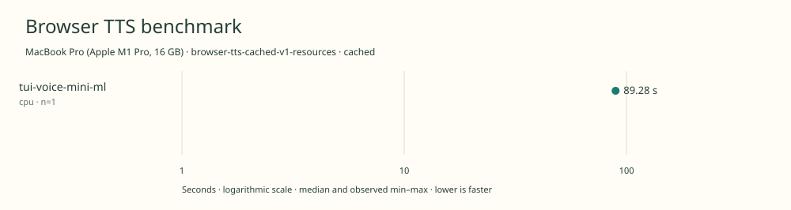

# 2026-11-23t15-46-19-544z-tui-voice-mini-ml-cpu-cached-457bf385

MacBook Pro (Apple M1 Pro, 16 GB) · Apple M1 Pro · Google Chrome 157.0.8103.79

Protocol: **browser-tts-cached-v1-resources**, scenario **cached**. Native harness run.

First source-chunk request through final CPU-readable PCM; excludes initialization, validation, hashing, WAV encoding and save. Optional articleCallPeakRssBytes spans the entire browser call including post-timer validation/export. Generation RSS uses timestamped samples inside browser generation start/end boundaries; it includes the owned Chrome process tree and browser baseline.

| Model | Requested backend | Status | Median | Min–max | Runs |
|---|---|---|---:|---:|---:|
| tui-voice-mini-ml | cpu | measured | 89.28 s | 89.28–89.28 s | 1 |

Additional metrics (median of available observations; scopes are distinct):

| Model | Backend | Metric | Median | Unit | n |
|---|---|---|---:|---|---:|
| tui-voice-mini-ml | cpu | First completed source chunk | 981.255 | ms | 1 |
| tui-voice-mini-ml | cpu | First PCM block | 981.205 | ms | 1 |
| tui-voice-mini-ml | cpu | Generated audio | 1373.184 | s | 1 |
| tui-voice-mini-ml | cpu | Generation / audio duration | 0.065 | ratio | 1 |
| tui-voice-mini-ml | cpu | Model initialization | 783.526 | ms | 1 |
| tui-voice-mini-ml | cpu | Complete controller trial including setup/export | 94194.188 | ms | 1 |
| tui-voice-mini-ml | cpu | Transferred HTTP body data | 108641 | bytes | 1 |
| tui-voice-mini-ml | cpu | Ideal body transfer at 1 Mbps | 0.869 | s | 1 |
| tui-voice-mini-ml | cpu | Whole-call Chrome process-tree peak RSS | 1642692608 | bytes | 1 |
| tui-voice-mini-ml | cpu | Per-trial mean generation Chrome process-tree RSS | 1256274117 | bytes | 1 |
| tui-voice-mini-ml | cpu | In-window Chrome RSS observations | 177.000 | samples | 1 |

Model support (catalog capability, not coverage of this run):

| Model | Supported voices | Bundled voices | Languages | Tested voice |
|---|---:|---:|---|---|
| tui-voice-mini-ml | 1 | 1 | 1 (ml) | F2 |

Pinned Cyrax321/tui-voice-mini-ml checkpoint with F2, the speaker with Malayalam metadata. 24 kHz mono.. The publisher reports 4,537,291 parameters. The pinned config declares a Dizione fingerprint, while the qualified benchmark route uses the documented eSpeak NG 1.51 ml frontend and published 76-slot phone plan; these are reported separately. Independent fixture smoke audit: 105 spans, 461 source clauses, maximum 232 tokens, 53 phones, 914 published merge emissions, no unplanned phones, no unknown tokens, and normalized/token-ID/combined digests pinned in the adapter profile. Parent qualification observed matching native traces and finite nonzero FP32 PCM on CPU/WASM and hardware WebGPU+WASM; this is qualification evidence, not a timing score. No native-speaker review or recording release is claimed. Sources: [1](https://huggingface.co/Cyrax321/tui-voice-mini-ml/blob/9c2fee75373d81bbd62fbe2d683b1bad3c4415ea/README.md), [2](https://github.com/Cyrax321/tui-voice/tree/478761a10399c357e9ccc5380145906167e4d655), [3](https://huggingface.co/datasets/ai4bharat/Rasa/tree/632f55c7ac590219d41cd7adffce5b440e4604f5), [4](https://github.com/espeak-ng/espeak-ng/tree/2e9a5fccbb0095e87b2769e9249ea1f821918ecd), [5](https://registry.npmjs.org/onnxruntime-web/-/onnxruntime-web-1.31.1.tgz).

- **tui-voice-mini-ml / cpu**: Explicit ONNX Runtime Web 1.31.1 single-thread WASM provider.

Capability checks run separately before timing. GPU dispatch does not imply GPU-exclusive execution.

Raw WAV is saved locally; opt-in audio publication is separate from timing and automatic result submission.

Campaign 2026-11-23T15-38-31-411Z-b9fab7be12e7; cell 3/4; source 0c5a1a00e43aaa0976a98425a3f82f5fe0a4c4ce; fixture ml-article-v1 (ml, 23011 JavaScript characters, 105 spans); requested n=1; effective n=1; Headed Google Chrome on Apple M1 Pro under AC power and sequential disposable profiles. Pinned v0.1-preview FP32 browser ONNX and Malayalam F2/index zero, one source span per ONNX call, eSpeak NG 1.51 Malayalam and the published 76-slot mapping, zero stress, 24 kHz, speed 1, pitch shift 0.15, pitch range 0.85, no inserted gaps. ONNX Runtime Web 1.31.1 on both routes, one WASM thread or Apple hardware WebGPU plus WASM asyncify and synchronized CPU PCM readback. Released graph contains stochastic noise.

RSS is sampled every 500 ms across the owned Chrome process tree, including the Chrome baseline and inference workers. Whole-call peak spans post-timer validation/export; generation mean uses only in-window samples from browser generation start through final CPU-readable PCM.

Different protocols, fixtures, settings or machines must not be pooled into a speedup ranking. This report does not rate speech quality.
