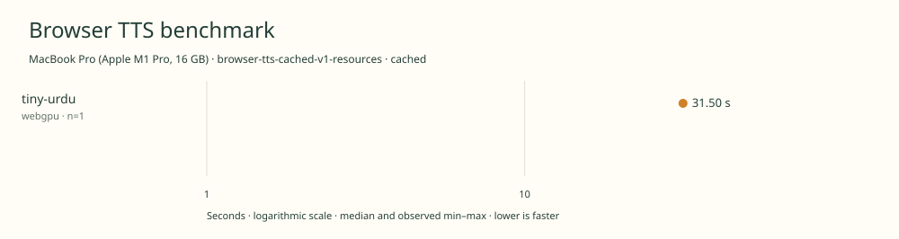

# 2026-11-23t16-34-15-251z-tiny-urdu-webgpu-cached-faf31c2f

MacBook Pro (Apple M1 Pro, 16 GB) · Apple M1 Pro · Google Chrome 157.0.8103.79

Protocol: **browser-tts-cached-v1-resources**, scenario **cached**. Native harness run.

First source-chunk request through final CPU-readable PCM; excludes initialization, validation, hashing, WAV encoding and save. Optional articleCallPeakRssBytes spans the entire browser call including post-timer validation/export. Generation RSS uses timestamped samples inside browser generation start/end boundaries; it includes the owned Chrome process tree and browser baseline.

| Model | Requested backend | Status | Median | Min–max | Runs |
|---|---|---|---:|---:|---:|
| tiny-urdu | webgpu | measured | 31.50 s | 31.50–31.50 s | 1 |

Additional metrics (median of available observations; scopes are distinct):

| Model | Backend | Metric | Median | Unit | n |
|---|---|---|---:|---|---:|
| tiny-urdu | webgpu | First completed source chunk | 503.000 | ms | 1 |
| tiny-urdu | webgpu | First PCM block | 249.430 | ms | 1 |
| tiny-urdu | webgpu | Generated audio | 1511.141 | s | 1 |
| tiny-urdu | webgpu | Generation / audio duration | 0.021 | ratio | 1 |
| tiny-urdu | webgpu | Model initialization | 1175.363 | ms | 1 |
| tiny-urdu | webgpu | Complete controller trial including setup/export | 37337.914 | ms | 1 |
| tiny-urdu | webgpu | Transferred HTTP body data | 68202 | bytes | 1 |
| tiny-urdu | webgpu | Ideal body transfer at 1 Mbps | 0.546 | s | 1 |
| tiny-urdu | webgpu | Whole-call Chrome process-tree peak RSS | 2477408256 | bytes | 1 |
| tiny-urdu | webgpu | Per-trial mean generation Chrome process-tree RSS | 2062644653 | bytes | 1 |
| tiny-urdu | webgpu | In-window Chrome RSS observations | 62.000 | samples | 1 |

Model support (catalog capability, not coverage of this run):

| Model | Supported voices | Bundled voices | Languages | Tested voice |
|---|---:|---:|---|---|
| tiny-urdu | 1 | 1 | 1 (ur) | M2 |

Pinned zafar205/tiny-urdu-tts-4.5-million-parameters checkpoint, Roman Urdu input \(ur-Latn\), Urdu speech, M2/index 1, 24 kHz mono FP32.. The model card reports 4.5 million parameters; the registered exact count is the 4,545,739 logical scalar values across pinned ONNX initializer tensor shapes, including any graph constants, and is not asserted as a trainable-only count. The stock frontend audit covers ur-latn-article-v1: 103 ordered spans, 319 utterances, maximum 177 tokens, zero unknown token IDs, zero nonzero stress values, digest ef4562f72d6725d8f5a9b2a50644e914bcdd1b768b2baaffb38e64e57e5f9161. Roman Urdu uses Urdu phonemizer rules; common English loanwords are read with those Urdu rules, not as an English route. Urdu-script input is unsupported. Independent headed Chrome qualification tested stock 1.17.3 CPU and matched 1.31.1 CPU/WebGPU settings; the registered adapter uses 1.31.1 on both backends. Sources: [1](https://huggingface.co/zafar205/tiny-urdu-tts-4.5-million-parameters/tree/4fe6566118972ea0d44b517f413191e0e30f5880), [2](https://huggingface.co/zafar205/tiny-urdu-tts-4.5-million-parameters/blob/4fe6566118972ea0d44b517f413191e0e30f5880/README.md), [3](https://github.com/Zafar205/tiny-urdu/tree/5770756e05f33591eab29498a47f6644664beae7), [4](https://github.com/Zafar205/tiny-urdu/blob/5770756e05f33591eab29498a47f6644664beae7/web/lib/urdu.ts), [5](https://huggingface.co/datasets/kaab4321/UrduTTS/tree/f5c50b7aaabd4325bfe33617232203ad02e30f97), [6](https://github.com/microsoft/onnxruntime/tree/v1.31.1).

- **tiny-urdu / webgpu**: Observed 835 WebGPU compute dispatches during the untimed Tiny Urdu probe. ONNX Runtime Web may use WASM for unsupported operators.

Capability checks run separately before timing. GPU dispatch does not imply GPU-exclusive execution.

Raw WAV is saved locally; opt-in audio publication is separate from timing and automatic result submission.

Campaign 2026-11-23T16-25-32-219Z-98f5a9c7732d; cell 4/4; source 54408783d9ba80b002a90ebb8106bb03ba43176f; fixture ur-latn-article-v1 (ur-Latn, 22486 JavaScript characters, 103 spans); requested n=1; effective n=1; Headed Google Chrome on Apple M1 Pro under AC power and sequential disposable profiles. Exact original Tiny Urdu FP32 browser graph, M2/index one, speed 1, pitch shift zero, range one, 24 kHz. Original pinned Roman Urdu TypeScript port compiled by erasing types, stock punctuation sentence splitting and recursive 500-token fit, a 150 ms inter-utterance gap within each source span, stock 0.99 span peak cap. ONNX Runtime Web 1.31.1 on both routes, one WASM thread or Apple hardware WebGPU plus WASM asyncify with synchronized CPU PCM readback, stock basic graph optimization with CPU arena and memory pattern disabled.

RSS is sampled every 500 ms across the owned Chrome process tree, including the Chrome baseline and inference workers. Whole-call peak spans post-timer validation/export; generation mean uses only in-window samples from browser generation start through final CPU-readable PCM.

Different protocols, fixtures, settings or machines must not be pooled into a speedup ranking. This report does not rate speech quality.
