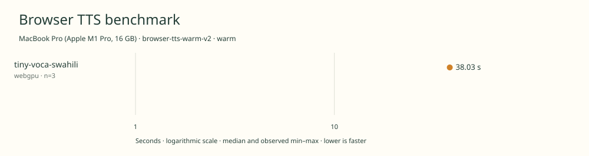

# 2026-11-23t17-22-45-151z-tiny-voca-swahili-webgpu-warm-322bcfcb

MacBook Pro (Apple M1 Pro, 16 GB) · Apple M1 Pro · Google Chrome 157.0.8103.79

Protocol: **browser-tts-warm-v2**, scenario **warm**. Native harness run.

First source-chunk request through final CPU-readable PCM; excludes initialization, validation, hashing, WAV encoding and save. Optional articleCallPeakRssBytes spans the entire browser call including post-timer validation/export.

| Model | Requested backend | Status | Median | Min–max | Runs |
|---|---|---|---:|---:|---:|
| tiny-voca-swahili | webgpu | measured | 38.03 s | 37.93–38.08 s | 3 |

Additional metrics (median of available observations; scopes are distinct):

| Model | Backend | Metric | Median | Unit | n |
|---|---|---|---:|---|---:|
| tiny-voca-swahili | webgpu | First completed source chunk | 326.405 | ms | 3 |
| tiny-voca-swahili | webgpu | First PCM block | 141.180 | ms | 3 |
| tiny-voca-swahili | webgpu | Generated audio | 2321.163 | s | 3 |
| tiny-voca-swahili | webgpu | Generation / audio duration | 0.016 | ratio | 3 |

Model support (catalog capability, not coverage of this run):

| Model | Supported voices | Bundled voices | Languages | Tested voice |
|---|---:|---:|---|---|
| tiny-voca-swahili | 7 | 7 | 1 (sw) | WAXAL speaker 1 (speaker ID 1) |

Pinned tiny-voca Kiswahili 55k FP32 checkpoint; sw text, WAXAL speaker ID 1 at graph voice index 0, 24 kHz mono.. The benchmark implements the publisher’s documented Kiswahili letter-to-phone rules independently. All four published sentence token and stress vectors match exactly. Pronunciation outside those examples is approximate. The fixture audit covers 109 spans and 341 sentence calls, up to 212 tokens per call, with zero unknown IDs and full non-whitespace input coverage. Clips are shared under CC BY-SA 4.0. Sources: [1](https://huggingface.co/adoamesh/tiny-voca-swahili/tree/408b7b783b0c77ed66030521f8cec88f5c6d6e2b), [2](https://huggingface.co/adoamesh/tiny-voca-swahili/blob/408b7b783b0c77ed66030521f8cec88f5c6d6e2b/README.md), [3](https://huggingface.co/datasets/google/WaxalNLP/tree/5f4d8ca24f2b9d168b2ee545f1febaaff4b40580), [4](https://github.com/n4ze3m/tiny-voca).

- **tiny-voca-swahili / webgpu**: Observed 770 hardware WebGPU compute dispatches in an untimed probe; WASM remains an explicit fallback for unsupported graph operators.

Capability checks run separately before timing. GPU dispatch does not imply GPU-exclusive execution.

Raw WAV is saved locally; opt-in audio publication is separate from timing and automatic result submission.

Campaign 2026-11-23T17-14-17-113Z-1c1e820b74ff; cell 2/4; source ac0cebd561863f8bb27411b6d01453fe99c842a1; fixture sw-article-v1 (sw, 23917 JavaScript characters, 109 spans); requested n=3; effective n=3; Headed Google Chrome on Apple M1 Pro and AC power with sequential disposable profiles. Exact published Tiny Voca Kiswahili FP32 graph from revision 408b7b783b0c77ed66030521f8cec88f5c6d6e2b, speaker 1/index zero, speed 1, pitch shift zero, pitch range 1, 24 kHz. The benchmark-owned Swahili frontend matches the four publisher reference token and stress vectors. Source-order sentence audio uses the original untrimmed PCM and no inserted pauses. ONNX Runtime Web 1.31.1 on both routes, one WASM thread, CPU or verified Apple hardware WebGPU plus WASM asyncify, graph optimization all, synchronized CPU PCM readback.

Different protocols, fixtures, settings or machines must not be pooled into a speedup ranking. This report does not rate speech quality.
