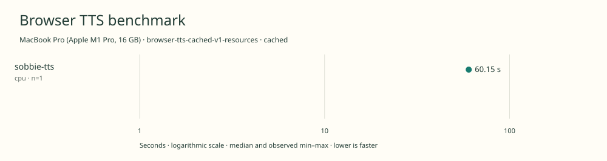

# 2026-11-23t17-49-52-453z-sobbie-tts-cpu-cached-a50fa7d2

MacBook Pro (Apple M1 Pro, 16 GB) · Apple M1 Pro · Google Chrome 157.0.8103.79

Protocol: **browser-tts-cached-v1-resources**, scenario **cached**. Native harness run.

First source-chunk request through final CPU-readable PCM; excludes initialization, validation, hashing, WAV encoding and save. Optional articleCallPeakRssBytes spans the entire browser call including post-timer validation/export. Generation RSS uses timestamped samples inside browser generation start/end boundaries; it includes the owned Chrome process tree and browser baseline.

| Model | Requested backend | Status | Median | Min–max | Runs |
|---|---|---|---:|---:|---:|
| sobbie-tts | cpu | measured | 60.15 s | 60.15–60.15 s | 1 |

Additional metrics (median of available observations; scopes are distinct):

| Model | Backend | Metric | Median | Unit | n |
|---|---|---|---:|---|---:|
| sobbie-tts | cpu | First completed source chunk | 698.615 | ms | 1 |
| sobbie-tts | cpu | First PCM block | 170.580 | ms | 1 |
| sobbie-tts | cpu | Generated audio | 1225.717 | s | 1 |
| sobbie-tts | cpu | Generation / audio duration | 0.049 | ratio | 1 |
| sobbie-tts | cpu | Model initialization | 2597.276 | ms | 1 |
| sobbie-tts | cpu | Complete controller trial including setup/export | 66633.338 | ms | 1 |
| sobbie-tts | cpu | Transferred HTTP body data | 64636 | bytes | 1 |
| sobbie-tts | cpu | Ideal body transfer at 1 Mbps | 0.517 | s | 1 |
| sobbie-tts | cpu | Whole-call Chrome process-tree peak RSS | 1621606400 | bytes | 1 |
| sobbie-tts | cpu | Per-trial mean generation Chrome process-tree RSS | 1078238475 | bytes | 1 |
| sobbie-tts | cpu | In-window Chrome RSS observations | 119.000 | samples | 1 |

Model support (catalog capability, not coverage of this run):

| Model | Supported voices | Bundled voices | Languages | Tested voice |
|---|---:|---:|---|---|
| sobbie-tts | 2 | 2 | 1 (en) | F |

Pinned SobbieTTS FP32 checkpoint; English canonical fixture, publisher F/index 0, 24 kHz mono. Dizione at pinned source/data; speed 1, pitch shift 0, pitch range 1.15.. The browser route follows the staged publisher worker for finished\(\), abbreviations/sentence boundaries, max\_tokens minus 12 recursive token fitting, default F voice, direct PCM concatenation and one 0.99 final source-span peak cap. The Dizione config frontend fingerprint is retained as a distinct release identifier; the source/data digest is recorded separately. Sources: [1](https://huggingface.co/PatnaikAshish/SobbieTTS/tree/6b6132c6d34b5fc163d8f5553580678a60532ac3), [2](https://huggingface.co/PatnaikAshish/SobbieTTS/blob/6b6132c6d34b5fc163d8f5553580678a60532ac3/README.md), [3](https://github.com/n4ze3m/dizione/tree/8cd889e4de7be6bd1dd2e6891344a0729fa14dd4).

- **sobbie-tts / cpu**: Explicit one-thread ONNX Runtime Web 1.31.1 WASM CPU route; pinned Dizione frontend uses local Pyodide 0.26.4 and NumPy 1.26.4.

Capability checks run separately before timing. GPU dispatch does not imply GPU-exclusive execution.

Raw WAV is saved locally; opt-in audio publication is separate from timing and automatic result submission.

Campaign 2026-11-23T17-43-43-862Z-b6127a3103f3; cell 3/4; source 541739673980e4a5789a06360e9bbb3a211ac22f; fixture english-20k-v1 (en, 20000 JavaScript characters, 93 spans); requested n=1; effective n=1; Headed Google Chrome on Apple M1 Pro under AC power, sequential disposable profiles. Exact SobbieTTS FP32 English graph, revision 6b6132c6d34b5fc163d8f5553580678a60532ac3, F/index zero, speed 1, pitch shift zero, pitch range 1.15, 24 kHz. Stock Dizione assets, publisher frontend format and token budgeting with Pyodide 0.26.4. ONNX Runtime Web 1.31.1 on both routes, one WASM thread and verified Apple hardware WebGPU plus WASM asyncify. PCM is joined and capped at the publisher peak for each source span.

RSS is sampled every 500 ms across the owned Chrome process tree, including the Chrome baseline and inference workers. Whole-call peak spans post-timer validation/export; generation mean uses only in-window samples from browser generation start through final CPU-readable PCM.

Different protocols, fixtures, settings or machines must not be pooled into a speedup ranking. This report does not rate speech quality.
