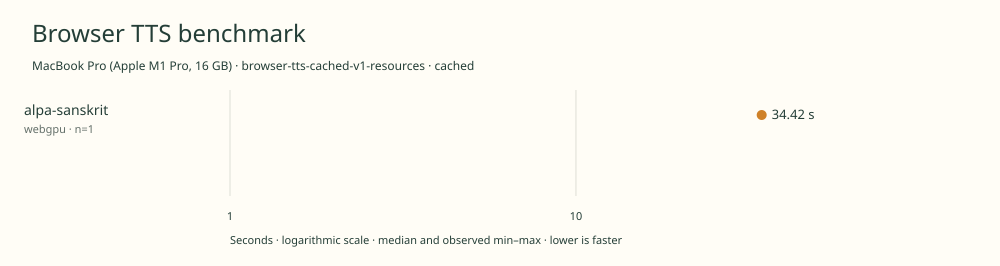

# 2026-11-23t18-34-23-366z-alpa-sanskrit-webgpu-cached-3b277786

MacBook Pro (Apple M1 Pro, 16 GB) · Apple M1 Pro · Google Chrome 157.0.8103.79

Protocol: **browser-tts-cached-v1-resources**, scenario **cached**. Native harness run.

First source-chunk request through final CPU-readable PCM; excludes initialization, validation, hashing, WAV encoding and save. Optional articleCallPeakRssBytes spans the entire browser call including post-timer validation/export. Generation RSS uses timestamped samples inside browser generation start/end boundaries; it includes the owned Chrome process tree and browser baseline.

| Model | Requested backend | Status | Median | Min–max | Runs |
|---|---|---|---:|---:|---:|
| alpa-sanskrit | webgpu | measured | 34.42 s | 34.42–34.42 s | 1 |

Additional metrics (median of available observations; scopes are distinct):

| Model | Backend | Metric | Median | Unit | n |
|---|---|---|---:|---|---:|
| alpa-sanskrit | webgpu | First completed source chunk | 645.510 | ms | 1 |
| alpa-sanskrit | webgpu | First PCM block | 645.305 | ms | 1 |
| alpa-sanskrit | webgpu | Generated audio | 1801.237 | s | 1 |
| alpa-sanskrit | webgpu | Generation / audio duration | 0.019 | ratio | 1 |
| alpa-sanskrit | webgpu | Model initialization | 1181.575 | ms | 1 |
| alpa-sanskrit | webgpu | Complete controller trial including setup/export | 41255.217 | ms | 1 |
| alpa-sanskrit | webgpu | Transferred HTTP body data | 99727 | bytes | 1 |
| alpa-sanskrit | webgpu | Ideal body transfer at 1 Mbps | 0.798 | s | 1 |
| alpa-sanskrit | webgpu | Whole-call Chrome process-tree peak RSS | 2474098688 | bytes | 1 |
| alpa-sanskrit | webgpu | Per-trial mean generation Chrome process-tree RSS | 2207113698 | bytes | 1 |
| alpa-sanskrit | webgpu | In-window Chrome RSS observations | 68.000 | samples | 1 |

Model support (catalog capability, not coverage of this run):

| Model | Supported voices | Bundled voices | Languages | Tested voice |
|---|---:|---:|---|---|
| alpa-sanskrit | 2 | 2 | 1 (sa) | female |

Pinned Alpa v0.2 FP32 graph and official JavaScript Devanagari frontend. Benchmark voice female at index 0, 24 kHz mono.. The published browser frontend processes Devanagari. The publisher’s ITRANS setting transliterates Roman Sanskrit. The fixed Sanskrit fixture produces 90 complete plans with up to 262 tokens and zero unknowns. Token IDs and syllable weights match the official Python implementation over all 90 source spans. Sources: [1](https://huggingface.co/77ethers/alpa/tree/b3973a79888b9c63b2fc6f56140c1699c0bd44d6), [2](https://alpa.blog/), [3](https://alpa.blog/js/text.js?v=ab33b3eb), [4](https://huggingface.co/datasets/ai4bharat/Rasa/tree/632f55c7ac590219d41cd7adffce5b440e4604f5).

- **alpa-sanskrit / webgpu**: Hardware WebGPU with explicit WASM operator fallback and PCM readback.

Capability checks run separately before timing. GPU dispatch does not imply GPU-exclusive execution.

Raw WAV is saved locally; opt-in audio publication is separate from timing and automatic result submission.

Campaign 2026-11-23T18-19-02-403Z-9f5d222bdb01; cell 4/4; source 7f6c1496053453747bbb47b4f6af6ac041ecc6eb; fixture sa-article-v1 (sa, 19801 JavaScript characters, 90 spans); requested n=1; effective n=1; Headed Google Chrome on Apple M1 Pro under AC power, sequential disposable profiles. Exact Alpa v0.2 Sanskrit FP32 browser graph from b3973a79888b9c63b2fc6f56140c1699c0bd44d6, female/index zero, speed 1, pitch shift zero, pitch range 1, 24 kHz. Exact stock JavaScript Devanagari reading and parts planner from alpa.blog with syllable weights. Concatenate raw PCM directly. ONNX Runtime Web 1.31.1 on both routes, one WASM thread and verified Apple hardware WebGPU plus WASM asyncify with synchronized CPU PCM readback.

RSS is sampled every 500 ms across the owned Chrome process tree, including the Chrome baseline and inference workers. Whole-call peak spans post-timer validation/export; generation mean uses only in-window samples from browser generation start through final CPU-readable PCM.

Different protocols, fixtures, settings or machines must not be pooled into a speedup ranking. This report does not rate speech quality.
