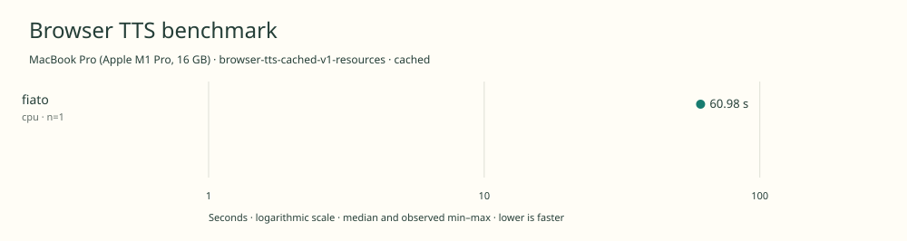

# 2026-11-23t18-52-15-794z-fiato-cpu-cached-aee03084

MacBook Pro (Apple M1 Pro, 16 GB) · Apple M1 Pro · Google Chrome 157.0.8103.79

Protocol: **browser-tts-cached-v1-resources**, scenario **cached**. Native harness run.

First source-chunk request through final CPU-readable PCM; excludes initialization, validation, hashing, WAV encoding and save. Optional articleCallPeakRssBytes spans the entire browser call including post-timer validation/export. Generation RSS uses timestamped samples inside browser generation start/end boundaries; it includes the owned Chrome process tree and browser baseline.

| Model | Requested backend | Status | Median | Min–max | Runs |
|---|---|---|---:|---:|---:|
| fiato | cpu | measured | 60.98 s | 60.98–60.98 s | 1 |

Additional metrics (median of available observations; scopes are distinct):

| Model | Backend | Metric | Median | Unit | n |
|---|---|---|---:|---|---:|
| fiato | cpu | First completed source chunk | 712.910 | ms | 1 |
| fiato | cpu | First PCM block | 177.555 | ms | 1 |
| fiato | cpu | Generated audio | 1240.843 | s | 1 |
| fiato | cpu | Generation / audio duration | 0.049 | ratio | 1 |
| fiato | cpu | Model initialization | 2664.843 | ms | 1 |
| fiato | cpu | Complete controller trial including setup/export | 67517.849 | ms | 1 |
| fiato | cpu | Transferred HTTP body data | 65796 | bytes | 1 |
| fiato | cpu | Ideal body transfer at 1 Mbps | 0.526 | s | 1 |
| fiato | cpu | Whole-call Chrome process-tree peak RSS | 1686159360 | bytes | 1 |
| fiato | cpu | Per-trial mean generation Chrome process-tree RSS | 1412910258 | bytes | 1 |
| fiato | cpu | In-window Chrome RSS observations | 121.000 | samples | 1 |

Model support (catalog capability, not coverage of this run):

| Model | Supported voices | Bundled voices | Languages | Tested voice |
|---|---:|---:|---|---|
| fiato | 2 | 2 | 1 (en) | F1 |

Pinned Fiato FP32 ONNX checkpoint; English canonical english-20k-v1 fixture; benchmark voice F1/index 0; 24 kHz mono; speed 1, pitch shift 0, pitch range 1; publisher sentence finishing, expression tokens and post-span 0.99 peak ceiling.. The upstream bundle contains F1 and M1. The benchmark uses F1 at index 0. Dizione runs through Pyodide 0.26.4 and NumPy 1.26.4. Separate untimed controls cover sigh, exhale and gasp. The fixed English article is used unchanged. Sources: [1](https://huggingface.co/cfahlgren1/fiato/tree/967de50b6a9ab673ef7de9f8f276fa93a8c0db81), [2](https://huggingface.co/cfahlgren1/fiato/blob/967de50b6a9ab673ef7de9f8f276fa93a8c0db81/README.md), [3](https://huggingface.co/datasets/cfahlgren1/fiato/tree/df0dcab5b7df8c130b5f4d8867caab25c602707f), [4](https://huggingface.co/spaces/cfahlgren1/fiato).

- **fiato / cpu**: Explicit one-thread ONNX Runtime Web WASM CPU route; Fiato Dizione G2P runs in local Pyodide.

Capability checks run separately before timing. GPU dispatch does not imply GPU-exclusive execution.

Raw WAV is saved locally; opt-in audio publication is separate from timing and automatic result submission.

Campaign 2026-11-23T18-45-59-688Z-7348f0ef444f; cell 3/4; source d24857e8727041e252b4a453a0cdac158d541081; fixture english-20k-v1 (en, 20000 JavaScript characters, 93 spans); requested n=1; effective n=1; Headed Google Chrome on Apple M1 Pro under AC power, sequential disposable profiles. Exact Fiato FP32 English graph, revision 967de50b6a9ab673ef7de9f8f276fa93a8c0db81, F1/index zero, speed 1, pitch shift zero, pitch range 1, 24 kHz. Stock Dizione assets, publisher frontend format and token budgeting with Pyodide 0.26.4. ONNX Runtime Web 1.31.1 on both routes, one WASM thread and verified Apple hardware WebGPU plus WASM asyncify. PCM is joined and capped at the publisher peak for each source span.

RSS is sampled every 500 ms across the owned Chrome process tree, including the Chrome baseline and inference workers. Whole-call peak spans post-timer validation/export; generation mean uses only in-window samples from browser generation start through final CPU-readable PCM.

Different protocols, fixtures, settings or machines must not be pooled into a speedup ranking. This report does not rate speech quality.
