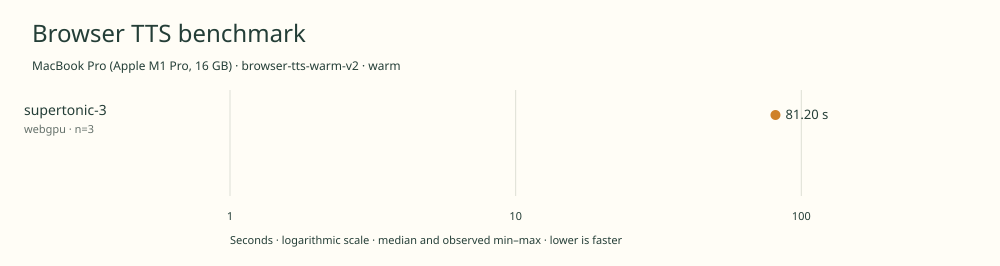

# 2026-11-23t22-29-10-473z-supertonic-3-webgpu-warm-84344e8e

MacBook Pro (Apple M1 Pro, 16 GB) · Apple M1 Pro · Google Chrome 157.0.8103.79

Protocol: **browser-tts-warm-v2**, scenario **warm**. Native harness run.

First source-chunk request through final CPU-readable PCM; excludes initialization, validation, hashing, WAV encoding and save. Optional articleCallPeakRssBytes spans the entire browser call including post-timer validation/export.

| Model | Requested backend | Status | Median | Min–max | Runs |
|---|---|---|---:|---:|---:|
| supertonic-3 | webgpu | measured | 81.20 s | 81.19–82.27 s | 3 |

Additional metrics (median of available observations; scopes are distinct):

| Model | Backend | Metric | Median | Unit | n |
|---|---|---|---:|---|---:|
| supertonic-3 | webgpu | First completed source chunk | 687.745 | ms | 3 |
| supertonic-3 | webgpu | First PCM block | 687.745 | ms | 3 |
| supertonic-3 | webgpu | Generated audio | 1367.213 | s | 3 |
| supertonic-3 | webgpu | Generation / audio duration | 0.059 | ratio | 3 |

Model support (catalog capability, not coverage of this run):

| Model | Supported voices | Bundled voices | Languages | Tested voice |
|---|---:|---:|---|---|
| supertonic-3 | 10 | 1 | 31 | M3 (Robert) |

Pinned Supertonic 3 checkpoint and ten supplied preset voice styles. Ten supplied presets F1–F5 and M1–M5; only M3 \(Robert\) is staged and tested in English. Language-agnostic mode na is not an additional language. Custom voice profiles are outside this preset count. Eight denoising steps and effective speed 1.05 match the linked demo defaults \(UI speed 1.0\). Sources: [1](https://huggingface.co/Supertone/supertonic-3/blob/3cadd1ee6394adea1bd021217a0e650ede09a323/README.md), [2](https://huggingface.co/Supertone/supertonic-3/tree/3cadd1ee6394adea1bd021217a0e650ede09a323/voice_styles), [3](https://huggingface.co/spaces/Supertone/supertonic-3/blob/4402acca094e2ff2b3dff446e0bf915f3fccc462/script.js).

- **supertonic-3 / webgpu**: Observed 8014 WebGPU compute dispatches in a separate untimed synthesis. WebGPU + WASM operator fallback; CPU text processing. Hooks were removed before timed generation.

Capability checks run separately before timing. GPU dispatch does not imply GPU-exclusive execution.

Raw WAV is saved locally; opt-in audio publication is separate from timing and automatic result submission.

Campaign 2026-11-23T22-29-09-544Z-a70fbbdc1453; cell 1/2; source 3bf3584889e6e8dc0c57d4101d09a91c223a7c8c; fixture de-article-v1 (de, 23885 JavaScript characters, 109 spans); requested n=3; effective n=3; Supertonic 3 FP32 M3 on Apple M1 Pro under AC, headed Google Chrome, dedicated disposable profiles, one sequential inference workload. Eight denoising steps, effective speed 1.05. GPU dispatch and CPU fallback operators are reported in the receipt.

Different protocols, fixtures, settings or machines must not be pooled into a speedup ranking. This report does not rate speech quality.
