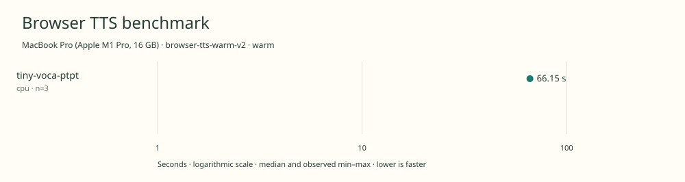

# 2026-11-24t11-58-36-394z-tiny-voca-ptpt-cpu-warm-a650579f

MacBook Pro (Apple M1 Pro, 16 GB) · Apple M1 Pro · Google Chrome 158.0.8127.37

Protocol: **browser-tts-warm-v2**, scenario **warm**. Native harness run.

First source-chunk request through final CPU-readable PCM; excludes initialization, validation, hashing, WAV encoding and save. Optional articleCallPeakRssBytes spans the entire browser call including post-timer validation/export.

| Model | Requested backend | Status | Median | Min–max | Runs |
|---|---|---|---:|---:|---:|
| tiny-voca-ptpt | cpu | measured | 66.15 s | 66.06–66.23 s | 3 |

Additional metrics (median of available observations; scopes are distinct):

| Model | Backend | Metric | Median | Unit | n |
|---|---|---|---:|---|---:|
| tiny-voca-ptpt | cpu | First completed source chunk | 602.980 | ms | 3 |
| tiny-voca-ptpt | cpu | First PCM block | 167.030 | ms | 3 |
| tiny-voca-ptpt | cpu | Generated audio | 1344.832 | s | 3 |
| tiny-voca-ptpt | cpu | Generation / audio duration | 0.049 | ratio | 3 |

Model support (catalog capability, not coverage of this run):

| Model | Supported voices | Bundled voices | Languages | Tested voice |
|---|---:|---:|---|---|
| tiny-voca-ptpt | 2 | 2 | 1 (pt-PT) | F3 |

Pinned joserui/tiny-voca-pt-pt ONNX graph, two fictional synthetic Lisbon voices \(F3 and M1\), 24 kHz mono, and the registered pt-pt-article-v1 fixture. CPU/WASM and WebGPU are explicit selections.. Supplied full-article frontend oracle binds the registered fixture SHA and reports 106 spans, 350 utterances, maximum 185 tokens, and zero unknown phones \(oracle SHA-256 43aa9a5d0e11b3dbfb5920cd1ab820cb389974d28bf2131b01d871e15249991e\). The pinned upstream vector file contains 632 Python/JavaScript parity vectors; their source identities are recorded in the adapter profile. This patch is not a browser or inference qualification receipt. WebGPU requires an explicit selection and can use internal WASM kernels for unsupported graph operators; use the untimed dispatch probe to record dispatch. Sources: [1](https://huggingface.co/joserui/tiny-voca-pt-pt/tree/9d547821151d1f009eada6f49b5be73af77ae245), [2](https://huggingface.co/joserui/tiny-voca-pt-pt/blob/9d547821151d1f009eada6f49b5be73af77ae245/README.md), [3](https://github.com/joseruimemory/tiny-voca-pt-pt/tree/744e42406fd481fbe61f3b67bf8012a7d29cb57a), [4](https://github.com/joseruimemory/tiny-voca-pt-pt/blob/744e42406fd481fbe61f3b67bf8012a7d29cb57a/docs/pronuncia.js), [5](https://github.com/joseruimemory/tiny-voca-pt-pt/blob/744e42406fd481fbe61f3b67bf8012a7d29cb57a/docs/test/vectores.json), [6](https://registry.npmjs.org/onnxruntime-web/-/onnxruntime-web-1.22.0.tgz).

- **tiny-voca-ptpt / cpu**: Explicit single-thread ONNX Runtime Web WASM provider; this is the CPU backend.

Capability checks run separately before timing. GPU dispatch does not imply GPU-exclusive execution.

Raw WAV is saved locally; opt-in audio publication is separate from timing and automatic result submission.

Campaign 2026-11-24T11-58-35-821Z-27c9051e8645; cell 1/4; source 2581937c17b500bda80cb158cd86a0c804149026; fixture pt-pt-article-v1 (pt-PT, 23265 JavaScript characters, 106 spans); requested n=3; effective n=3; Headed Google Chrome, Apple M1 Pro, AC power. Published tiny-voca-ptpt, F3, FP32 ONNX export of the released European Portuguese checkpoint. Qualified backends: cpu, webgpu. Sequential isolated profiles. Warm protocol v2 excludes the full article warmup.

Different protocols, fixtures, settings or machines must not be pooled into a speedup ranking. This report does not rate speech quality.
