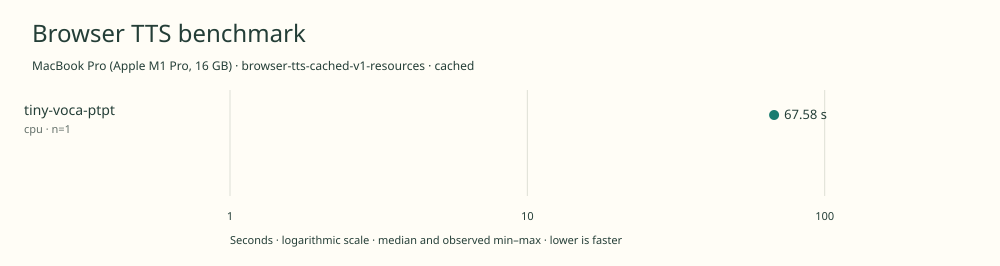

# 2026-11-24t12-05-03-409z-tiny-voca-ptpt-cpu-cached-fab0d37b

MacBook Pro (Apple M1 Pro, 16 GB) · Apple M1 Pro · Google Chrome 158.0.8127.37

Protocol: **browser-tts-cached-v1-resources**, scenario **cached**. Native harness run.

First source-chunk request through final CPU-readable PCM; excludes initialization, validation, hashing, WAV encoding and save. Optional articleCallPeakRssBytes spans the entire browser call including post-timer validation/export. Generation RSS uses timestamped samples inside browser generation start/end boundaries; it includes the owned Chrome process tree and browser baseline.

| Model | Requested backend | Status | Median | Min–max | Runs |
|---|---|---|---:|---:|---:|
| tiny-voca-ptpt | cpu | measured | 67.58 s | 67.58–67.58 s | 1 |

Additional metrics (median of available observations; scopes are distinct):

| Model | Backend | Metric | Median | Unit | n |
|---|---|---|---:|---|---:|
| tiny-voca-ptpt | cpu | First completed source chunk | 716.855 | ms | 1 |
| tiny-voca-ptpt | cpu | First PCM block | 246.650 | ms | 1 |
| tiny-voca-ptpt | cpu | Generated audio | 1344.832 | s | 1 |
| tiny-voca-ptpt | cpu | Generation / audio duration | 0.050 | ratio | 1 |
| tiny-voca-ptpt | cpu | Model initialization | 600.566 | ms | 1 |
| tiny-voca-ptpt | cpu | Complete controller trial including setup/export | 72572.274 | ms | 1 |
| tiny-voca-ptpt | cpu | Transferred HTTP body data | 94711 | bytes | 1 |
| tiny-voca-ptpt | cpu | Ideal body transfer at 1 Mbps | 0.758 | s | 1 |
| tiny-voca-ptpt | cpu | Whole-call Chrome process-tree peak RSS | 1458831360 | bytes | 1 |
| tiny-voca-ptpt | cpu | Per-trial mean generation Chrome process-tree RSS | 1086493711 | bytes | 1 |
| tiny-voca-ptpt | cpu | In-window Chrome RSS observations | 134.000 | samples | 1 |

Model support (catalog capability, not coverage of this run):

| Model | Supported voices | Bundled voices | Languages | Tested voice |
|---|---:|---:|---|---|
| tiny-voca-ptpt | 2 | 2 | 1 (pt-PT) | F3 |

Pinned joserui/tiny-voca-pt-pt ONNX graph, two fictional synthetic Lisbon voices \(F3 and M1\), 24 kHz mono, and the registered pt-pt-article-v1 fixture. CPU/WASM and WebGPU are explicit selections.. Supplied full-article frontend oracle binds the registered fixture SHA and reports 106 spans, 350 utterances, maximum 185 tokens, and zero unknown phones \(oracle SHA-256 43aa9a5d0e11b3dbfb5920cd1ab820cb389974d28bf2131b01d871e15249991e\). The pinned upstream vector file contains 632 Python/JavaScript parity vectors; their source identities are recorded in the adapter profile. This patch is not a browser or inference qualification receipt. WebGPU requires an explicit selection and can use internal WASM kernels for unsupported graph operators; use the untimed dispatch probe to record dispatch. Sources: [1](https://huggingface.co/joserui/tiny-voca-pt-pt/tree/9d547821151d1f009eada6f49b5be73af77ae245), [2](https://huggingface.co/joserui/tiny-voca-pt-pt/blob/9d547821151d1f009eada6f49b5be73af77ae245/README.md), [3](https://github.com/joseruimemory/tiny-voca-pt-pt/tree/744e42406fd481fbe61f3b67bf8012a7d29cb57a), [4](https://github.com/joseruimemory/tiny-voca-pt-pt/blob/744e42406fd481fbe61f3b67bf8012a7d29cb57a/docs/pronuncia.js), [5](https://github.com/joseruimemory/tiny-voca-pt-pt/blob/744e42406fd481fbe61f3b67bf8012a7d29cb57a/docs/test/vectores.json), [6](https://registry.npmjs.org/onnxruntime-web/-/onnxruntime-web-1.22.0.tgz).

- **tiny-voca-ptpt / cpu**: Explicit single-thread ONNX Runtime Web WASM provider; this is the CPU backend.

Capability checks run separately before timing. GPU dispatch does not imply GPU-exclusive execution.

Raw WAV is saved locally; opt-in audio publication is separate from timing and automatic result submission.

Campaign 2026-11-24T11-58-35-821Z-27c9051e8645; cell 3/4; source 2581937c17b500bda80cb158cd86a0c804149026; fixture pt-pt-article-v1 (pt-PT, 23265 JavaScript characters, 106 spans); requested n=1; effective n=1; Headed Google Chrome, Apple M1 Pro, AC power. Published tiny-voca-ptpt, F3, FP32 ONNX export of the released European Portuguese checkpoint. Qualified backends: cpu, webgpu. Sequential isolated profiles. Warm protocol v2 excludes the full article warmup.

RSS is sampled every 500 ms across the owned Chrome process tree, including the Chrome baseline and inference workers. Whole-call peak spans post-timer validation/export; generation mean uses only in-window samples from browser generation start through final CPU-readable PCM.

Different protocols, fixtures, settings or machines must not be pooled into a speedup ranking. This report does not rate speech quality.
