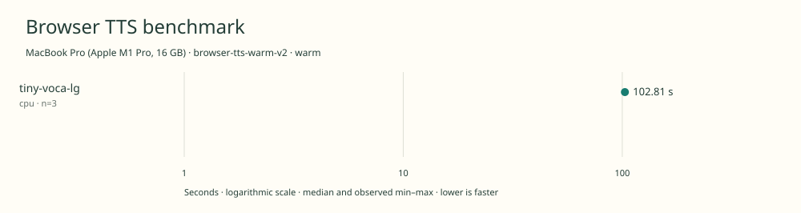

# 2026-11-24t12-22-06-303z-tiny-voca-lg-cpu-warm-a29a6b42

MacBook Pro (Apple M1 Pro, 16 GB) · Apple M1 Pro · Google Chrome 158.0.8127.37

Protocol: **browser-tts-warm-v2**, scenario **warm**. Native harness run.

First source-chunk request through final CPU-readable PCM; excludes initialization, validation, hashing, WAV encoding and save. Optional articleCallPeakRssBytes spans the entire browser call including post-timer validation/export.

| Model | Requested backend | Status | Median | Min–max | Runs |
|---|---|---|---:|---:|---:|
| tiny-voca-lg | cpu | measured | 102.81 s | 102.80–102.84 s | 3 |

Additional metrics (median of available observations; scopes are distinct):

| Model | Backend | Metric | Median | Unit | n |
|---|---|---|---:|---|---:|
| tiny-voca-lg | cpu | First completed source chunk | 958.115 | ms | 3 |
| tiny-voca-lg | cpu | First PCM block | 284.675 | ms | 3 |
| tiny-voca-lg | cpu | Generated audio | 1907.424 | s | 3 |
| tiny-voca-lg | cpu | Generation / audio duration | 0.054 | ratio | 3 |

Model support (catalog capability, not coverage of this run):

| Model | Supported voices | Bundled voices | Languages | Tested voice |
|---|---:|---:|---|---|
| tiny-voca-lg | 2 | 2 | 1 (lg) | F2 (female; WAXAL Luganda speaker 5) |

Pinned tiny-voca-lg step-4000 FP32 ONNX checkpoint; Luganda, F2 \(WAXAL speaker 5\) at graph voice index 0, 24 kHz mono.. The registered lg-article-v1 fixture is a translator draft without fluent-speaker review. Its canonical spans have been checked against the pinned Luganda Python and JavaScript frontends and stock worker token/stress planning controls; this is frontend qualification, not a model inference or benchmark result. The profile selects only F2; M2 remains a checkpoint voice but is not exposed by this adapter. Sources: [1](https://huggingface.co/henryhale/tiny-voca-lg/tree/dcb36749b11027ef8e57319d6508104e235ff783), [2](https://huggingface.co/henryhale/tiny-voca-lg/blob/dcb36749b11027ef8e57319d6508104e235ff783/README.md), [3](https://github.com/henryhale/tiny-voca-lg/tree/258107cba9bdf820a815554ce1b601369b8c1388), [4](https://huggingface.co/datasets/CraneAILabs/waxal-lug-clean).

- **tiny-voca-lg / cpu**: Explicit one-thread ONNX Runtime Web 1.31.1 WASM route; Luganda text frontend runs locally in the worker.

Capability checks run separately before timing. GPU dispatch does not imply GPU-exclusive execution.

Raw WAV is saved locally; opt-in audio publication is separate from timing and automatic result submission.

Campaign 2026-11-24T12-22-05-696Z-eb70ca864aec; cell 1/4; source abf55cecbaff617762d6bfdd4a3b47ad231fc414; fixture lg-article-v1 (lg, 25641 JavaScript characters, 117 spans); requested n=3; effective n=3; Headed Google Chrome, Apple M1 Pro, AC power. Published tiny-voca-lg, F2, FP32 ONNX export of tiny-voca-lg step 4000. Qualified backends: cpu, webgpu. Sequential isolated profiles. Warm protocol v2 excludes the full article warmup.

Different protocols, fixtures, settings or machines must not be pooled into a speedup ranking. This report does not rate speech quality.
