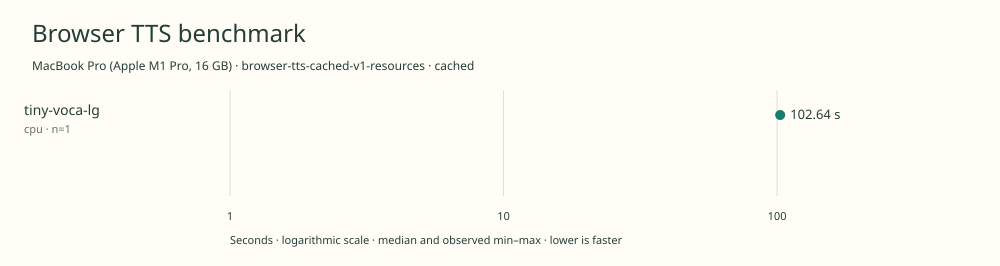

# 2026-11-24t12-31-43-246z-tiny-voca-lg-cpu-cached-16b52b0e

MacBook Pro (Apple M1 Pro, 16 GB) · Apple M1 Pro · Google Chrome 158.0.8127.37

Protocol: **browser-tts-cached-v1-resources**, scenario **cached**. Native harness run.

First source-chunk request through final CPU-readable PCM; excludes initialization, validation, hashing, WAV encoding and save. Optional articleCallPeakRssBytes spans the entire browser call including post-timer validation/export. Generation RSS uses timestamped samples inside browser generation start/end boundaries; it includes the owned Chrome process tree and browser baseline.

| Model | Requested backend | Status | Median | Min–max | Runs |
|---|---|---|---:|---:|---:|
| tiny-voca-lg | cpu | measured | 102.64 s | 102.64–102.64 s | 1 |

Additional metrics (median of available observations; scopes are distinct):

| Model | Backend | Metric | Median | Unit | n |
|---|---|---|---:|---|---:|
| tiny-voca-lg | cpu | First completed source chunk | 987.690 | ms | 1 |
| tiny-voca-lg | cpu | First PCM block | 291.665 | ms | 1 |
| tiny-voca-lg | cpu | Generated audio | 1907.424 | s | 1 |
| tiny-voca-lg | cpu | Generation / audio duration | 0.054 | ratio | 1 |
| tiny-voca-lg | cpu | Model initialization | 795.329 | ms | 1 |
| tiny-voca-lg | cpu | Complete controller trial including setup/export | 108810.725 | ms | 1 |
| tiny-voca-lg | cpu | Transferred HTTP body data | 98732 | bytes | 1 |
| tiny-voca-lg | cpu | Ideal body transfer at 1 Mbps | 0.790 | s | 1 |
| tiny-voca-lg | cpu | Whole-call Chrome process-tree peak RSS | 2026487808 | bytes | 1 |
| tiny-voca-lg | cpu | Per-trial mean generation Chrome process-tree RSS | 1331389219 | bytes | 1 |
| tiny-voca-lg | cpu | In-window Chrome RSS observations | 204.000 | samples | 1 |

Model support (catalog capability, not coverage of this run):

| Model | Supported voices | Bundled voices | Languages | Tested voice |
|---|---:|---:|---|---|
| tiny-voca-lg | 2 | 2 | 1 (lg) | F2 (female; WAXAL Luganda speaker 5) |

Pinned tiny-voca-lg step-4000 FP32 ONNX checkpoint; Luganda, F2 \(WAXAL speaker 5\) at graph voice index 0, 24 kHz mono.. The registered lg-article-v1 fixture is a translator draft without fluent-speaker review. Its canonical spans have been checked against the pinned Luganda Python and JavaScript frontends and stock worker token/stress planning controls; this is frontend qualification, not a model inference or benchmark result. The profile selects only F2; M2 remains a checkpoint voice but is not exposed by this adapter. Sources: [1](https://huggingface.co/henryhale/tiny-voca-lg/tree/dcb36749b11027ef8e57319d6508104e235ff783), [2](https://huggingface.co/henryhale/tiny-voca-lg/blob/dcb36749b11027ef8e57319d6508104e235ff783/README.md), [3](https://github.com/henryhale/tiny-voca-lg/tree/258107cba9bdf820a815554ce1b601369b8c1388), [4](https://huggingface.co/datasets/CraneAILabs/waxal-lug-clean).

- **tiny-voca-lg / cpu**: Explicit one-thread ONNX Runtime Web 1.31.1 WASM route; Luganda text frontend runs locally in the worker.

Capability checks run separately before timing. GPU dispatch does not imply GPU-exclusive execution.

Raw WAV is saved locally; opt-in audio publication is separate from timing and automatic result submission.

Campaign 2026-11-24T12-22-05-696Z-eb70ca864aec; cell 3/4; source abf55cecbaff617762d6bfdd4a3b47ad231fc414; fixture lg-article-v1 (lg, 25641 JavaScript characters, 117 spans); requested n=1; effective n=1; Headed Google Chrome, Apple M1 Pro, AC power. Published tiny-voca-lg, F2, FP32 ONNX export of tiny-voca-lg step 4000. Qualified backends: cpu, webgpu. Sequential isolated profiles. Warm protocol v2 excludes the full article warmup.

RSS is sampled every 500 ms across the owned Chrome process tree, including the Chrome baseline and inference workers. Whole-call peak spans post-timer validation/export; generation mean uses only in-window samples from browser generation start through final CPU-readable PCM.

Different protocols, fixtures, settings or machines must not be pooled into a speedup ranking. This report does not rate speech quality.
