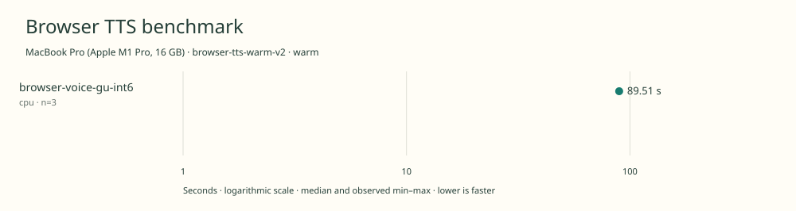

# 2026-11-24t15-39-38-328z-browser-voice-gu-int6-cpu-warm-740d1bed

MacBook Pro (Apple M1 Pro, 16 GB) · Apple M1 Pro · Google Chrome 158.0.8127.37

Protocol: **browser-tts-warm-v2**, scenario **warm**. Native harness run.

First source-chunk request through final CPU-readable PCM; excludes initialization, validation, hashing, WAV encoding and save. Optional articleCallPeakRssBytes spans the entire browser call including post-timer validation/export.

| Model | Requested backend | Status | Median | Min–max | Runs |
|---|---|---|---:|---:|---:|
| browser-voice-gu-int6 | cpu | measured | 89.51 s | 89.45–89.87 s | 3 |

Additional metrics (median of available observations; scopes are distinct):

| Model | Backend | Metric | Median | Unit | n |
|---|---|---|---:|---|---:|
| browser-voice-gu-int6 | cpu | First completed source chunk | 1041.050 | ms | 3 |
| browser-voice-gu-int6 | cpu | First PCM block | 1041.045 | ms | 3 |
| browser-voice-gu-int6 | cpu | Generated audio | 1428.021 | s | 3 |
| browser-voice-gu-int6 | cpu | Generation / audio duration | 0.063 | ratio | 3 |

Model support (catalog capability, not coverage of this run):

| Model | Supported voices | Bundled voices | Languages | Tested voice |
|---|---:|---:|---|---|
| browser-voice-gu-int6 | 1 | 1 | 1 (gu) | Jahnavi |

Jahnavi in the native Gujarati-script benchmark, using the published compact INT6 checkpoint.. The registered route reads Gujarati script using voice index zero. The published worker explicitly selects one-thread WebAssembly for the acoustic and pronunciation sessions. Sources: [1](https://huggingface.co/Hansda/gujarati-voice-compact/tree/e20cc854291738b7bdd7986cb01c90c9bfe1415f), [2](https://github.com/DarvinX/multilingual-browser-tts/tree/f2977727b8baccb989f80b492ea8da00124ecba3), [3](https://tts.hansda.in/?lang=gu), [4](https://huggingface.co/datasets/Hansda/gujarati-maya2-jahnavi-20h/blob/d2e587e6278a4792fb5d5952b2bda1871037eaf9/README.md).

- **browser-voice-gu-int6 / cpu**: The released acoustic and G2P sessions use the one-thread WASM provider.

Capability checks run separately before timing. GPU dispatch does not imply GPU-exclusive execution.

Raw WAV is saved locally; opt-in audio publication is separate from timing and automatic result submission.

Campaign 2026-11-24T15-39-37-719Z-cf8ee044badf; cell 1/2; source e8c324546f1ca848ccf39067d239a37717117df3; fixture gu-article-v1 (gu, 19600 JavaScript characters, 89 spans); requested n=3; effective n=3; Headed Google Chrome, Apple M1 Pro, AC power. Published browser-voice-gu-int6, Jahnavi, INT6 packed weights expanded to FP32. Qualified backends: cpu. Sequential isolated profiles. Warm protocol v2 excludes the full article warmup.

Different protocols, fixtures, settings or machines must not be pooled into a speedup ranking. This report does not rate speech quality.
