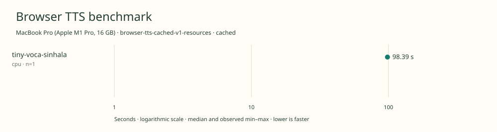

# 2026-11-24t16-33-56-405z-tiny-voca-sinhala-cpu-cached-8c41cc9f

MacBook Pro (Apple M1 Pro, 16 GB) · Apple M1 Pro · Google Chrome 158.0.8127.37

Protocol: **browser-tts-cached-v1-resources**, scenario **cached**. Native harness run.

First source-chunk request through final CPU-readable PCM; excludes initialization, validation, hashing, WAV encoding and save. Optional articleCallPeakRssBytes spans the entire browser call including post-timer validation/export. Generation RSS uses timestamped samples inside browser generation start/end boundaries; it includes the owned Chrome process tree and browser baseline.

| Model | Requested backend | Status | Median | Min–max | Runs |
|---|---|---|---:|---:|---:|
| tiny-voca-sinhala | cpu | measured | 98.39 s | 98.39–98.39 s | 1 |

Additional metrics (median of available observations; scopes are distinct):

| Model | Backend | Metric | Median | Unit | n |
|---|---|---|---:|---|---:|
| tiny-voca-sinhala | cpu | First completed source chunk | 1072.715 | ms | 1 |
| tiny-voca-sinhala | cpu | First PCM block | 264.690 | ms | 1 |
| tiny-voca-sinhala | cpu | Generated audio | 2007.999 | s | 1 |
| tiny-voca-sinhala | cpu | Generation / audio duration | 0.049 | ratio | 1 |
| tiny-voca-sinhala | cpu | Model initialization | 513.883 | ms | 1 |
| tiny-voca-sinhala | cpu | Complete controller trial including setup/export | 104966.242 | ms | 1 |
| tiny-voca-sinhala | cpu | Transferred HTTP body data | 124115 | bytes | 1 |
| tiny-voca-sinhala | cpu | Ideal body transfer at 1 Mbps | 0.993 | s | 1 |
| tiny-voca-sinhala | cpu | Whole-call Chrome process-tree peak RSS | 1623851008 | bytes | 1 |
| tiny-voca-sinhala | cpu | Per-trial mean generation Chrome process-tree RSS | 1106624344 | bytes | 1 |
| tiny-voca-sinhala | cpu | In-window Chrome RSS observations | 195.000 | samples | 1 |

Model support (catalog capability, not coverage of this run):

| Model | Supported voices | Bundled voices | Languages | Tested voice |
|---|---:|---:|---|---|
| tiny-voca-sinhala | 2 | 2 | 1 (si) | M1 |

Pinned tiny-voca Sinhala step-55000 FP32 ONNX checkpoint; Sinhala text, M1 \(Ven. Mettananda, index 0\) and F1 \(Mrs. Oshadi, index 1\), 24 kHz mono. Both donated voices have the publisher’s non-obscene/non-offensive use restriction.. Uses the publisher’s browser frontend and genuine sentences\(\)/shorter\(\) controls with eSpeak NG inc/si, the exact 73-symbol inventory and pinned frontend fingerprint. Only the stock CPU/WASM provider is enabled. The browser player defaults to 0.35 seconds between sentence ends, with a single 0.99 normalizer over the complete playable span; benchmark source spans apply the same pause and complete-span normalization. The registered article has 90 spans; pinned frontend control covers 373 utterances, maximum 207 tokens and zero unknowns. The model and voice terms require license acceptance. Sources: [1](https://huggingface.co/eminduperera/tiny-voca-sinhala/tree/c54a456ed65ac8173a666a69b81d99c4ac882dd6), [2](https://huggingface.co/eminduperera/tiny-voca-sinhala/blob/c54a456ed65ac8173a666a69b81d99c4ac882dd6/README.md), [3](https://github.com/Emindu/tiny-voca-sinhala/tree/f9f903be847f89458dbc9af750b0ffc6d66a2c9b), [4](https://github.com/espeak-ng/espeak-ng/tree/1.52.0), [5](https://github.com/pnfo/sinhala-tts-dataset).

- **tiny-voca-sinhala / cpu**: Explicit ONNX Runtime Web 1.20.1 one-thread WASM CPU route; WebGPU is unsupported by this adapter.

Capability checks run separately before timing. GPU dispatch does not imply GPU-exclusive execution.

Raw WAV is saved locally; opt-in audio publication is separate from timing and automatic result submission.

Campaign 2026-11-24T16-27-09-629Z-bcf4e26c239b; cell 2/2; source 65036acbd399d20db9dbea6c4ce74254f5a26d54; fixture si-article-v1 (si, 19752 JavaScript characters, 90 spans); requested n=1; effective n=1; Headed Google Chrome, Apple M1 Pro, AC power. Published tiny-voca-sinhala, M1, FP32 ONNX export of the pinned tiny-voca Sinhala step-55000 checkpoint. Qualified backends: cpu. Sequential isolated profiles. Warm protocol v2 excludes the full article warmup.

RSS is sampled every 500 ms across the owned Chrome process tree, including the Chrome baseline and inference workers. Whole-call peak spans post-timer validation/export; generation mean uses only in-window samples from browser generation start through final CPU-readable PCM.

Different protocols, fixtures, settings or machines must not be pooled into a speedup ranking. This report does not rate speech quality.
