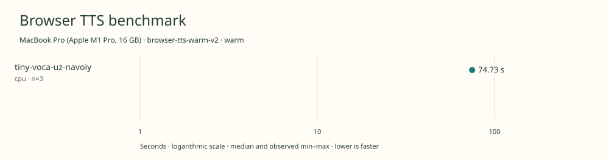

# 2026-11-24t19-19-49-945z-tiny-voca-uz-navoiy-cpu-warm-6bc5b74b

MacBook Pro (Apple M1 Pro, 16 GB) · Apple M1 Pro · Google Chrome 158.0.8127.37

Protocol: **browser-tts-warm-v2**, scenario **warm**. Native harness run.

First source-chunk request through final CPU-readable PCM; excludes initialization, validation, hashing, WAV encoding and save. Optional articleCallPeakRssBytes spans the entire browser call including post-timer validation/export.

| Model | Requested backend | Status | Median | Min–max | Runs |
|---|---|---|---:|---:|---:|
| tiny-voca-uz-navoiy | cpu | measured | 74.73 s | 74.72–75.02 s | 3 |

Additional metrics (median of available observations; scopes are distinct):

| Model | Backend | Metric | Median | Unit | n |
|---|---|---|---:|---|---:|
| tiny-voca-uz-navoiy | cpu | First completed source chunk | 713.035 | ms | 3 |
| tiny-voca-uz-navoiy | cpu | First PCM block | 290.600 | ms | 3 |
| tiny-voca-uz-navoiy | cpu | Generated audio | 1528.640 | s | 3 |
| tiny-voca-uz-navoiy | cpu | Generation / audio duration | 0.049 | ratio | 3 |

Model support (catalog capability, not coverage of this run):

| Model | Supported voices | Bundled voices | Languages | Tested voice |
|---|---:|---:|---|---|
| tiny-voca-uz-navoiy | 1 | 1 | 1 (uz) | M2 |

Pinned 104737-step FP32 Uzbek checkpoint trained from scratch; one synthetic male voice M2, Uzbek Latin input, 24 kHz mono. The model card reports 4,531,531 learned parameters.. The local external-noise ONNX export is 21357838 bytes with SHA-256 7003f4334796dbc08d932cd00e08945d3285eb3b9d9df9c34da29b7b0e563052; its export receipt reports 4531531 learned parameters, matching the publisher's PyTorch checkpoint. Browser frontend parity is verified against Python inference for all 105 ordered fixture spans and 11 edge cases; 345 utterances, maximum 191 tokens, zero unknowns. The graph takes deterministic seed-plus-utterance noise as an explicit seventh input. ONNX Runtime Web 1.31.1 CPU/WASM and mixed WebGPU/WASM routes are registered; no browser inference or backend qualification has yet been performed. Sources: [1](https://huggingface.co/Inomjonov/tiny-voca-uzbek-navoiy/tree/3d960bd05c728b21fff4ec5154cada7f6b082df1), [2](https://huggingface.co/Inomjonov/tiny-voca-uzbek-navoiy/blob/3d960bd05c728b21fff4ec5154cada7f6b082df1/README.md), [3](https://github.com/n4ze3m/tiny-voca/tree/62e2adef158bc997042cc6234f541f1e0e4cd55d), [4](https://huggingface.co/aisha-org/navoiy-tts/tree/9445f41ee5f38bd3a34eb16b0279dc05f9997fc2), [5](https://commonvoice.mozilla.org/en/datasets).

- **tiny-voca-uz-navoiy / cpu**: Explicit one-thread ONNX Runtime Web 1.31.1 WASM route; Uzbek text processing and output peak cap run locally in the worker.

Capability checks run separately before timing. GPU dispatch does not imply GPU-exclusive execution.

Raw WAV is saved locally; opt-in audio publication is separate from timing and automatic result submission.

Campaign 2026-11-24T19-19-49-344Z-2d48a1db0b22; cell 1/4; source 007f6ae5d51aa27b8f9323a862bd56eed152a0eb; fixture uz-article-v1 (uz, 23088 JavaScript characters, 105 spans); requested n=3; effective n=3; Headed Google Chrome, Apple M1 Pro, AC power. Published tiny-voca-uz-navoiy, M2, FP32 ONNX checkpoint. Qualified backends: cpu, webgpu. Sequential isolated profiles. Warm protocol v2 excludes the full article warmup.

Different protocols, fixtures, settings or machines must not be pooled into a speedup ranking. This report does not rate speech quality.
