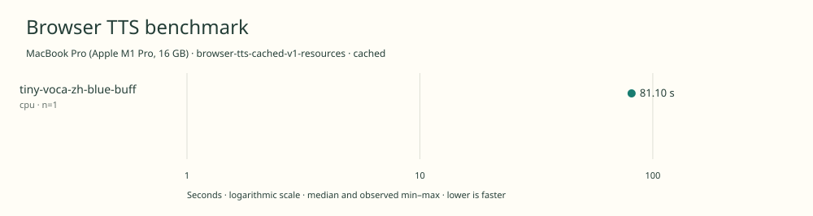

# 2026-11-24t23-18-48-694z-tiny-voca-zh-blue-buff-cpu-cached-b6713c39

MacBook Pro (Apple M1 Pro, 16 GB) · Apple M1 Pro · Google Chrome 158.0.8127.37

Protocol: **browser-tts-cached-v1-resources**, scenario **cached**. Native harness run.

First source-chunk request through final CPU-readable PCM; excludes initialization, validation, hashing, WAV encoding and save. Optional articleCallPeakRssBytes spans the entire browser call including post-timer validation/export. Generation RSS uses timestamped samples inside browser generation start/end boundaries; it includes the owned Chrome process tree and browser baseline.

| Model | Requested backend | Status | Median | Min–max | Runs |
|---|---|---|---:|---:|---:|
| tiny-voca-zh-blue-buff | cpu | measured | 81.10 s | 81.10–81.10 s | 1 |

Additional metrics (median of available observations; scopes are distinct):

| Model | Backend | Metric | Median | Unit | n |
|---|---|---|---:|---|---:|
| tiny-voca-zh-blue-buff | cpu | First completed source chunk | 2731.565 | ms | 1 |
| tiny-voca-zh-blue-buff | cpu | First PCM block | 605.025 | ms | 1 |
| tiny-voca-zh-blue-buff | cpu | Generated audio | 1250.283 | s | 1 |
| tiny-voca-zh-blue-buff | cpu | Generation / audio duration | 0.065 | ratio | 1 |
| tiny-voca-zh-blue-buff | cpu | Model initialization | 3867.515 | ms | 1 |
| tiny-voca-zh-blue-buff | cpu | Complete controller trial including setup/export | 88934.632 | ms | 1 |
| tiny-voca-zh-blue-buff | cpu | Transferred HTTP body data | 81965 | bytes | 1 |
| tiny-voca-zh-blue-buff | cpu | Ideal body transfer at 1 Mbps | 0.656 | s | 1 |
| tiny-voca-zh-blue-buff | cpu | Whole-call Chrome process-tree peak RSS | 1650049024 | bytes | 1 |
| tiny-voca-zh-blue-buff | cpu | Per-trial mean generation Chrome process-tree RSS | 1543394781 | bytes | 1 |
| tiny-voca-zh-blue-buff | cpu | In-window Chrome RSS observations | 161.000 | samples | 1 |

Model support (catalog capability, not coverage of this run):

| Model | Supported voices | Bundled voices | Languages | Tested voice |
|---|---:|---:|---|---|
| tiny-voca-zh-blue-buff | 2 | 2 | 1 (zh-Hans) | F |

Pinned Blue-Buff tiny-voca-zh FP32 checkpoint bundles voices F and M; this qualified browser profile selects F at graph index 0 for Simplified Chinese, 24 kHz mono.. The browser frontend uses the pinned per-span Pyodide phonemizer and checked dictionary/dependency notices. Native and browser plans must match the independent frontend receipts. The direct acoustic control qualifies only three spans and does not establish a benchmark result or listening quality. Sources: [1](https://huggingface.co/songLucasXXX/tiny-voca-zh/tree/9d6b4631bd59b1fa69b398913b852d03f22071d2), [2](https://github.com/blue-buff/tiny-voca-zh/tree/8b3fb5b460e828a90913edc28f3f1ddc51a66127).

- **tiny-voca-zh-blue-buff / cpu**: Explicit one-thread ONNX Runtime WASM provider; Mandarin normalization, segmentation and phonemization execute locally in Pyodide.

Capability checks run separately before timing. GPU dispatch does not imply GPU-exclusive execution.

Raw WAV is saved locally; opt-in audio publication is separate from timing and automatic result submission.

Campaign 2026-11-24T23-11-44-741Z-251e85f51339; cell 3/4; source 939917ac5bc6b4e310a5ad6a49b485120d929a5a; fixture zh-hans-article-v1 (zh-Hans, 6570 JavaScript characters, 30 spans); requested n=1; effective n=1; Headed Google Chrome, Apple M1 Pro, AC power. Published tiny-voca-zh-blue-buff, F, FP32 ONNX checkpoint. Qualified backends: cpu, webgpu. Sequential isolated profiles. Warm protocol v2 excludes the full article warmup.

RSS is sampled every 500 ms across the owned Chrome process tree, including the Chrome baseline and inference workers. Whole-call peak spans post-timer validation/export; generation mean uses only in-window samples from browser generation start through final CPU-readable PCM.

Different protocols, fixtures, settings or machines must not be pooled into a speedup ranking. This report does not rate speech quality.
