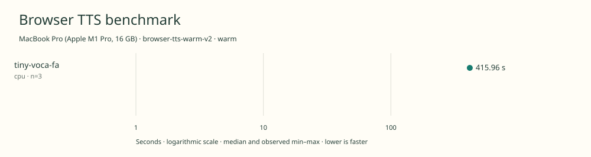

# 2026-11-25t01-41-43-438z-tiny-voca-fa-cpu-warm-5a8600fc

MacBook Pro (Apple M1 Pro, 16 GB) · Apple M1 Pro · Google Chrome 158.0.8127.37

Protocol: **browser-tts-warm-v2**, scenario **warm**. Native harness run.

First source-chunk request through final CPU-readable PCM; excludes initialization, validation, hashing, WAV encoding and save. Optional articleCallPeakRssBytes spans the entire browser call including post-timer validation/export.

| Model | Requested backend | Status | Median | Min–max | Runs |
|---|---|---|---:|---:|---:|
| tiny-voca-fa | cpu | measured | 415.96 s | 415.61–416.08 s | 3 |

Additional metrics (median of available observations; scopes are distinct):

| Model | Backend | Metric | Median | Unit | n |
|---|---|---|---:|---|---:|
| tiny-voca-fa | cpu | First completed source chunk | 4578.110 | ms | 3 |
| tiny-voca-fa | cpu | First PCM block | 932.345 | ms | 3 |
| tiny-voca-fa | cpu | Generated audio | 1560.835 | s | 3 |
| tiny-voca-fa | cpu | Generation / audio duration | 0.267 | ratio | 3 |

Model support (catalog capability, not coverage of this run):

| Model | Supported voices | Bundled voices | Languages | Tested voice |
|---|---:|---:|---|---|
| tiny-voca-fa | 1 | 1 | 1 (fa) | parisa |

Persian only; Parisa voice at 24 kHz. G2P uses CPU/WASM; WebGPU applies to acoustic synthesis.. The 4,531,147-parameter acoustic model uses the single Parisa voice. Both ByT5 pronunciation graphs run in the Chrome worker on WASM. The acoustic graph and pronunciation graphs are separately pinned. Sources: [1](https://huggingface.co/mehdi-hf/tiny-ava/blob/cd2a2217ac31447763cbb500bdc2433973e6e4f4/README.md), [2](https://huggingface.co/mehdi-hf/tiny-ava), [3](https://github.com/mallahyari/tiny-ava/tree/d4bd268a5386c60f15d1abb7e706df02b6ba4d32), [4](https://huggingface.co/mehdi-hf/tiny-ava/tree/cd2a2217ac31447763cbb500bdc2433973e6e4f4), [5](https://huggingface.co/mehdi-hf/persian-g2p-tiny/blob/596e9b915f2973ac476a32b4c8558c6544eb53db/README.md).

- **tiny-voca-fa / cpu**: Acoustic and G2P inference use ONNX Runtime Web 1.20.1 single-thread SIMD WASM.

Capability checks run separately before timing. GPU dispatch does not imply GPU-exclusive execution.

Raw WAV is saved locally; opt-in audio publication is separate from timing and automatic result submission.

Campaign 2026-11-25T01-41-42-800Z-5f03ae2e3091; cell 1/4; source 02e06ca8b35a8e0bc3833822350935acec166c75; fixture fa-article-v1 (fa, 18805 JavaScript characters, 86 spans); requested n=3; effective n=3; Headed Google Chrome, Apple M1 Pro, AC power. Published tiny-voca-fa, parisa, FP32. Qualified backends: cpu, webgpu. Sequential isolated profiles. Warm protocol v2 excludes the full article warmup.

Different protocols, fixtures, settings or machines must not be pooled into a speedup ranking. This report does not rate speech quality.
