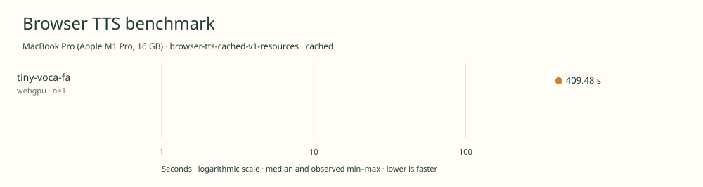

# 2026-11-25t02-44-04-633z-tiny-voca-fa-webgpu-cached-3318b625

MacBook Pro (Apple M1 Pro, 16 GB) · Apple M1 Pro · Google Chrome 158.0.8127.37

Protocol: **browser-tts-cached-v1-resources**, scenario **cached**. Native harness run.

First source-chunk request through final CPU-readable PCM; excludes initialization, validation, hashing, WAV encoding and save. Optional articleCallPeakRssBytes spans the entire browser call including post-timer validation/export. Generation RSS uses timestamped samples inside browser generation start/end boundaries; it includes the owned Chrome process tree and browser baseline.

| Model | Requested backend | Status | Median | Min–max | Runs |
|---|---|---|---:|---:|---:|
| tiny-voca-fa | webgpu | measured | 409.48 s | 409.48–409.48 s | 1 |

Additional metrics (median of available observations; scopes are distinct):

| Model | Backend | Metric | Median | Unit | n |
|---|---|---|---:|---|---:|
| tiny-voca-fa | webgpu | First completed source chunk | 4581.235 | ms | 1 |
| tiny-voca-fa | webgpu | First PCM block | 982.630 | ms | 1 |
| tiny-voca-fa | webgpu | Generated audio | 1560.835 | s | 1 |
| tiny-voca-fa | webgpu | Generation / audio duration | 0.262 | ratio | 1 |
| tiny-voca-fa | webgpu | Model initialization | 676.865 | ms | 1 |
| tiny-voca-fa | webgpu | Complete controller trial including setup/export | 415208.792 | ms | 1 |
| tiny-voca-fa | webgpu | Transferred HTTP body data | 106581 | bytes | 1 |
| tiny-voca-fa | webgpu | Ideal body transfer at 1 Mbps | 0.853 | s | 1 |
| tiny-voca-fa | webgpu | Whole-call Chrome process-tree peak RSS | 1646444544 | bytes | 1 |
| tiny-voca-fa | webgpu | Per-trial mean generation Chrome process-tree RSS | 1074306097 | bytes | 1 |
| tiny-voca-fa | webgpu | In-window Chrome RSS observations | 815.000 | samples | 1 |

Model support (catalog capability, not coverage of this run):

| Model | Supported voices | Bundled voices | Languages | Tested voice |
|---|---:|---:|---|---|
| tiny-voca-fa | 1 | 1 | 1 (fa) | parisa |

Persian only; Parisa voice at 24 kHz. G2P uses CPU/WASM; WebGPU applies to acoustic synthesis.. The 4,531,147-parameter acoustic model uses the single Parisa voice. Both ByT5 pronunciation graphs run in the Chrome worker on WASM. The acoustic graph and pronunciation graphs are separately pinned. Sources: [1](https://huggingface.co/mehdi-hf/tiny-ava/blob/cd2a2217ac31447763cbb500bdc2433973e6e4f4/README.md), [2](https://huggingface.co/mehdi-hf/tiny-ava), [3](https://github.com/mallahyari/tiny-ava/tree/d4bd268a5386c60f15d1abb7e706df02b6ba4d32), [4](https://huggingface.co/mehdi-hf/tiny-ava/tree/cd2a2217ac31447763cbb500bdc2433973e6e4f4), [5](https://huggingface.co/mehdi-hf/persian-g2p-tiny/blob/596e9b915f2973ac476a32b4c8558c6544eb53db/README.md).

- **tiny-voca-fa / webgpu**: Observed 840 WebGPU dispatches; G2P uses WASM.

Capability checks run separately before timing. GPU dispatch does not imply GPU-exclusive execution.

Raw WAV is saved locally; opt-in audio publication is separate from timing and automatic result submission.

Campaign 2026-11-25T01-41-42-800Z-5f03ae2e3091; cell 4/4; source 02e06ca8b35a8e0bc3833822350935acec166c75; fixture fa-article-v1 (fa, 18805 JavaScript characters, 86 spans); requested n=1; effective n=1; Headed Google Chrome, Apple M1 Pro, AC power. Published tiny-voca-fa, parisa, FP32. Qualified backends: cpu, webgpu. Sequential isolated profiles. Warm protocol v2 excludes the full article warmup.

RSS is sampled every 500 ms across the owned Chrome process tree, including the Chrome baseline and inference workers. Whole-call peak spans post-timer validation/export; generation mean uses only in-window samples from browser generation start through final CPU-readable PCM.

Different protocols, fixtures, settings or machines must not be pooled into a speedup ranking. This report does not rate speech quality.
