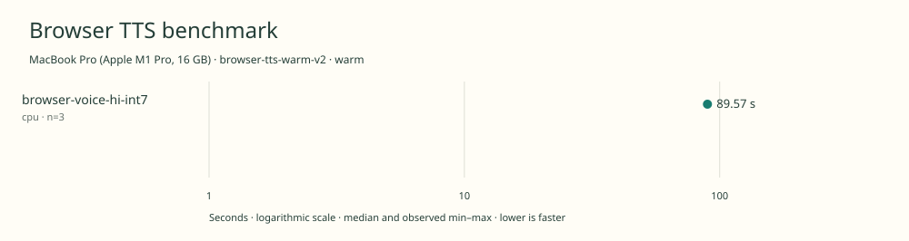

# 2026-11-25t03-00-08-613z-browser-voice-hi-int7-cpu-warm-5161c073

MacBook Pro (Apple M1 Pro, 16 GB) · Apple M1 Pro · Google Chrome 158.0.8127.37

Protocol: **browser-tts-warm-v2**, scenario **warm**. Native harness run.

First source-chunk request through final CPU-readable PCM; excludes initialization, validation, hashing, WAV encoding and save. Optional articleCallPeakRssBytes spans the entire browser call including post-timer validation/export.

| Model | Requested backend | Status | Median | Min–max | Runs |
|---|---|---|---:|---:|---:|
| browser-voice-hi-int7 | cpu | measured | 89.57 s | 89.55–89.59 s | 3 |

Additional metrics (median of available observations; scopes are distinct):

| Model | Backend | Metric | Median | Unit | n |
|---|---|---|---:|---|---:|
| browser-voice-hi-int7 | cpu | First completed source chunk | 1063.425 | ms | 3 |
| browser-voice-hi-int7 | cpu | First PCM block | 1062.300 | ms | 3 |
| browser-voice-hi-int7 | cpu | Generated audio | 1435.541 | s | 3 |
| browser-voice-hi-int7 | cpu | Generation / audio duration | 0.062 | ratio | 3 |

Model support (catalog capability, not coverage of this run):

| Model | Supported voices | Bundled voices | Languages | Tested voice |
|---|---:|---:|---|---|
| browser-voice-hi-int7 | 1 | 1 | 1 (hi) | Ishwari |

Ishwari in the native Hindi-script benchmark using the pinned compact INT7 checkpoint.. Native Hindi-script fixture only. Stock pace scale is 0.9333333333333333 at UI speed 1. The publisher worker uses one-thread WebAssembly for acoustic and G2P sessions. Sources: [1](https://huggingface.co/Hansda/hindi-voice-compact/tree/04e39413827f3d45af54ceb480cb77e732983c1b), [2](https://tts.hansda.in/?lang=hi), [3](https://raw.githubusercontent.com/DarvinX/multilingual-browser-tts/f2977727b8baccb989f80b492ea8da00124ecba3/web/credits.html), [4](https://huggingface.co/datasets/Hansda/hindi-maya2-ishwari-20h/tree/c835a1a2c3892f5cd47507824bf33df19deec955).

- **browser-voice-hi-int7 / cpu**: The released acoustic and G2P sessions use the one-thread WASM provider.

Capability checks run separately before timing. GPU dispatch does not imply GPU-exclusive execution.

Raw WAV is saved locally; opt-in audio publication is separate from timing and automatic result submission.

Campaign 2026-11-25T03-00-07-990Z-f0789d6a2486; cell 1/2; source 3aee337ce12dc3d7f941c174653a51bf4cc5f6df; fixture hi-article-v1 (hi, 19885 JavaScript characters, 91 spans); requested n=3; effective n=3; Headed Google Chrome, Apple M1 Pro, AC power. Published browser-voice-hi-int7, Ishwari, INT7 packed weights expanded to FP32. Qualified backends: cpu. Sequential isolated profiles. Warm protocol v2 excludes the full article warmup.

Different protocols, fixtures, settings or machines must not be pooled into a speedup ranking. This report does not rate speech quality.
